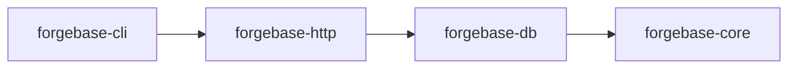

# Architecture

M1 is implemented: the metadata model and document validation (`forgebase-core`), the PostgreSQL pool, migrations, schema sync and document CRUD (`forgebase-db`) and the `forgebase` command-line tool (`forgebase-cli`). Everything from M2 on is design only. Sections and statements marked Accepted are owner-accepted ADRs or owner decisions recorded in these docs; the rest is a design proposal. Workflow and approval rules: [AGENTS.md](../../AGENTS.md).

**Status vocabulary**

| Status | Meaning |
|---|---|
| Accepted | Confirmed by the owner, or a process decision recorded as Accepted (an ADR marked "Accepted by owner" is an Accepted decision the owner made or provided). |
| Proposed | Recommendation, awaiting owner decision. |
| Undecided | Options listed; decision deferred. The deciding milestone is named where the approved plan ties it (for example UI library: M4, multi-site: before the multi-site milestone); otherwise: decide when the related milestone is planned. |

Accepted so far: ADR 0001 (record decisions as ADRs), ADRs 0002-0006 (accepted by the owner on 2026-10-28: modular monolith and workspace layout, PostgreSQL only, database access layer direction, HTTP stack, extension model), MIT license (ADR 0007), English docs, the four-stage workflow and the Model Selection Policy (ADR 0008), the Toolchain/MSRV policy (owner decision 2026-10-28, see [maintenance-policy](maintenance-policy.md#toolchain-and-msrv)), and the M1 owner decisions of 2026-10-28 (TOML metadata files, UUID v7 generated in the application, `time`, `rust_decimal`, `clap` (derive) for the CLI, PostgreSQL 16 as the version floor, DocType `name` with a separate `label`; see section 3 and [dependency-evaluation](dependency-evaluation.md)). **Everything else below is Proposed or Undecided.** The M1 spike confirmed the ADR 0004 direction (no superseding ADR; see [dependency-evaluation](dependency-evaluation.md#m1-spike-result-adr-0004-checkpoint)). Decisions are recorded in [docs/adr](../adr/README.md). Frappe behavior referenced here is labelled in the [feature matrix](feature-matrix.md).

## 1. Shape: modular monolith (Accepted, [ADR 0002](../adr/0002-modular-monolith-and-workspace-layout.md))

The Accepted scope is exactly the ADR 0002 decision: four crates (`forgebase-core`, `forgebase-db`, `forgebase-http`, `forgebase-cli`), the dependency direction cli → http → db → core, jobs and scheduler as a module in `forgebase-db` plus a `worker` command, and a React + TypeScript `desk/` arriving at M4. Other details in this section (Vite, the specific CLI command list, the "Rejected for now" list) remain Proposed.

One Cargo workspace, four crates. Do not split further until a real boundary problem appears.

| Crate | Responsibility |
|---|---|
| `forgebase-core` | Metadata model (DocType, DocField, field types), document value model (validated map), validation, naming, lifecycle pipeline definitions, permission evaluator. **No I/O, no async, no SQL.** Pure and unit-testable; most business rules live here. |
| `forgebase-db` | PostgreSQL access: pool, transactions, metadata-driven schema sync (DDL), framework migrations, document persistence, permission-filtered queries, job queue tables. |
| `forgebase-http` | axum routes, auth/session middleware, REST resource API, JSON error mapping. Thin; delegates to core and db. |
| `forgebase-cli` | The `forgebase` binary (clap): site init, migrate, serve, create user, run worker. |

The frontend `desk/` (React + TypeScript + Vite) arrives only at the Desk milestone (M4).

Dependency direction (core depends on nothing internal):

Background jobs and the scheduler are a module in `forgebase-db` plus a `worker` command, not a separate service.

Rejected for now: microservices, dynamic libraries, WASM plugins, a separate jobs service, Redis.

## 2. Extension model (Accepted, [ADR 0006](../adr/0006-extension-model.md))

A Forgebase "app" is a Rust crate compiled into the user's binary. The user's `main` depends on `forgebase-*` and registers app DocTypes and hooks at startup through an explicit registration list (no global magic or inventory macros).

- Pros: type safety, no runtime plugin machinery, one build artifact.
- Cons: changing hooks requires rebuild and redeploy; no install-at-runtime like `bench get-app`.
- This is an intentional difference from Frappe. Server Scripts (runtime user code) are out of scope.

## 3. Metadata (DocType) model (Proposed)

**Owner decisions, 2026-10-28 (Accepted)**, for M1; the remaining items in this section keep their stated status. The last four bullets were confirmed ("setuju semua") after the M1.1 review:

- Metadata file format: **TOML**.
- `id` is a **UUID v7 generated in the application**.
- A DocType `name` is a snake_case identifier with a separate `label`; the label is not derived automatically.
- `required` is enforced by application validation, not by a database `NOT NULL`, in M1.
- M1 field types: Data, Text, Int, Decimal, Check, Date, Datetime, Select (Link and Table arrive in M2).

- Int maps to PostgreSQL `bigint` (spike lesson: an `int` column decodes as `i32`, while `Value::Int` is `i64`).
- Data fields default to `max_length` 140.
- A required Data, Text or Select field treats an empty or whitespace-only string as missing.
- Decimal values with more decimal places than the field's scale are rejected rather than rounded.

- **Schema-as-code.** DocTypes are defined in files inside the app crate (versioned in git) and loaded at startup; the DB holds a synced copy for introspection and admin. Single direction of truth: files to DB. File format: TOML (Accepted, see above).
- **Field types.** Small closed set first: Data (text with max length), Text, Int, Decimal (Postgres `numeric`; Float only if justified), Check (bool), Date, Datetime (`timestamptz`), Select, Link, Table (child). Layout-only types (section/column breaks) stay out of the data field list; UI layout is a separate optional section. Other types (Attach, JSON, Dynamic Link, Currency, ...) are added one at a time with a reason.
- **Standard columns.** `id` (UUID surrogate PK; v7, generated in the application, Accepted), `name` (unique human-facing identifier), `owner`, `created_at`, `modified_at`, `modified_by`, `version` (int, optimistic concurrency), `docstatus` (smallint, submittable types). A surrogate PK separate from `name` is an intentional difference (Frappe uses `name` as PK) so renames do not cascade. The surrogate key itself is confirmed in M1.
- **Table naming.** Deterministic, validated snake_case identifiers derived from DocType names (for example `doc_sales_order`), always quoted; never interpolated from unvalidated input. PostgreSQL truncates identifiers at 63 bytes, so the limit applies to the full table name including the `doc_` prefix (and to index and constraint names).
- **Naming strategies, initially.** Random/hash; naming series (gap-tolerant, via Postgres sequence or counter row); field-based. Others deferred.
- **Single DocTypes (settings): Undecided** (decide when the related milestone is planned). Simplest option is a regular one-row table rather than a key-value `singles` table.

### DocType file format (M1)

One TOML file per DocType; unknown keys are rejected. Loaded with `DocType::from_toml_str`; an example is `crates/forgebase-core/tests/fixtures/customer.toml`.

Top-level keys:

- `name` (required): snake_case identifier, `^[a-z][a-z0-9_]*$`, at most 59 bytes.
- `label` (required): human-readable name, not derived from `name`.
- `naming` (optional): `"random"` (default) or `{ field = "<fieldname>" }`; the named field must be a required, unique Data field.
- `[[fields]]`: the field list, in order.

Field keys (`[[fields]]`):

- `name` (required): snake_case identifier, at most 63 bytes, not a reserved standard column (`id`, `name`, `owner`, `created_at`, `modified_at`, `modified_by`, `version`, `docstatus`, `idx`, `parent_id`) or a PostgreSQL system column (`tableoid`, `xmin`, `xmax`, `cmin`, `cmax`, `ctid`).
- `label` (optional): defaults to the field `name`.
- `type` (required): `data`, `text`, `int`, `decimal`, `check`, `date`, `datetime` or `select`.
- `required`, `unique` (optional, default `false`). `required` is enforced by application validation; for Text, Data and Select an empty or whitespace-only string counts as missing.
- `max_length` (`data` only): `1..=65535`, default 140.
- `precision` (`1..=28`) and `scale` (`<= precision`), both required for `decimal`. Strict rule: a value with more decimal places than `scale` is rejected, not rounded (trailing zeros are ignored).
- `options` (`select` only, required): non-empty list of unique, non-empty strings.

Text, Data and Select values and Select options must not contain NUL (`\0`), which PostgreSQL text cannot store.

## 4. Relationships (Proposed)

- **Link field** is a real PostgreSQL foreign key to the target's `id` (`ON DELETE RESTRICT`), so the DB enforces integrity (Frappe checks in the application; behavior itself Unverified, see [feature matrix](feature-matrix.md)). The API accepts and returns the target `name`; resolution is internal. Intentional difference.
- **Child tables.** Each child DocType belongs to exactly one parent DocType. The child table has `parent_id` FK `ON DELETE CASCADE` and `idx` ordering; no polymorphic `parenttype`/`parentfield` columns. Intentional difference (Frappe allows reusing one child DocType across parents). Child rows are saved or replaced only as part of the parent document, in the same transaction.
- **Dynamic Link:** deferred (no FK possible); not a priority.

## 5. Schema sync and migrations (Proposed; M1.2 implemented in `forgebase-db`)

**Implemented in M1.2** (the rest of this section is still the design direction):

- **Framework migrations**: embedded SQL in `crates/forgebase-db/migrations/`, run by `migrate_framework` in one transaction under a transaction-level advisory lock (`pg_advisory_xact_lock`, released automatically, never a session lock on a pooled connection). Applied migrations are verified first: unknown version (database newer than code) or checksum mismatch is an error. The checksum is SHA-256 computed by PostgreSQL (no hash crate). Tables: `fb_migration`, `fb_doctype` (which DocType tables Forgebase manages).
- **Schema sync** (`sync`): one transaction; transaction-local `lock_timeout` (default 5 s, clamped to 1 ms ..= `i32::MAX` ms; an error `LockTimeout` that is safe to retry; in `migrate` the framework migrations stay applied, only the sync step is not), advisory lock, then introspection of the connection's current schema inside the transaction so concurrent syncs see each other's result. Steps are additive only: create table, add the keys of new tables, add nullable column, create unique index, register in `fb_doctype`. `dry_run` rolls back and returns the SQL; for framework migrations a dry run still executes the migration DDL before rolling back. Connection errors keep the server message and SQLSTATE (for example 28P01, 3D000). Database state that does not match expectations (such as an `fb_migration` with other column types) gives an error, never a panic.
- **Type mapping**: Data `varchar(n)`, Text and Select `text` (Select options are validated by the application, so option changes need no migration), Int `bigint`, Decimal `numeric(p,s)`, Check `boolean`, Date `date`, Datetime `timestamptz`. Field columns are always nullable; `required` is application-enforced.
- **Conflicts** (whole sync refused, nothing applied): a column whose type, length, precision or scale differs from the metadata (including a Data `max_length` change in either direction), a standard column that is missing, differently typed or nullable (also `id` not being the primary key and `name` not unique), a `timestamptz` column with a precision other than the default 6, a non-table relation or standalone type named `doc_<name>`, and an existing `doc_<name>` table that Forgebase did not create (never adopted). **Warnings** (reported, nothing changed): a field column that is `NOT NULL` in the database (fields are nullable; the application enforces `required`), a column no field describes, a unique index whose field is no longer `unique`, and a registered DocType missing from the registry.
- **Names**: Forgebase does not name constraints or indexes. `CREATE TABLE` creates columns only, keys are added afterwards with `ALTER TABLE ... ADD PRIMARY KEY ("id"), ADD UNIQUE ("col")` (unnamed), and unique indexes added later use `CREATE UNIQUE INDEX ON ... ("col")`; PostgreSQL picks free names of at most 63 bytes. A sync works in phases: it first creates every new table with columns only, then adds the primary key and unique constraints of the new tables, then added columns, then late unique indexes, then registers the DocTypes. Because all tables of the sync exist before any key or index is named, a generated name cannot clash with a DocType table in the same sync, even when PostgreSQL truncates long names. Unique detection reads `pg_index` (valid, single-column, non-partial), not names. If a relation of any kind or a standalone type (view, index, sequence, domain, ...) already has the name `doc_<name>`, the sync reports a conflict; an ordinary table of that name that Forgebase did not create is reported as unmanaged. A later sync can still conflict when a DocType table name equals a name PostgreSQL already gave to an index of an earlier table.
- **Limits**: plain `CREATE INDEX` (blocks writes on that table while building; no `CONCURRENTLY` yet); adding a unique index to an existing column fails, and the sync rolls back, if the column already holds duplicates; only the connection's current schema is handled; no TLS to PostgreSQL yet (planned: rustls; run over a local or private network until then).

Two distinct problems:

1. **Framework migrations** (Forgebase's own system tables): small embedded, ordered SQL migrations with checksums and an advisory lock. Tool choice depends on the DB-layer decision ([ADR 0004](../adr/0004-database-access-layer.md)).
2. **DocType schema sync.** Framework code diffs metadata against the live schema (`information_schema`) and produces a plan.
   - **Additive changes** (new table, new nullable column, new index, and the foreign key constraint plus index that a new Link column implies) apply automatically.
   - **Destructive or risky changes** (drop/rename column, type change, NOT NULL on existing data) are never automatic; they require an explicit migration file.
   - `migrate --dry-run` prints the plan. Sync runs in a transaction where PostgreSQL allows it (most DDL is transactional).
   - **Design notes for M1/M2 (not decisions):**
     - A plain `CREATE INDEX` takes a lock that blocks writes on the table while it builds, which matters on large tables.
     - `CREATE INDEX CONCURRENTLY` and `CREATE DATABASE` (needed for database-per-site) cannot run inside a transaction block, so they sit outside the sync transaction and need special handling (for example an explicit, separate step).
     - Adding a Link column also adds a foreign key constraint, which takes locks on the referenced table.
     - PostgreSQL does not automatically index the referencing column of a foreign key; sync should create an index on every foreign key column (Link columns and child `parent_id`), otherwise `ON DELETE RESTRICT` checks and child-row lookups scan the whole table.
     - Most `ALTER TABLE` forms (including ADD COLUMN) take an ACCESS EXCLUSIVE lock (ADD FOREIGN KEY takes SHARE ROW EXCLUSIVE); while such a statement waits behind a long-running transaction it queues and blocks every later read and write on that table. Set `lock_timeout` for sync DDL so it fails fast instead of stalling the application. Hitting `lock_timeout` aborts the sync transaction, so sync must report the failure and allow a retry.
3. **Data patches.** Ordered, run-once, recorded in a table, inside transactions, with "before schema sync" and "after schema sync" phases (concept from Frappe's pre/post model sync).

### Document CRUD (M1.3, implemented in `forgebase-db`)

`insert`, `get`, `update` and `delete` handle one document of one DocType. They take a `tokio_postgres::GenericClient`, so they run on a pooled connection (each call is then its own transaction) or inside a `Transaction` that the caller owns and commits or rolls back.

- **Validation first.** `insert` runs `forgebase_core::document::validate` and `update` runs `validate_update`; all problems are returned together (`DbError::Validation`). Nothing is written when validation fails.
- **Names.** Random naming: `name` is the new `id` as a hyphenated UUID, and a given name is rejected. Field naming: `name` is the value of the naming field; a given name must be absent or equal to it. Changing the naming field in an update is rejected: renames are not supported yet.
- **Standard columns.** `id` is a UUID v7 generated in the application. `created_at` and `modified_at` are the database's `now()` (the transaction start time, so several writes in one transaction share it). `owner` and `modified_by` are the `actor`, which must be a non-empty string without NUL; it is recorded, not authenticated. `version` starts at 1 and every update adds 1. An update keeps `id`, `name`, `owner` and `created_at`.
- **Values.** Always bound parameters, with an explicit cast per field type in the SQL (`$n::varchar`, `::bigint`, `::numeric`, ...) so parameter types come from the metadata, not from inference. Absent fields are stored as NULL; an update changes only the fields it names, and `null` clears one. Identifiers come from validated metadata and are quoted.
- **Errors.** A duplicate in a `unique` field or in `name` is `DbError::UniqueViolation` (SQLSTATE 23505, server message kept); an unknown name in `update` or `delete` is `NotFound` (`get` returns `None`); an update without changes is `NoChanges`.
- **Not yet:** permissions (M3), optimistic concurrency (M2: today the last writer wins and `version` is only informational), renames, Link and child tables, lifecycle hooks, list and filter queries.

### The `forgebase` command-line tool (M1.3, implemented in `forgebase-cli`)

`forgebase migrate --doctypes DIR [--dry-run] [--lock-timeout-ms N]` and `forgebase doc insert|get|update|delete`. The database URL comes from the `FORGEBASE_DATABASE_URL` environment variable; there is no config file. DocTypes are read from the `*.toml` files directly in `--doctypes DIR` (sorted by file name; not recursive; the extension match is case-sensitive, so `*.TOML` is ignored; names starting with `.` are skipped; a `*.toml` entry that cannot be read, such as a dangling symlink, is reported as an error; every file error is reported with its file name). Output is the stored document as pretty JSON on standard output; errors are `error: ...` on standard error with exit code 1, usage errors exit with 2.

JSON mapping (in the CLI for now, to move to a shared place with the HTTP API in M3): Data, Text and Select are strings; Int is a JSON integer (floats and values outside `i64` are rejected); Decimal is a JSON **string** (a JSON number is rejected so no precision is lost); Check is a boolean; Date is `YYYY-MM-DD`; Datetime is RFC 3339 and is printed in UTC with `Z`; `null` is no value. Datetime has **microsecond precision** (PostgreSQL `timestamptz`): finer digits are truncated, not rounded or rejected. Duplicate keys in the input are accepted and the last one wins (serde_json behavior). Decimal strings accept every form `rust_decimal` parses (for example `"1e3"`, `"+12.5"`, `".5"`) with exact values. Output keys are sorted alphabetically (the standard columns appear among the fields). Keys that are not fields are passed on so that validation reports them. Limit: values another tool wrote that are outside the supported ranges (`date` and `timestamptz` years beyond ±9999 as `time` supports them, `infinity`, `NaN`) cannot be read; `get` fails with an error that names the DocType and the field.

## 6. Document lifecycle and transactions (Proposed)

- **One fixed, documented, tested pipeline per operation.** Insert: set defaults, naming, validate (field types, required, links, permissions), `before_insert` hook, `validate` hook, write, `after_insert` hook, enqueue after-commit effects, commit. Save, Submit, Cancel and Delete are analogous. The exact order is specified in M2 and covered by tests.
- **Hooks** (Accepted, [ADR 0006](../adr/0006-extension-model.md)) are a small Rust trait per DocType (`DocTypeHooks`, default no-op methods) registered by the app; with several apps, hooks run in registration order. No class override mechanism. The pipeline and transaction details below remain Proposed.
- **Transactions.** Exactly one DB transaction per API request or command; the framework owns commit and rollback. Hooks **cannot commit**. Design requirement: hooks receive a restricted, framework-provided handle (a fixed set of operations) rather than a raw database connection or transaction, so app code cannot issue `COMMIT` or unvalidated SQL; the exact mechanism, and whether hook reads run as the user or the system, are decided in M2. Side effects that must happen only after commit (jobs, realtime, emails) go to an outbox/job table written in the same transaction (transactional outbox).
- **docstatus.** Draft (0) / Submitted (1) / Cancelled (2), and amendment (new draft with `amended_from`) for submittable DocTypes; fields locked after submit except those explicitly allowed.
- **Optimistic concurrency.** Updates require the client's `version`; mismatch returns 409 Conflict.

## 7. API (Proposed)

- REST: `/api/v1/resource/{doctype}` (list with filters/fields/paging, get, create, update with version, delete) and `/api/v1/method/{name}` for explicitly registered app endpoints.
- JSON only; consistent error envelope; stable versioned prefix from day one; default page limit with a hard maximum.
- No GraphQL, no RPC-by-dotted-path.
- HTTP stack: axum on tokio ([ADR 0005](../adr/0005-http-stack.md)).

Security rules for the API are in [security-model](security-model.md).

## 8. Background jobs, scheduler, realtime

- **Jobs (Proposed).** Postgres table queue using `SELECT ... FOR UPDATE SKIP LOCKED`, run by `forgebase worker` (same binary; Accepted, [ADR 0002](../adr/0002-modular-monolith-and-workspace-layout.md): jobs are a module in `forgebase-db` plus a `worker` command; the queue design in this bullet remains Proposed). At-least-once delivery, so jobs must be idempotent; retries with backoff; a lease/visibility timeout so jobs claimed by a crashed worker become runnable again; a dead state.
- **Scheduler (Proposed).** Cron-like, table driven, leader elected with a Postgres advisory lock. Milestone M5. Design note: a session-level advisory lock belongs to one connection, so it must be held on a dedicated (non-pooled) connection, or a transaction-level lock taken per tick must be used. With the per-tick lock, `next_run_at` must be advanced in the same transaction so a second instance cannot re-run the same tick right after the first commits. The mechanism is decided in M5.
- **Realtime (Undecided, deferred).** Later option: Postgres `LISTEN/NOTIFY` to SSE/WebSocket in the same binary. No Node/socket.io, no Redis.

## 9. Multi-site (Undecided)

Lean: **database-per-site** (strong isolation, simple per-tenant backup and restore, matches the Frappe concept). Alternatives: schema-per-site; row-level tenant column (rejected for weakest isolation: permission bugs leak data). Decide before the multi-site milestone. Note: database-per-site needs `CREATE DATABASE`, which cannot run in a transaction (see section 5).

Design constraint from day one (Proposed): every request or command carries an explicit `Site`/DB-pool context; there is no global DB handle, so multi-site is additive later.

## 10. Customization (Proposed, not a priority)

Custom fields and property setters: when added, a small explicit per-site overlay table applied over app metadata, schema-sync aware. No "Customize Form" equivalent before a real need.

## 11. Desk, reports, workflow

- **Desk (Proposed, M4).** Metadata-driven generic list and form views in React; minimal. UI component library: **Undecided**, decided in M4 together with a dependency evaluation.
- **Reports (Proposed, Later).** Start with saved list views and filters; SQL-based query reports later with a read-only DB role. Script reports: no.
- **Workflow (Proposed, not a priority).** States, transitions and roles mapped onto docstatus; after M5.

## Key challenges and how we approach them

| Challenge | Approach |
|---|---|
| Tables and columns come from runtime metadata, so static ORMs do not fit | Small in-house SQL layer for DocType DDL/CRUD with strict identifier validation, quoting and bound parameters ([dependency-evaluation](dependency-evaluation.md)). Accepted direction ([ADR 0004](../adr/0004-database-access-layer.md)), confirmed by the M1 spike. |
| Schema drift and risky migrations | Additive-only auto-sync, explicit files for destructive changes, `--dry-run`, transactional DDL. |
| Hook order and partial commits. Frappe's docs may list hook order inconsistently (Unverified; search summaries suggest the hook table and the Document API page differ, see [feature matrix](feature-matrix.md)); partial commits from user-code `commit()` are our own analysis (opinion, not documented fact) | One fixed pipeline, one transaction per request, hooks cannot commit, outbox for side effects. |
| Permission complexity | One evaluator in `forgebase-core`; all reads go through a permission-filtered query path; exhaustive negative tests ([security-model](security-model.md)). |
| Integrity of references | Real foreign keys instead of application-level checks. |
| Multi-site retrofit cost | Explicit site/pool context from day one; decision deferred. |
| Scope creep | Closed field-type set, milestone gates, explicit non-goals, [maintenance-policy](maintenance-policy.md). |

## Cost of in-house components

The approach in this document means owning these pieces ourselves: SQL builder, schema sync, migration runner, runtime validator, job queue, scheduler, session store and permission evaluator. This is a deliberate trade against dependency weight and lock-in, not free. Each must stay small, be thoroughly tested (integration tests against real PostgreSQL where it touches the database), and be reviewed against the maintenance cost it adds. If one grows beyond that, revisit the dependency alternatives in [dependency-evaluation](dependency-evaluation.md).

## What we deliberately do not build

- Microservices, dynamic libraries, WASM plugins, runtime plugin install.
- Server Scripts, Script Reports, or any admin-authored code stored in the DB.
- Redis, a Node realtime server, a separate jobs service.
- GraphQL, RPC-by-dotted-path.
- Class-override mechanisms for hooks.
- Row-level tenant column for multi-site.
- A "Customize Form" equivalent (until a real need exists).
- Databases other than PostgreSQL.
