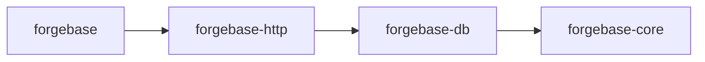

# Architecture

M1 is implemented: the metadata model and document validation (`forgebase-core`), the PostgreSQL pool, migrations, schema sync and document CRUD (`forgebase-db`) and the `forgebase` command-line tool (then `forgebase-cli`, renamed `forgebase` in M5.1). M2 is implemented in four PRs: M2.1 (Link fields and optimistic concurrency), M2.2 (child tables), M2.3 (lifecycle pipeline and hooks, [ADR 0009](../adr/0009-lifecycle-pipeline-and-hooks.md)) and M2.4 (docstatus with submit, cancel and amend, and naming series). M3 is implemented in three PRs: M3.1 (users, sessions, API tokens, [ADR 0010](../adr/0010-authentication-and-sessions.md)), M3.2 (role permissions, enforced document operations and the list query, [ADR 0011](../adr/0011-permission-model-phase-1.md)) and M3.3 (the HTTP API, section 7). M4 (the desk) is implemented, and M5 (the app model) is implemented in three PRs: M5.1 is the framework part ([ADR 0012](../adr/0012-app-model-and-public-api-boundary.md), sections 1, 2 and 5), M5.2 `forgebase new-app` and the first-app guide, and M5.3 the example apps; everything from M6 on is design only. Sections and statements marked Accepted are owner-accepted ADRs or owner decisions recorded in these docs; the rest is a design proposal. Workflow and approval rules: [AGENTS.md](../../AGENTS.md).

**Status vocabulary**

| Status | Meaning |
|---|---|
| Accepted | Confirmed by the owner, or a process decision recorded as Accepted (an ADR marked "Accepted by owner" is an Accepted decision the owner made or provided). |
| Proposed | Recommendation, awaiting owner decision. |
| Undecided | Options listed; decision deferred. The deciding milestone is named where the approved plan ties it (for example UI library: M4, multi-site: before the multi-site milestone); otherwise: decide when the related milestone is planned. |

Accepted so far: ADR 0001 (record decisions as ADRs), ADRs 0002-0006 (accepted by the owner on 2026-10-28: modular monolith and workspace layout, PostgreSQL only, database access layer direction, HTTP stack, extension model), MIT license (ADR 0007), English docs, the four-stage workflow and the Model Selection Policy (ADR 0008), the Toolchain/MSRV policy (owner decision 2026-10-28, see [maintenance-policy](maintenance-policy.md#toolchain-and-msrv)), and the M1 owner decisions of 2026-10-28 (TOML metadata files, UUID v7 generated in the application, `time`, `rust_decimal`, `clap` (derive) for the CLI, PostgreSQL 16 as the version floor, DocType `name` with a separate `label`; see section 3 and [dependency-evaluation](dependency-evaluation.md)), and the seven M2 owner decisions of 2026-10-28 (section 3, "M2 owner decisions"). **Everything else below is Proposed or Undecided.** The M1 spike confirmed the ADR 0004 direction (no superseding ADR; see [dependency-evaluation](dependency-evaluation.md#m1-spike-result-adr-0004-checkpoint)). Decisions are recorded in [docs/adr](../adr/README.md). Frappe behavior referenced here is labelled in the [feature matrix](feature-matrix.md).

## 1. Shape: modular monolith (Accepted, [ADR 0002](../adr/0002-modular-monolith-and-workspace-layout.md))

The Accepted scope is exactly the ADR 0002 decision: four crates (`forgebase-core`, `forgebase-db`, `forgebase-http` and the entry crate, `forgebase-cli` until M5.1 and `forgebase` since, [ADR 0012](../adr/0012-app-model-and-public-api-boundary.md)), the dependency direction entry crate → http → db → core, jobs and scheduler as a module in `forgebase-db` plus a `worker` command, and a React + TypeScript `desk/` arriving at M4. Other details in this section (Vite, the specific CLI command list, the "Rejected for now" list) remain Proposed.

One Cargo workspace, four crates. Do not split further until a real boundary problem appears.

| Crate | Responsibility |
|---|---|
| `forgebase-core` | Metadata model (DocType, DocField, field types), document value model (validated map), validation, naming, lifecycle pipeline definitions, permission evaluator. **No I/O, no async, no SQL.** Pure and unit-testable; most business rules live here. |
| `forgebase-db` | PostgreSQL access: pool, transactions, metadata-driven schema sync (DDL), framework migrations, document persistence, permission-filtered queries, job queue tables. |
| `forgebase-http` | axum routes, Host validation, authentication and CSRF extractors, REST resource API, the error envelope and the JSON mapping (`forgebase_http::json`). Thin; delegates to core and db. axum types stay inside this crate. |
| `forgebase` | The entry crate (M5.1, [ADR 0012](../adr/0012-app-model-and-public-api-boundary.md); named `forgebase-cli` until then): a library and the `forgebase` binary. **The only public API**: `App`, `Forgebase`, the embedded-file macros, the hook API and `testing` (feature). The binary (clap): migrate, serve, doc, user, token (later: site init, run worker). |

The frontend `desk/` (React + TypeScript + Vite) arrives only at the Desk milestone (M4).

Dependency direction (core depends on nothing internal):

Background jobs and the scheduler are a module in `forgebase-db` plus a `worker` command, not a separate service.

Apps and the rest of the world depend on the `forgebase` crate only. `forgebase-core`, `forgebase-db` and `forgebase-http` are internal: no compatibility promise (their crate documentation says so), and they are not meant to be depended on directly.

Rejected for now: microservices, dynamic libraries, WASM plugins, a separate jobs service, Redis.

## 2. Extension model (Accepted, [ADR 0006](../adr/0006-extension-model.md))

A Forgebase "app" is a Rust crate compiled into the user's binary. The user's `main` depends on `forgebase-*` and registers app DocTypes and hooks at startup through an explicit registration list (no global magic or inventory macros).

- Pros: type safety, no runtime plugin machinery, one build artifact.
- Cons: changing hooks requires rebuild and redeploy; no install-at-runtime like `bench get-app`.
- This is an intentional difference from Frappe. Server Scripts (runtime user code) are out of scope.

### The app model (M5.1, Accepted by [ADR 0012](../adr/0012-app-model-and-public-api-boundary.md))

An `App` is a plain value built by a function: a name, an optional version, `depends_on`, DocType files embedded with `forgebase::doctypes!`, hooks for DocTypes and SQL migrations embedded with `forgebase::migrations!`. A binary lists its apps, in order, in `main`: `Forgebase::new().app(crm::app()).app(sales::app()).run()`. There is no global registry, no code generation and no runtime plugin. The stock `forgebase` binary has no apps (`Forgebase::new().run()`) and loads DocTypes from `--doctypes DIR`, which a binary with apps also accepts, as one more app named `local` that depends on all the others; so the stock binary reports `"app": "local"` for every DocType in the metadata API.

- **Loading order.** The apps are checked (names, dependencies, order, migration versions); the DocTypes of every app in app order, then of `local`; the reference checks; the hooks in app order, then registration order; at `migrate`, framework migrations, verification of applied app migrations, schema sync, then the app migrations in app order (each with a `lock_timeout` of `--lock-timeout-ms`; a not-yet-applied migration with a lower version than an applied one of the same app is refused, like an unknown applied one), then the fixtures of the apps in app order (M9.4, below).
- **Dependencies.** `depends_on` names apps that must be registered earlier (nothing is sorted: a wrong order is an error). An app may link to DocTypes of itself and of its (transitive) dependencies only, and may register hooks for them; a Link to any other app is a startup error.
- **Ownership.** Each DocType belongs to the one app that defines it; a name used twice is an error that names both apps. `Registry::owner` returns the owner tag, and the metadata API says it (`"app"` in `GET /api/v1/meta` and `/meta/{doctype}`). An app cannot change another app's DocType definition (custom fields: M10).
- **Hook order.** App order, then registration order within an app. An app that extends another app's DocType runs after it and can reject what it accepted.
- **Startup errors.** Everything above is checked before any command runs; all problems are collected and reported together (`StartupError`, exit code 1): invalid or duplicate app name, a missing dependency, a dependency registered after its dependent, a DocType defined twice, a hook for an unknown, child or non-dependency DocType, a Link to a non-dependency app, migration versions that do not increase, and every DocType file error (naming the app and the file).
- **`forgebase new-app` (M5.2).** `forgebase new-app <name> --forgebase-path <checkout> [--dir <parent>]` writes an app crate: `Cargo.toml` (edition 2024, the MSRV of this Forgebase, a path dependency on `<checkout>/crates/forgebase`, the `testing` feature on a dev-dependency only, its own `[workspace]`), `src/lib.rs` (`app()`), `src/main.rs`, one sample DocType `<name>_note` with permissions for the role `<Name> User` and one hook, tests (guard, startup check, hook without a database, end to end with `forgebase::testing`), `README.md`, `AGENTS.md` for the app's maintainers and a copy of the checkout's `Cargo.lock`. The files are embedded in the binary from `crates/forgebase/templates/app/` (plain text, four `{{placeholder}}`s, simple string replacement, no template engine) and written without a database. It never overwrites and removes what it wrote when it fails. The name follows the app-name rule (checked by the same function as at startup) and must also be a usable crate name. CI proves the template with the job `app-template` (generate, `cargo test`, migrate, serve, log in, read the metadata). See the [guide](../guide/first-app.md).
- **Example apps (M5.3).** [`examples/sales`](../../examples/sales/README.md) (customers and submittable sales orders with hooks that compute `amount` and `total` and refuse a submit without items, and a data migration) and [`examples/sales_extension`](../../examples/sales_extension/README.md) (depends on `sales`: a DocType with a Link to `customer`, and a hook on `sales_order` that runs after the `sales` hook) are workspace members that depend on the `forgebase` crate only. They are the proof that the public API is enough (the M5.3 change touches no file under `crates/`) and run in the CI job `check` with the other tests. Since M6.3 they also use jobs: `sales` logs a submit and a cancel through the outbox and writes a daily summary on a schedule, and `sales_extension` plans a follow-up visit with a job of its own (again no file under `crates/` changed). They validate the framework; they are not domain products.
- **Public API and testing.** `forgebase` re-exports exactly what an app needs (the list is in ADR 0012). With the cargo feature `testing`, `forgebase::testing` has `TestDb` (a throwaway database that can migrate a `Forgebase`), an in-process `HttpClient` and `assert_doctypes_listed`, a guard that fails when a DocType file (compared by its path relative to the crate root) is not in the embedded list. `Forgebase::run_from(args)` runs the command line with given arguments and returns the exit code without exiting the process. Hooks are registered with `App::hooks(doctype, impl DocTypeHooks + 'static)`.

## 3. Metadata (DocType) model (Proposed)

**Owner decisions, 2026-10-28 (Accepted)**, for M1; the remaining items in this section keep their stated status. The last four bullets were confirmed ("setuju semua") after the M1.1 review:

- Metadata file format: **TOML**.
- `id` is a **UUID v7 generated in the application**.
- A DocType `name` is a snake_case identifier with a separate `label`; the label is not derived automatically.
- `required` is enforced by application validation, not by a database `NOT NULL`, in M1.
- M1 field types: Data, Text, Int, Decimal, Check, Date, Datetime, Select. Link arrived in M2.1 and Table in M2.2.

- Int maps to PostgreSQL `bigint` (spike lesson: an `int` column decodes as `i32`, while `Value::Int` is `i64`).
- Data fields default to `max_length` 140.
- A required Data, Text, Select or Link field treats an empty or whitespace-only string as missing.
- Decimal values with more decimal places than the field's scale are rejected rather than rounded.

- **Schema-as-code.** DocTypes are defined in files inside the app crate (versioned in git) and loaded at startup; the DB holds a synced copy for introspection and admin. Single direction of truth: files to DB. File format: TOML (Accepted, see above).
- **Field types.** Small closed set first: Data (text with max length), Text, Int, Decimal (Postgres `numeric`; Float only if justified), Check (bool), Date, Datetime (`timestamptz`), Select, Link, Table (child). Layout-only types (section/column breaks) stay out of the data field list; UI layout is a separate optional section. Other types (Attach, JSON, Dynamic Link, Currency, ...) are added one at a time with a reason.
- **Standard columns.** `id` (UUID surrogate PK; v7, generated in the application, Accepted), `name` (unique human-facing identifier), `owner`, `created_at`, `modified_at`, `modified_by`, `version` (int, optimistic concurrency), `docstatus` and `amended_from` (submittable types only, M2.4: `smallint NOT NULL DEFAULT 0` and nullable `text`). A surrogate PK separate from `name` is an intentional difference (Frappe uses `name` as PK) so renames do not cascade. The surrogate key itself is confirmed in M1. A child DocType's table (M2.2) has only `id`, `parent_id` and `idx` as standard columns, see section 4.
- **Table naming.** Deterministic, validated snake_case identifiers derived from DocType names (for example `doc_sales_order`), always quoted; never interpolated from unvalidated input. PostgreSQL truncates identifiers at 63 bytes, so the limit applies to the full table name including the `doc_` prefix (and to index and constraint names).
- **Naming strategies, initially.** Random/hash; field-based; naming series (Accepted owner decision 2026-10-28, implemented in M2.4: gapless per rendered prefix, a counter row in `fb_series` incremented in the document's transaction; see "M2 owner decisions" below). Others deferred.
- **Single DocTypes (settings): Undecided** (decide when the related milestone is planned). Simplest option is a regular one-row table rather than a key-value `singles` table.

### M2 owner decisions (2026-10-28, Accepted)

Approved with the M2 plan ("setuju semua"). Implementation is split into four PRs: M2.1 Link fields and optimistic concurrency (implemented), M2.2 child tables (implemented), M2.3 lifecycle and hooks (implemented), M2.4 docstatus and naming series (implemented). Details of each decision are in the section named in brackets.

1. **Link storage** [section 4]: a `uuid` column with a foreign key to the target's `id` (`ON DELETE RESTRICT`) and an automatic index. The API accepts and returns the target `name`. A missing target is a validation error naming the field; deleting a referenced document is refused with a message naming the referencing DocType. The target must be in the registry; self-links are allowed.
2. **Optimistic concurrency** [section 6]: update, delete, submit and cancel require `expected_version`; a mismatch is `DbError::Conflict` with the current version. The CLI needs `--version N` for `doc update` and `doc delete`. This is a breaking API change, accepted in 0.x.
3. **Child tables** [section 4, implemented in M2.2]: `is_child = true`; no own CRUD; no nesting (a child cannot contain a Table field). Columns `id`, `parent_id` (foreign key `ON DELETE CASCADE`, indexed), `idx` and the fields; Link fields inside a child are allowed. Saved with the parent in the same transaction: insert writes all rows; update replaces the rows of a table (delete the old rows, insert the new ones in `idx` order) only when they differ from the stored rows, so a table with identical rows keeps its row ids (identical means equal to the stored rows with every field present; a row that leaves out a null field counts as different and the table is replaced, which is always correct).
4. **Hooks** [section 6, implemented in M2.3 for insert, update and delete and in M2.4 for submit, cancel and amend]: synchronous and pure, defined in `forgebase-core`; they may modify the document or reject it with an error. No database access in M2; hooks that read the database and after-commit effects wait for the outbox (M6). Hooks: `before_insert`, `validate` (insert, update, submit), `before_submit`, `before_cancel`, `before_delete`. Insert order within one transaction: `before_insert`, the `validate` hook, framework validation (types, required, Links), naming, then write the document and its children. Any hook failure rolls back the whole transaction.
5. **docstatus** [section 6, implemented in M2.4]: `submittable = true` adds `docstatus` and `amended_from` columns. A draft is editable and deletable. A submitted document is locked except fields marked `allow_on_submit`. A cancelled document is deletable or can be amended into a new draft. The amended name is `<original-name>-<n>`; submittable DocTypes may not use field naming. Implementation details (M2.4, decided by the implementer, reviewed per PR): section 6, "docstatus".
6. **Naming series** [implemented in M2.4; details in section 6]: for example `naming = { series = "INV-.YYYY.-.#####" }`; the counter lives in table `fb_series` and is incremented in the same transaction as the document, so numbers have no gaps per rendered prefix (a rollback returns the number) and inserts with the same prefix serialize. Date parts come from the transaction date in UTC. M2.4 implementation details: the key of `fb_series` is the rendered text before the number part, see section 6, "Naming series".
7. **ADR 0009** records the lifecycle and hooks decisions: [0009 Lifecycle pipeline and hooks](../adr/0009-lifecycle-pipeline-and-hooks.md) (written with M2.3).

### DocType file format

One TOML file per DocType; unknown keys are rejected. Loaded with `DocType::from_toml_str`; an example is `crates/forgebase-core/tests/fixtures/customer.toml`.

Top-level keys:

- `name` (required): snake_case identifier, `^[a-z][a-z0-9_]*$`, at most 59 bytes.
- `label` (required): human-readable name, not derived from `name`.
- `naming` (optional): `"random"` (default), `{ field = "<fieldname>" }` (the named field must be a required, unique Data field) or `{ series = "<pattern>" }` (M2.4, see section 6, "Naming series"; the pattern is validated when the file is loaded). Not allowed in a child DocType.
- `submittable` (optional, default `false`, M2.4): the DocType has a docstatus and can be submitted, cancelled and amended (section 6). It is a definition error on a child DocType and together with `naming = { field = ... }`.
- `is_child` (optional, default `false`): a child DocType (M2.2), the row type of a Table field of exactly one other DocType. A child has no `naming` key (its rows have no names), no Table fields (no nesting) and no `unique` fields (uniqueness across all parents is not meaningful), cannot be the target of a Link, and has no CRUD of its own.
- `title_field` (optional, UX.1): the field that best names a document for a person. It must be a field of the DocType of kind `data`, `int`, `decimal`, `date`, `datetime`, `select` or `link` (not `text`, which is long, not `check`, and not `table`). Metadata for the desk only: the framework attaches no behaviour to it. Not allowed on a child DocType. The metadata API returns it as `title_field` (`null` when absent).
- `icon` (optional, UX.4): the icon the desk draws for the DocType, a name from the list in `crates/forgebase-core/src/doctype_icons.txt` (one name per line: `file-text`, `users`, `user`, `shopping-cart`, `package`, `building-2`, `receipt`, `briefcase`, `calendar`, `clipboard-list`, `folder`, `tag`, `truck`, `wallet`, `settings`, `box`). An unknown name is a load error that lists the allowed ones; not allowed on a child DocType. Metadata for the desk only. The metadata API returns it as `icon` (`null` when absent: the desk draws `file-text`). The desk's own copy of the icons is checked against the same list by a desk test.
- `list_fields` (optional, UX.1): the columns the desk list shows after `name`, for example `["customer", "order_date", "total"]`. Every entry must be a field of the DocType; `table` and `text` fields are refused, duplicates are refused, and there may be at most 8 (and at least one). Not allowed on a child DocType. The metadata API returns it as `list_fields` (`null` when absent: the desk keeps its default columns, see section 11).
- `[[fields]]`: the field list, in order.
- `[workflow]` (optional, M8.1, [ADR 0015](../adr/0015-workflow-states-and-transitions.md)): `[[workflow.states]]` (`name`, `docstatus` 0, 1 or 2, optional `style`, optional `edit_roles` on a docstatus 0 state; the first state is the initial one) and `[[workflow.transitions]]` (`action`, `from`, `to`, `roles`). Not allowed on a child DocType; a field may not be named `workflow_state`. All rules are listed in the ADR and checked when the file is loaded.
- `[[permissions]]` (optional, repeatable, M3.2, [ADR 0011](../adr/0011-permission-model-phase-1.md)): who may do what with the DocType's documents. Keys: `role` (required; the same rule as a user's role: 1 to 140 characters, not blank, no control characters), `read`, `write`, `create`, `delete`, `submit`, `cancel`, `amend`, `export` and `import` (M9.3, [ADR 0021](../adr/0021-import-and-export.md): export needs `read` too, import needs `create`; all default `false`) and `if_owner` (default `false`: the rights apply to documents whose `owner` is the caller only). Access is the union over the caller's roles; there are no deny rules. The built-in role `Administrator` bypasses every rule, and a DocType **without rules is closed** to everyone else (deny by default). Definition errors: an invalid role, a rule that grants nothing, `submit`, `cancel` or `amend` on a DocType that is not `submittable`, two rules with the same `role` and `if_owner`, and any rule on a child DocType (its rows follow the parent). Since M10.2 ([ADR 0024](../adr/0024-field-permission-levels.md)) a rule also has `level` (0 to 9, default 0): a rule at level 0 is the document rule above; a rule at level `n > 0` grants `read` and `write` (and nothing else, never with `if_owner`, never `write` without `read`) on the fields with `perm_level = n`, and one rule per role and level is allowed. Example: [examples/sales/doctypes/sales_order.toml](../../examples/sales/doctypes/sales_order.toml).

Field keys (`[[fields]]`):

- `name` (required): snake_case identifier, at most 63 bytes, not a reserved standard column (`id`, `name`, `owner`, `created_at`, `modified_at`, `modified_by`, `version`, `docstatus`, `amended_from`, `idx`, `parent_id`) or a PostgreSQL system column (`tableoid`, `xmin`, `xmax`, `cmin`, `cmax`, `ctid`).
- `label` (optional): defaults to the field `name` humanized (UX.1): `order_date` gives "Order Date", `qty` gives "Qty". Use an explicit `label` where that is not good English (`label = "Quantity"`). The metadata API returns the resulting label.
- `type` (required): `data`, `text`, `int`, `decimal`, `check`, `date`, `datetime`, `select`, `link` or `table`.
- `required`, `unique` (optional, default `false`). `required` is enforced by application validation; for Text, Data, Select and Link an empty or whitespace-only string counts as missing; for a `table` field it means at least one row. A `table` field cannot be `unique`.
- `allow_on_submit` (optional, default `false`, M2.4): the field may still change on a submitted document. Setting it on a DocType that is not `submittable`, or on a `table` field (the rows of a submitted document are always locked), is a definition error (`AllowOnSubmitNotSubmittable`, `AllowOnSubmitTable`) rather than being ignored, so a forgotten `submittable = true` is noticed when the file is loaded.
- `read_only` (optional, default `false`, UX.1): the field is written only by hooks (and by SQL migrations), never by a caller. `forgebase-db` enforces it for every caller (HTTP API, `forgebase doc`, a job's documents handle) on the **caller's input, before the hooks run**: an insert with a non-null value for the field, or a row with a non-null value for a `read_only` field of its child DocType, is refused with `ValidationError::ReadOnly` (HTTP 422 `validation_failed`, the field named in `details`); an update is refused when `changes.values` holds a value that differs from the stored one, a missing stored value counting as null, so `null` over a stored value is refused (sending the stored value back, `null` when it is null, is allowed) or when a row in `changes.tables` has a non-null value for a `read_only` column. Hooks may set the field and the value is validated and stored as usual. An amendment copies the cancelled document, which is not caller input, so it is not refused. Consequence: a client that replaces a table must leave the computed columns out of its rows. Allowed on every type except `table`, and on the fields of a child DocType; `read_only` together with `required` is a definition error (a caller could never provide the value). The metadata API returns `read_only` for every field, the inlined child fields included.
- `perm_level` (optional, default 0, M10.2, [ADR 0024](../adr/0024-field-permission-levels.md)): an integer 0 to 9. A caller reads or writes the field only with a `[[permissions]]` rule of `level = perm_level` (and the read or write right at level 0); a field the caller cannot read is **unknown** to them: omitted from get, list, summary, export and the metadata API, and refused in filters, sort, group-by and input with the error of a missing field. A level that no rule names is visible to Administrator and the system context only. Not allowed (definition errors): on a field of a child DocType (give the Table field of the parent a level to protect the whole table), on the naming field, the `title_field` or a `list_fields` column, and together with `required` (there is no default value, so a caller who cannot write it could never save). Allowed on every type of a non-child DocType, Table fields included, and on overlay and site custom fields (their rules come from the target DocType).
- `max_length` (`data` only): `1..=65535`, default 140.
- `precision` (`1..=28`) and `scale` (`<= precision`), both required for `decimal`. Strict rule: a value with more decimal places than `scale` is rejected, not rounded (trailing zeros are ignored).
- `options` (`select` only, required): non-empty list of unique, non-empty strings.
- `target` (`link` and `table`, required): the name of the DocType the field points to, a valid DocType name; for `table` it must be a child DocType. A parameter that does not belong to the type is an error.

Text, Data, Select and Link values and Select options must not contain NUL (`\0`), which PostgreSQL text cannot store.

## 4. Relationships (Link implemented in M2.1, child tables in M2.2; both Accepted)

- **Link field (Accepted owner decision 2026-10-28; implemented in M2.1)** is a real PostgreSQL foreign key to the target's `id` (`ON DELETE RESTRICT`), so the DB enforces integrity (Frappe checks in the application; behavior itself Unverified, see [feature matrix](feature-matrix.md)). The API accepts and returns the target `name`; resolution is internal. Intentional difference.
  - **Definition.** `type = "link"` with `target = "<doctype name>"` (see the file format in section 3). `FieldType::Link { target }`; the value is `Value::Text(name)`, validated like Data without a length limit (text, no NUL, a required Link is non-blank). Existence of the target document is not checked by `forgebase-core` (no I/O): `forgebase-db` reports `ValidationError::LinkNotFound`.
  - **References between DocTypes.** `Registry::add` checks one DocType, so files may name DocTypes that are loaded later. `Registry::check_references` checks that every Link target is in the registry (a self-link is fine) and is not a child DocType, and returns every `DefinitionError::UnknownLinkTarget` and `LinkToChild`; since M2.2 it checks the child-table rules too (below). Callers must run it after loading all DocTypes: `forgebase-db::sync` does (`DbError::InvalidMetadata`, a clear error and not a schema conflict) and so does the CLI loader (the message names the file).
  - **Writing.** For every non-null Link value, `insert` and `update` resolve the name with `SELECT "id" FROM "doc_<target>" WHERE "name" = $1::text FOR KEY SHARE` on the same client. The row lock stops a concurrent delete of the target until the transaction ends. Since M2.2 every call runs in its own transaction (a savepoint inside a caller's transaction, see "Document CRUD" in section 5), so the lock lasts until the write is done, on a pooled client too. An unknown name is a `LinkNotFound` item in `DbError::Validation`, collected with the other problems; nothing is written. The resolved id is bound as `uuid` with an explicit cast.
  - **Reading.** `get` and the `RETURNING` of `insert` and `update` select the target's `name` with a scalar subquery on the id (aliased to the field name), so `StoredDocument` holds `Value::Text(name)`.
  - **Deleting.** A document that other documents link to cannot be deleted: SQLSTATE 23503 becomes `DbError::LinkedDocumentExists { doctype, name, referenced_by }`. `referenced_by` is the DocType derived from the table the server names in the error (`doc_<doctype>`), or `None` if that is not available; no extra query is needed. For a link from a child row it is the DocType that owns the row (the parent). The delete runs in a savepoint, so the failure does not abort a caller's transaction.
- **Child tables (Accepted owner decision 2026-10-28, see section 3; implemented in M2.2).** Each child DocType belongs to exactly one parent DocType and is marked `is_child = true`; it has no CRUD of its own and cannot contain a Table field (no nesting). The child table has columns `id`, `parent_id` (FK `ON DELETE CASCADE`, indexed), `idx` for ordering and the fields; Link fields inside a child are allowed. There are no polymorphic `parenttype`/`parentfield` columns. Intentional difference (Frappe allows reusing one child DocType across parents). Child rows are saved only as part of the parent document, in the same transaction. Insert writes all rows; update replaces the rows of a table (delete the old rows, insert the new ones in `idx` order) only when they differ from the stored rows, so child row ids change only when a table's rows change.
  - **Definition.** In the parent: `type = "table"`, `target = "<child doctype>"` (`FieldType::Table { target }`). The Table field has no column in the parent's table and no `Value`; its rows are in `Document::tables` (`BTreeMap<field, Vec<Row>>`, `Row = BTreeMap<String, Value>`), and a row's position in the list is its `idx` (from 1). `required` on a Table field means at least one row; `unique` is not allowed. In a child DocType: no `naming`, no Table field, no `unique` field (`DefinitionError::ChildWithNaming`, `ChildWithTable`, `ChildWithUnique`, `UniqueTable`).
  - **References.** `Registry::check_references` also checks that a Table target exists and is a child DocType, that a Link target is not a child, that every child DocType is the target of exactly one Table field (`UnknownTableTarget`, `TableTargetNotChild`, `LinkToChild`, `UnusedChild`, `ChildSharedByTables`; an unused child is an error, not a warning), and `Registry::parent_of` finds the owner of a child. `sync` and the CLI loader run it.
  - **Validation.** `validate` takes the `Registry` (breaking change) to find the child DocTypes. Each row is validated like a document (unknown fields, required fields, value kinds, constraints; Link names are text here). Row problems are `ValidationError::InRow { field, row, error }` with the 1-based row position, displayed as ``field `items` row 2: field `qty` is required``; all problems are collected. A value for a Table field in `values`, or rows for a field that is not a Table field, is a `TypeMismatch`; an unknown table key is `UnknownField`. `update` takes `Changes { values, tables }`: a Table field present in `tables` replaces its rows (when they differ) and an absent one keeps them; since M2.3 the merged whole document is validated (so a required table cannot be given an empty list), and `validate_update` was removed.
  - **Reading.** `StoredDocument::tables` has one entry per Table field with the rows in `idx` order (row values only; row ids and `idx` are not exposed). A document with Table fields is read with several statements; `get` re-reads when the `version` changed meanwhile (the version and the rows change together in one transaction), so a document and rows of different versions are never mixed, also at READ COMMITTED; after five unlucky attempts it fails with `DbError::ChangedWhileReading`.
  - **Writing.** `insert` writes the document, then one `INSERT` per row (new UUID v7 id, `parent_id`, `idx`, bound values with casts) in the same transaction. `update` locks the document row with its first read (`FOR NO KEY UPDATE`, which keeps other writers out), updates the document row and then, for every Table field whose rows differ from the stored ones (given in `Changes::tables` or changed by a hook), runs `DELETE FROM <child> WHERE parent_id = $1` and inserts the new rows; the version is bumped as usual, and an update that changes tables only is valid (`NoChanges` means no values and no tables). `delete` removes the rows through the `ON DELETE CASCADE` key. Calling any of the four with a child DocType is `DbError::ChildDocType`; an unknown DocType name is `DbError::UnknownDocType`. Links inside rows are resolved like the document's own (`FOR KEY SHARE`, one lookup per link per row); a missing target is a `LinkNotFound` wrapped in `InRow`.
  - **Limits.** No row-level ids, upserts or per-row diffs (a table is compared as a whole: replaced entirely when any row differs, left alone when identical); no limit on the number of rows per save beyond memory; no nested child tables; a child cannot be shared by several parents or be linked to. If a document's own child rows link to that same document, deleting it may be refused with `LinkedDocumentExists` naming its own DocType, depending on the order in which PostgreSQL fires the cascade and restrict triggers (nothing is corrupted).
  - **Invariant.** Every change to a document's child rows bumps the parent's `version` in the same transaction (today `update` does this by updating the parent row first). `get` relies on it for its consistency check; any future operation that writes child rows (M2.3, M2.4) must keep it.
- **Dynamic Link:** deferred (no FK possible); not a priority.

## 5. Schema sync and migrations (Proposed; M1.2, M2.1 and M2.2 implemented in `forgebase-db`)

**Implemented in M1.2, M2.1 and M2.2** (the rest of this section is still the design direction):

- **Framework migrations**: embedded SQL in `crates/forgebase-db/migrations/`, run by `migrate_framework` in one transaction under a transaction-level advisory lock (`pg_advisory_xact_lock`, released automatically). (Since M5.1 `migrate_apps` additionally holds the same key as a session-level lock on its one connection for the whole migrate and releases it explicitly; see the app migrations item below.) Applied migrations are verified first: unknown version (database newer than code) or checksum mismatch is an error. The checksum is SHA-256 computed by PostgreSQL (no hash crate). Tables: `fb_migration`, `fb_doctype` (which DocType tables Forgebase manages) and, since migration 0002 (M2.4), `fb_series` (naming series counters: `prefix text PRIMARY KEY`, `current bigint NOT NULL`) and, since migration 0003 (M3.1, [ADR 0010](../adr/0010-authentication-and-sessions.md)), the auth tables: `fb_user` (`id`, unique `username`, `password_hash`, `enabled`, `created_at`), `fb_user_role` (`user_id`, `role`), `fb_session` (`token_hash`, `csrf_hash`, `user_id`, `created_at`, `last_seen_at`, `expires_at`), `fb_api_token` (`key`, `secret_hash`, `user_id`, `created_at`, `revoked_at`) and `fb_login_failure` (`username`, `failures`, `locked_until`). Users, sessions and tokens are framework tables, not DocTypes; token and CSRF digests are SHA-256 computed by PostgreSQL. The Rust API is `forgebase_db::auth`. Since migration 0004 (M5.1, [ADR 0012](../adr/0012-app-model-and-public-api-boundary.md)): `fb_app` (`name`, `version`, `migrated_at`: the apps that were present at a `migrate`) and `fb_app_migration` (`app`, `version`, `name`, `checksum`, `applied_at`).
- **App data migrations (M5.1)**: `migrate_apps` runs the framework migrations, verifies the applied app migrations (a changed checksum or a migration the app no longer declares is an error, before the schema sync), syncs the schema of all apps, then applies per app, in app order, its pending SQL migrations by version, each in its own transaction together with its `fb_app_migration` row, then upserts the `fb_app` row. The migration advisory lock is held for the whole call (session-level, bounded by the lock timeout), so two `migrate` runs never interleave. A failing migration is rolled back and stops the run; the earlier ones, the framework migrations and the schema sync stay applied. `migrate --dry-run` lists the pending app migrations. Apps missing from a binary are left as they are. The SQL runs with the database role of the binary (app code is trusted). Rust-code migrations and uninstalling an app do not exist.
- **Fixtures (M9.4, Accepted, [ADR 0022](../adr/0022-fixtures.md); owner decision 10 of the M9 plan; no new dependency).** `App::fixtures(fixtures!["fixtures/customer_group.json"])` embeds JSON files, one per DocType (`{"doctype": "...", "records": [...]}`, each record shaped like the body of `POST /resource`). Only a DocType with field naming may have fixtures (the name is the identity); submittable, workflow and child DocTypes are refused. The `forgebase` crate checks the files at startup (with the other app problems) and computes a SHA-256 of each record's canonical JSON; `forgebase_db` applies them in `migrate`, after the app migrations, the workflow backfill and the schedule sync, in app order, **one transaction per app**, through `insert` and `update` as `Caller::System` (actor `fixture:<app>`), so hooks, validation, naming and webhooks run. `fb_fixture` (framework migration 0011, primary key `(doctype, name)`, with `app`, `checksum` and `applied_at`) remembers the checksum last applied: a record with no row is inserted (or, if its document exists, **kept** and tracked); the same checksum does nothing, even if the site edited or deleted the document; another checksum updates only the fields the record has (or inserts again if the site deleted the document); nothing is ever deleted. `migrate` prints `fixtures: <app>: N inserted, N updated, N kept, N unchanged` per app; `--dry-run` reads and plans without writing. Fixtures of an app that a site does not install are not applied on that site.
- **Schema sync** (`sync`): one transaction; transaction-local `lock_timeout` (default 5 s, clamped to 1 ms ..= `i32::MAX` ms; an error `LockTimeout` that is safe to retry; in `migrate` the framework migrations stay applied, only the sync step is not), advisory lock, then introspection of the connection's current schema inside the transaction so concurrent syncs see each other's result. Steps are additive only: create table, add the keys of new tables, add foreign keys, add nullable column, create unique index, create a Link index, register in `fb_doctype`. `dry_run` rolls back and returns the SQL; for framework migrations a dry run still executes the migration DDL before rolling back. Connection errors keep the server message and SQLSTATE (for example 28P01, 3D000). Database state that does not match expectations (such as an `fb_migration` with other column types) gives an error, never a panic.
- **Type mapping**: Data `varchar(n)`, Text and Select `text` (Select options are validated by the application, so option changes need no migration), Int `bigint`, Decimal `numeric(p,s)`, Check `boolean`, Date `date`, Datetime `timestamptz`, Link `uuid` (the target's `id`), Table no column (the rows are in the child's table). Field columns are always nullable; `required` is application-enforced.
- **Conflicts** (whole sync refused, nothing applied): a column whose type, length, precision or scale differs from the metadata (including a Data `max_length` change in either direction), a standard column that is missing, differently typed or nullable (also `id` not being the primary key and `name` not unique), a `timestamptz` column with a precision other than the default 6, a non-table relation or standalone type named `doc_<name>`, and an existing `doc_<name>` table that Forgebase did not create (never adopted); and, for Link fields, the foreign key conflicts described below. **Warnings** (reported, nothing changed): a field column that is `NOT NULL` in the database (fields are nullable; the application enforces `required`), a column no field describes, a unique index whose field is no longer `unique`, and a registered DocType missing from the registry.
- **Names**: Forgebase does not name constraints or indexes. `CREATE TABLE` creates columns only, keys are added afterwards with `ALTER TABLE ... ADD PRIMARY KEY ("id"), ADD UNIQUE ("col")` (unnamed), and unique indexes added later use `CREATE UNIQUE INDEX ON ... ("col")`; PostgreSQL picks free names of at most 63 bytes. A sync works in phases: it first creates every new table with columns only, then adds the primary key and unique constraints of the new tables, then the foreign keys of the new tables, then added columns, then the foreign keys of added Link columns, then late unique and Link indexes, then registers the DocTypes. Every primary key exists before any foreign key is added, so Link fields between new tables (also two DocTypes that link to each other, and self-links) sync in one run. Because all tables of the sync exist before any key or index is named, a generated name cannot clash with a DocType table in the same sync, even when PostgreSQL truncates long names. Unique and index detection reads `pg_index` (valid, single-column, non-partial), not names. If a relation of any kind or a standalone type (view, index, sequence, domain, ...) already has the name `doc_<name>`, the sync reports a conflict; an ordinary table of that name that Forgebase did not create is reported as unmanaged. A later sync can still conflict when a DocType table name equals a name PostgreSQL already gave to an index of an earlier table.
- **Child tables (M2.2)**: the table of a child DocType (`doc_<child>`) has the standard columns `id uuid NOT NULL`, `parent_id uuid NOT NULL` and `idx integer NOT NULL`, then the field columns (nullable); no `name`, `owner`, `version` or timestamps. Keys: `ADD PRIMARY KEY ("id")` only. Foreign keys, in the same phase as Link keys and in one statement per table: `ADD FOREIGN KEY ("parent_id") REFERENCES "doc_<parent>" ("id") ON DELETE CASCADE`, plus the child's Link keys (`RESTRICT`). Indexes: a plain index on `parent_id` and on each non-unique Link column. The parent is found with `Registry::parent_of`; a parent and its child can be created in one sync (all primary keys exist before the foreign keys), and a Table field and its child can be added later without touching the parent's table. **Conflicts**: a missing or differently typed or nullable child standard column, `id` not the primary key, and a `parent_id` foreign key that is missing, not validated, points elsewhere, or has a delete rule other than `CASCADE`. A missing `parent_id` index is an additive step. A DocType that switches between child and not child is a conflict through its standard columns (for example `column doc_x.parent_id is missing in the database but the metadata requires uuid NOT NULL`); nothing is applied and nothing is dropped. A leftover `name` column on a child table is a warning like any column no field describes.
- **Submittable DocTypes (M2.4)**: the table has `docstatus smallint NOT NULL DEFAULT 0` and `amended_from text` (nullable) after the standard columns. Making an existing DocType submittable adds both with `ADD COLUMN` (the default makes every existing document a draft; adding a column with a constant default does not rewrite the table in PostgreSQL 11 and later). A missing column is added; a column with another type, or a different nullability, is a conflict (`column doc_x.docstatus is bigint NOT NULL in the database but the metadata requires smallint NOT NULL`). Turning `submittable` off is not destructive: the columns are kept and reported as `ColumnNotInMetadata` warnings, and inserts keep working because `docstatus` has a default. Making a DocType submittable again later adopts the kept columns if they still match.
- **Link fields (M2.1)**: a Link column is `uuid`. New tables get `ALTER TABLE t ADD FOREIGN KEY ("col") REFERENCES "doc_<target>" ("id") ON DELETE RESTRICT` (unnamed, one statement per table) in the foreign-key phase. A Link column added to an existing table gets `ADD COLUMN`, then the foreign key, then the index. Every Link column gets a plain `CREATE INDEX ON t ("col")` because PostgreSQL does not index referencing columns itself; a `unique` Link field is covered by its unique constraint and gets no extra index. An index that is missing on an existing Link column is an additive step (it may have been dropped by hand). Foreign keys of managed tables are read from `pg_constraint` (single-column, `contype = 'f'`, with the delete rule, the referenced table and column, and whether it is validated). **Conflicts** (whole sync refused): a Link column that exists without the expected foreign key, with a foreign key to another table or column, with a delete rule other than `RESTRICT` (including the default `NO ACTION`), or with a `NOT VALID` foreign key (existing rows were never checked); and a foreign key on a column whose field is not a Link. Forgebase never repairs a foreign key by itself, because adding one validates all existing rows. A Link whose target DocType is not in the registry is refused before any SQL runs (`DbError::InvalidMetadata`), not reported as a conflict.
- **Limits**: plain `CREATE INDEX` (blocks writes on that table while building; no `CONCURRENTLY` yet); adding a unique index to an existing column fails, and the sync rolls back, if the column already holds duplicates; only the connection's current schema is handled; TLS to PostgreSQL follows the `sslmode` of the database URL, off by default ([ADR 0018](../adr/0018-postgres-tls.md); before M9.0 there was none).

Two distinct problems:

1. **Framework migrations** (Forgebase's own system tables): small embedded, ordered SQL migrations with checksums and an advisory lock. Tool choice depends on the DB-layer decision ([ADR 0004](../adr/0004-database-access-layer.md)).
2. **DocType schema sync.** Framework code diffs metadata against the live schema (`information_schema`) and produces a plan.
   - **Additive changes** (new table, new nullable column, new index, and the foreign key constraint plus index that a new Link column implies) apply automatically.
   - **Destructive or risky changes** (drop/rename column, type change, NOT NULL on existing data) are never automatic; they require an explicit migration file.
   - `migrate --dry-run` prints the plan. Sync runs in a transaction where PostgreSQL allows it (most DDL is transactional).
   - **Design notes for M1/M2 (not decisions):**
     - A plain `CREATE INDEX` takes a lock that blocks writes on the table while it builds, which matters on large tables.
     - `CREATE INDEX CONCURRENTLY` and `CREATE DATABASE` (needed for database-per-site) cannot run inside a transaction block, so they sit outside the sync transaction and need special handling (for example an explicit, separate step).
     - Adding a Link column also adds a foreign key constraint, which takes locks on the referenced table.
     - PostgreSQL does not automatically index the referencing column of a foreign key; sync should create an index on every foreign key column (Link columns and child `parent_id`), otherwise `ON DELETE RESTRICT` checks and child-row lookups scan the whole table.
     - Most `ALTER TABLE` forms (including ADD COLUMN) take an ACCESS EXCLUSIVE lock (ADD FOREIGN KEY takes SHARE ROW EXCLUSIVE); while such a statement waits behind a long-running transaction it queues and blocks every later read and write on that table. Set `lock_timeout` for sync DDL so it fails fast instead of stalling the application. Hitting `lock_timeout` aborts the sync transaction, so sync must report the failure and allow a retry.
3. **Data patches.** Ordered, run-once, recorded in a table, inside transactions, with "before schema sync" and "after schema sync" phases (concept from Frappe's pre/post model sync).

### Document CRUD (M1.3, implemented in `forgebase-db`)

`insert`, `get`, `update` and `delete` handle one document of one DocType. They take a `&mut impl tokio_postgres::GenericClient` and the `&Registry`, and the DocType **name** (`insert(client, registry, "customer", doc, &caller)`; `get(client, registry, doctype, name, &caller)`, `update(client, registry, doctype, name, expected_version, &Changes, &caller)`, `delete(client, registry, doctype, name, expected_version, &caller)`; M2.2 changed these signatures, breaking, M2.3 added the actor to `delete` and M3.2 replaced the actor string by the `&Caller` of the permission model, see below). The registry gives them the child DocTypes of Table fields. Each call runs all its statements inside `client.transaction()`: a transaction of its own on a pooled connection, a savepoint when the client is a caller-owned `Transaction`. So a document and its rows are written atomically on a pooled connection too, the `FOR KEY SHARE` lock of Links lasts until the write is done, and a failed call (a conflict, a linked delete, a failing row) is undone without aborting the caller's transaction; the caller still commits or rolls back its own.

- **Hooks, then validation.** `insert` and `update` run their hooks (`before_insert` then `validate` for `insert`, `validate` for `update`) and then `forgebase_core::document::validate` on the whole document (for `update` the stored document with the changes merged in, since M2.3); all problems are returned together (`DbError::Validation`). Nothing is written when validation fails. The full order of every operation, with the hooks, is in section 6.
- **Names.** Random naming: `name` is the new `id` as a hyphenated UUID, and a given name is rejected. Field naming: `name` is the value of the naming field; a given name must be absent or equal to it. Series naming (M2.4): `name` is the next name of the series and a given name is rejected (section 6). Changing the naming field in an update is rejected: renames are not supported yet.
- **Standard columns.** `id` is a UUID v7 generated in the application. `created_at` and `modified_at` are the database's `now()` (the transaction start time, so several writes in one transaction share it). `owner` and `modified_by` are the `actor`, which must be a non-empty string without NUL; it is recorded, not authenticated. `version` starts at 1 and every update adds 1. An update keeps `id`, `name`, `owner` and `created_at`.
- **Values.** Always bound parameters, with an explicit cast per field type in the SQL (`$n::varchar`, `::bigint`, `::numeric`, ...) so parameter types come from the metadata, not from inference. Absent fields are stored as NULL; an update changes only the fields it names, and `null` clears one. Identifiers come from validated metadata and are quoted.
- **Errors.** A duplicate in a `unique` field or in `name` is `DbError::UniqueViolation` (SQLSTATE 23505, server message kept); an unknown name in `update` or `delete` is `NotFound` (`get` returns `None`); an update without changes is `NoChanges`.
- **Links (M2.1).** See section 4: names are resolved to ids on write (`FOR KEY SHARE`) and back to names on read; a missing target is a `LinkNotFound` validation item; a delete that would orphan links is `LinkedDocumentExists`.
- **Optimistic concurrency (M2.1, Accepted owner decision 2026-10-28).** `update` and `delete` take `expected_version: i64` (a breaking change to the M1 signatures). Since M2.3 the first read of the call (which takes the row lock) detects `NotFound` and `Conflict`; the write keeps `... WHERE "name" = $n AND "version" = $m` as a safeguard. When no row matches, one more `SELECT "version" ... WHERE "name" = $1` tells the cases apart: no row is `NotFound`; a row with another version is `DbError::Conflict { doctype, name, expected, current }` and nothing was written. Under READ COMMITTED (the PostgreSQL default, which the conflict detection assumes) a second writer waits for the row lock of the first and then re-checks the version, so of two concurrent updates with the same `expected_version` exactly one succeeds. In a caller transaction at REPEATABLE READ or SERIALIZABLE the losing writer instead gets a serialization failure (SQLSTATE 40001, returned as `DbError::Postgres`, not `Conflict`) and should retry the whole transaction. A conflict is an ordinary result, so it does not abort a caller-owned transaction (and since M2.2 neither does any other failure of a call).
- **Child tables (M2.2).** See section 4: `Document::tables` and `Changes::tables` in, `StoredDocument::tables` out; a table's rows are replaced on update only when they differ from the stored rows; rows removed by the cascade on delete; child DocTypes have no CRUD of their own.
- **Lifecycle hooks (M2.3).** The registered `DocTypeHooks` run inside each call's transaction; see section 6 for the order and `DbError::Hook`. **Behaviour change of `update`:** it now loads the stored document with a row lock (`FOR NO KEY UPDATE`) and merges the changes into it, so hooks and validation see the whole document, **every column field is written**, and only the Table fields whose rows differ from the stored ones are replaced (an unchanged table keeps its row ids). `NotFound` and `Conflict` are now detected by that first read, before validation and before any hook (a stale update with invalid changes reports the conflict, no longer the validation errors). `delete` loads the document with `FOR UPDATE` first (for `before_delete`) and reports the same two cases there.
- **Submit, cancel and amend (M2.4).** `submit`, `cancel` and `amend` take the same arguments as `delete` (`client, registry, doctype, name, expected_version, actor`) and return the document as stored (`amend` the new draft); the rules are in section 6. `StoredDocument` has `docstatus: Option<DocStatus>` and `amended_from: Option<String>` (`None` for a DocType that is not submittable). `docstatus` and `amended_from` are not fields: a value for them in a document or in changes is an unknown field, so users cannot set them.
- **Permissions (M3.2, [ADR 0011](../adr/0011-permission-model-phase-1.md)).** Every operation takes a `forgebase_core::permission::Caller`: `User { username, roles, restrictions }` (build it with `AuthUser::caller()` from M3.1) or the trusted `System { actor }` (the CLI, tests; bypasses all rules; never from request data). The caller's name is recorded as `owner` / `modified_by` and given to hooks as `HookContext.actor`. The one evaluator `evaluate(&DocType, &Caller, Right) -> Access` decides; the operation turns `Access` into SQL (`AND "owner" = $n` for an `if_owner` read, also in the locking reads) or `DbError::PermissionDenied { doctype, right }`. A document the caller cannot read is `None` (`get`) or `NotFound` (everything else), checked before the version and before any hook, so a stale version on a hidden document is `NotFound`, not `Conflict`; a Link to such a document is `LinkNotFound` (checked for new or changed Link values on `update` and `submit`: Links already stored on the document are kept, per field and per table, and `amend` never keeps them; ADR 0011, item 6), and `LinkedDocumentExists` names the linking DocType only to a caller who can read it. Details and known limits: ADR 0011 and the [security model](security-model.md).
- **List query (M3.2).** `list(client, registry, doctype, &caller, &ListQuery)` returns a page of documents (typed filters, multi-field sort, `limit` default 20 and at most 500, `offset`; no child rows), with the caller's read access in the same statement; see ADR 0011 for the operators, the fields and the errors (`DbError::InvalidQuery`).
- **Field levels (M10.2, [ADR 0024](../adr/0024-field-permission-levels.md)).** One more pure function next to `evaluate`: `field_access(&DocType, &Caller) -> FieldAccess` (which levels 0 to 9 the caller may read and write); `readable_doctype` gives the DocType as the caller sees it. `forgebase-db` reads through that smaller DocType (`get`, `list`, `summary`, export, saved views, so a hidden field is unknown to every filter, sort and group-by) and writes through the whole one: the caller's input is checked first (`UnknownField` for a hidden or missing name, `NotPermitted` for a field that can be read and not written), hooks and the merged update see every field, so hidden data survives an update by a lower-level user, and the document that an operation returns is redacted. Reports, webhook payloads and the system context are not covered. A DocType without `perm_level` is not changed.
- **User permissions (M10.3, [ADR 0025](../adr/0025-user-permissions.md)).** The caller carries its restrictions (`Caller::User { username, roles, restrictions }`; `AuthUser` reads them from `fb_user_permission`, framework migration 0013, with the roles on every authenticated request) and a third pure function sits next to `evaluate` and `field_access`: `row_scope(&DocType, &Caller) -> RowScope` says which documents of a DocType the caller may see: the own name of a restricted DocType, and every document whose **top-level Links to a restricted DocType are all empty or allowed** (child rows and chains of Links do not count; `Administrator`, the system context and a child DocType get the empty scope). `forgebase-db` (`crate::scope::ReadScope`, one place) turns the owner scope of `if_owner` and the `RowScope` into bound `WHERE` conditions of the **same statement** (`"name" = ANY($n::text::text[])`, `("col" IS NULL OR "col" IN (SELECT t."id" FROM "doc_target" t WHERE t."name" = ANY($n::text::text[])))`) for `get`, `list`, `summary`, export, the locking reads (a hidden row is not returned and not locked), the safeguard after a write, link resolution (the scope of the **target**; `LinkNotFound`; the kept rule is unchanged) and link titles; import and methods inherit it. A caller restricted on a DocType cannot create or amend one of it (`PermissionDenied`). The rows are managed by `forgebase user permission add|remove|list` and the Administrator-only `GET|POST /api/v1/user-permissions` and `POST /api/v1/user-permissions/remove` (`forgebase_db::user_permissions`), at most 1000 documents per user and DocType; a change applies on the user's next request. Query reports, webhook payloads, jobs and fixtures are exempt. No admin UI.
- **Not yet:** renames and sharing.

### The `forgebase` command-line tool (M1.3, implemented in `forgebase-cli`, the `forgebase` crate since M5.1)

`forgebase migrate --doctypes DIR [--dry-run] [--lock-timeout-ms N]` (since M5.1 `--doctypes` is required only in a binary without apps, the stock one; `migrate` also applies the app migrations and lists them), `forgebase doc insert|get|list|update|delete|submit|cancel|amend`, and (M3.1) `forgebase user create|set-password|add-role|remove-role|disable|enable` and `forgebase token create|revoke`, and (M3.3) `forgebase serve --doctypes DIR` (the HTTP API; no migrations, run `migrate` first). (M3.2) The `doc` commands run as the **trusted system context** (`Caller::System`): `--actor` names it, no permission rule applies, and nothing else changed for them; `doc list DOCTYPE [--filter JSON] [--sort FIELD[:desc]]... [--limit N] [--offset N]` prints a JSON array of documents (filters are `[{"field":"tier","op":"=","value":"gold"}, ...]` with the operators `=`, `!=`, `<`, `<=`, `>`, `>=`, `in`, `like`, `is null` and `is not null`, values mapped like `--data`). The `user` commands read the password from the first line of standard input (never an argument or environment variable); `user create USERNAME [--role R]...`; `token create USERNAME` prints `key:secret` once and nothing else; `token revoke KEY`. Errors never contain a password or secret. `doc insert`, `doc update`, `doc delete`, `doc submit`, `doc cancel` and `doc amend` take `--actor NAME` (default `cli`), and all but insert and get require `--version N`, the `version` of the document as last read; a stale version fails with exit code 1 and a message that includes the current version, and deleting a document that others link to fails with a message naming the linking DocType. The DocType directory is also checked for Link targets that no file defines and for the child-table rules (reported with the file name). A child DocType has no commands of its own: `doc` on it fails with a message that says so. The database URL comes from the `FORGEBASE_DATABASE_URL` environment variable; there is no config file. DocTypes are read from the `*.toml` files directly in `--doctypes DIR` (sorted by file name; not recursive; the extension match is case-sensitive, so `*.TOML` is ignored; names starting with `.` are skipped; a `*.toml` entry that cannot be read, such as a dangling symlink, is reported as an error; every file error is reported with its file name). `doc submit`, `doc cancel` and `doc amend` take no data (M2.4; `doc amend NAME --version N` names the cancelled document and prints the new draft). The output of a submittable DocType includes `docstatus` (0, 1 or 2) and `amended_from` (a name or `null`). Output is the stored document as pretty JSON on standard output; errors are `error: ...` on standard error with exit code 1, usage errors exit with 2.

JSON mapping (`forgebase_http::json`, shared by the CLI and the HTTP API since M3.3): Data, Text and Select are strings; a Link is a string, the `name` of the target document (the database stores its `id`); a Table field is an array of objects, one per row in order, each with the fields of the child DocType (same mapping; `null` or `[]` is no rows; in `doc update` the array replaces the rows and an omitted key keeps them; output rows have every field, `null` when empty, and no ids); Int is a JSON integer (floats and values outside `i64` are rejected); Decimal is a JSON **string** (a JSON number is rejected so no precision is lost); Check is a boolean; Date is `YYYY-MM-DD`; Datetime is RFC 3339 and is printed in UTC with `Z`; `null` is no value. Datetime has **microsecond precision** (PostgreSQL `timestamptz`): finer digits are truncated, not rounded or rejected. Duplicate keys in the input are accepted and the last one wins (serde_json behavior). Decimal strings accept every form `rust_decimal` parses (for example `"1e3"`, `"+12.5"`, `".5"`) with exact values. Output keys are sorted alphabetically (the standard columns appear among the fields). Keys that are not fields are passed on so that validation reports them. Limit: values another tool wrote that are outside the supported ranges (`date` and `timestamptz` years beyond ±9999 as `time` supports them, `infinity`, `NaN`) cannot be read; `get` fails with an error that names the DocType and the field.

## 6. Document lifecycle and transactions (insert pipeline and hooks Accepted and implemented in M2.3; update and delete pipelines are reviewed M2.3 implementation details; docstatus and naming series are Accepted owner decisions implemented in M2.4, their details below are M2.4 implementation details; the rest Proposed)

- **One fixed, documented, tested pipeline per operation (implemented in M2.3 for insert, update and delete, tested in `forgebase-db/tests/lifecycle.rs`; submit, cancel and amend in M2.4, tested in `tests/docstatus.rs`).** The insert order and the rollback rule are Accepted owner decisions ([ADR 0009](../adr/0009-lifecycle-pipeline-and-hooks.md)); the update and delete orders, including the merge semantics and the lock modes, are reviewed M2.3 implementation details ([ADR 0009, Implementation details](../adr/0009-lifecycle-pipeline-and-hooks.md#implementation-details-m23)). Every step runs in the operation's one transaction (a savepoint inside a caller's); any hook error rolls it back (`DbError::Hook`).

  | Operation | Order |
  |---|---|
  | Insert | 1. reject a child DocType; 2. `before_insert` hooks; 3. `validate` hooks; 4. framework validation (types, required, rows); 5. Link resolution (`FOR KEY SHARE`); 6. naming; 7. write the document and its rows |
  | Update | 1. load the stored document and its rows with `FOR NO KEY UPDATE`: `NotFound`, or `Conflict` when `version` is not `expected_version`; 2. merge the changes (stored values overlaid with `changes.values`; rows from `changes.tables` where given, else the stored rows); 3. reject a change to the naming field; 4. `validate` hooks on the merged document (the naming field must stay); 5. framework validation of the whole merged document; 6. Link resolution; 7. write every column field, replace the rows of each table that differs from the stored rows, `version = version + 1` |
  | Delete | 1. load with `FOR UPDATE`: `NotFound` or `Conflict`; 2. a submitted document is refused (`InvalidDocStatus`); 3. `before_delete` hooks with the stored document and rows; 4. delete (rows by cascade; `LinkedDocumentExists` when linked) |
  | Submit (M2.4) | 1. the DocType must be submittable; 2. load with `FOR NO KEY UPDATE`: `NotFound` or `Conflict`; 3. the document must be a draft (`InvalidDocStatus`); 4. `validate` hooks on the whole stored document, then `before_submit` hooks; 5. framework validation of the whole document; 6. Link resolution; 7. write every column field, replace the rows of each table that differs, `docstatus = 1`, `version = version + 1` |
  | Cancel (M2.4) | 1. the DocType must be submittable; 2. load with `FOR NO KEY UPDATE`: `NotFound` or `Conflict`; 3. the document must be submitted; 4. `before_cancel` hooks with the stored document and rows; 5. write `docstatus = 2`, `version = version + 1` |
  | Amend (M2.4) | 1. the DocType must be submittable; 2. load the cancelled document with `FOR NO KEY UPDATE`: `NotFound` or `Conflict`; 3. it must be cancelled and not amended yet (`AlreadyAmended`); 4. the **insert** pipeline on a copy (steps 2 to 7 of the insert row, with `Operation::Amend`), where naming is the amend name rule |
  | Update, docstatus (M2.4) | after step 1: a cancelled document is refused; on a submitted document a change to a field that is not `allow_on_submit`, or to a table, is refused (`FieldLocked`), checked before the hooks and again after them, and only the `allow_on_submit` columns are written |
  | Transition (M8.1, [ADR 0015](../adr/0015-workflow-states-and-transitions.md)) | only for a DocType with a workflow: 1. `NoWorkflow`; 2. lock with the read grant (`NotFound`, `Conflict`); 3. find the transition from the state and the action (`UnknownTransition`); 4. the transition's role **and** the right of its docstatus move (`TransitionDenied`; `if_owner` as for update); 5. `before_transition` hooks; 6. the pipeline of the move (0 to 0 update, 0 to 1 submit, 1 to 1 update of a submitted document, 1 to 2 cancel), writing the new `workflow_state`; 7. the `fb_workflow_log` row and the jobs. Plain submit and cancel are refused (`WorkflowRequired`) |

  Permissions (M3.2, ADR 0011) are checked before step 1 of each: the doctype-level right first (`PermissionDenied`), then, in the locking read of step 1, the read scope in SQL (an unreadable document is `NotFound`), then the right on that document (`if_owner`: `PermissionDenied`), then the version (`Conflict`); Link resolution in the steps above uses the caller's read access on the target. A refused operation runs no hook. The proposed `after_*` hooks and after-commit effects are not part of this. An update is an explicit save: it bumps `version` even when the merged document equals the stored one (only an empty `Changes` is `NoChanges`).
- **Hooks** (Accepted, [ADR 0006](../adr/0006-extension-model.md)) are a small Rust trait per DocType (`DocTypeHooks`, default no-op methods) registered by the app; with several apps, hooks run in registration order. No class override mechanism. The M2 owner decisions of 2026-10-28 (section 3, decisions 4 and 7) narrow the first version: hooks are synchronous and pure, defined in `forgebase-core` (`forgebase_core::hooks`), may modify the document or reject it with a `HookError`, and have no database access in M2. **Implemented in M2.3:** `before_insert`, `validate` (insert and update) and `before_delete`, registered with `Registry::add_hooks(doctype, Arc<dyn DocTypeHooks>)` (an unknown or a child DocType is refused; child tables have no lifecycle of their own, the hooks of the parent see the rows in `doc.tables`), receiving a `HookContext { doctype, actor, operation }` (`actor` is a `&str` for every operation, delete included: a reviewed M2.3 implementation detail, see [ADR 0009, Implementation details](../adr/0009-lifecycle-pipeline-and-hooks.md#implementation-details-m23)). **Implemented in M2.4:** `before_submit` and `before_cancel` as new default methods, and `Operation::{Submit, Cancel, Amend}`; `validate` also runs on submit and on amend (and `before_insert` on amend), see "docstatus" below. Hooks run before the framework validation and must be defensive; a hook panic is not caught (it aborts the operation like any panic; an implementation detail). The `after_*` hooks, hooks with database reads and after-commit effects remain Proposed and need a new ADR superseding or extending ADR 0009.
- **Transactions.** Exactly one DB transaction per API request or command; the framework owns commit and rollback. Hooks **cannot commit**: in M2 (ADR 0009) they have no database access at all, only the document. Design requirement for any later hook that reads the database: it receives a restricted, framework-provided handle (a fixed set of operations) rather than a raw database connection or transaction, so app code cannot issue `COMMIT` or unvalidated SQL; the mechanism, and whether such reads run as the user or the system, need a new ADR. Side effects that must happen only after commit (jobs, realtime, emails) go to an outbox/job table written in the same transaction (transactional outbox).
- **docstatus (Accepted owner decision 2026-10-28; implemented in M2.4).** Draft (0) / Submitted (1) / Cancelled (2) (`forgebase_core::document::DocStatus`), and amendment (a new draft with `amended_from`, named `<original-name>-<n>`) for DocTypes with `submittable = true`; a submitted document is locked except fields marked `allow_on_submit`; submittable DocTypes may not use field naming (`DefinitionError::SubmittableWithFieldNaming`); a child DocType cannot be submittable. The state machine is `Draft --submit--> Submitted --cancel--> Cancelled --amend--> new Draft`; every other transition is `DbError::InvalidDocStatus { doctype, name, docstatus, operation }`, and submit, cancel and amend on a DocType that is not submittable are `DbError::NotSubmittable`. Details decided in M2.4 (implementation details, reviewed per PR):
  - **Rules by state.** Draft: update and delete as for any document. Submitted: update only for `allow_on_submit` column fields (a locked field, or any table, gives `DbError::FieldLocked`; repeating a stored value is not a change); no delete. Cancelled: no update; delete allowed, and amend. Cancel does not touch documents that link to the cancelled one (no automatic cancellation; Links stay valid because the document still exists).
  - **A hook cannot get around the lock.** The locked-field check runs on the merged document before the `validate` hooks and again after them; a hook that changes a locked field of a submitted document fails the update with `FieldLocked`.
  - **Submit** locks with `FOR NO KEY UPDATE` (the lock an update takes: it serializes with other updates, submits, cancels, amends and deletes of the same document but does not block Link lookups of other documents, which use `FOR KEY SHARE`). The `validate` hooks run on the stored document with `Operation::Submit`, then `before_submit` (both may modify it; `&mut` like `validate`, because a submit hook typically finalizes values), then the whole document is validated. It is written like an update: every column field, and the tables whose rows a hook changed (so changes made by the hooks are persisted), with `docstatus = 1` in the same statement as `version = version + 1`, which keeps the child-rows invariant.
  - **Cancel**: `before_cancel` takes `&Document` (a veto, like `before_delete`); there is no validation (nothing else changes). It writes `docstatus = 2` and bumps the version.
  - **Amend** takes the cancelled document's `expected_version` (as `delete` does; the CLI passes `--version`) and does not change that document. The hooks run as for an insert with `Operation::Amend` in the context: `before_insert` and `validate`, so every hook that sees new documents also sees amendments and tells them apart by `ctx.operation`. The document they see already has the new name in `doc.name`; changing it is `DbError::Naming`. The new name is `<root>-<n>`, not the DocType's naming rule (a series takes no number): if the cancelled document has `amended_from` and its name is `<root>-<k>` (k digits only), the new name is `<root>-<k+1>`, otherwise `<name>-1`; so `X`, `X-1`, `X-2`. Its `amended_from` is the cancelled document's name, `owner` and `modified_by` are the actor, `version` is 1. A cancelled document can be amended once at a time: if the document with the new name exists and has `amended_from` equal to the cancelled one, the call fails with `DbError::AlreadyAmended` (concurrent amends serialize on the row lock of the cancelled document, so the second sees the first); deleting the amendment allows amending again. The check is by the (indexed) name, not by scanning `amended_from`, so no extra index is needed. Two edge cases (documented, no code change): (1) `amended_from` has no foreign key, so after a cancelled document in a chain is deleted and re-created by re-amending, a later amend can report `AlreadyAmended` naming an amendment of the deleted document (`X`, `X-1`, `X-2`; delete `X-1`; amend `X` again, giving a new `X-1`; submit and cancel it; amending it gives `AlreadyAmended { amended_by: "X-2" }`); the workaround is to delete `X-2`. (2) The copy repeats the values of `unique` fields while the cancelled original still holds them, so amending a document of a DocType with a `unique` field fails with `DbError::UniqueViolation` unless a `before_insert` or `validate` hook checks `ctx.operation == Operation::Amend` and changes the value (the original cannot be deleted or updated first: amend needs it, and a cancelled document cannot be updated); tested in `tests/docstatus.rs`. Links in the copy are resolved again (a target deleted since is a validation error).
  - **`docstatus` and `amended_from` are not fields.** They are columns outside the field list, written only by these operations (the draft default is the column default; `amended_from` only by amend), so a value for them in `insert` or `update` input is an unknown field (validation error) and `docstatus` and `amended_from` are reserved field names.
- **Naming series (Accepted owner decision 2026-10-28; implemented in M2.4).** `naming = { series = "INV-.YYYY.-.#####" }`. Pattern (`forgebase_core::series::SeriesPattern`, validated when the DocType is loaded, `DefinitionError::InvalidSeriesPattern`): parts separated by `.`; a part is literal text, `YYYY`, `YY`, `MM`, `DD` or a run of `#` (the number, zero-padded; at most 20 wide; a wider number is printed in full); exactly one number part; no empty part; a literal may not contain `#` or NUL; a child DocType cannot use a series. The counter row is taken with `INSERT INTO fb_series (prefix, current) VALUES ($1, 1) ON CONFLICT (prefix) DO UPDATE SET current = fb_series.current + 1 RETURNING current` in the insert's transaction at the naming step (after hooks, validation and Link resolution, so a document refused earlier takes no number). The row lock lasts until the transaction ends, so inserts with the same prefix serialize, and a rollback (a failed insert, a caller's transaction, a savepoint) gives the number back: no gaps. The prefix and the number are bound parameters. The date is `(now() AT TIME ZONE 'UTC')::date` of the database, that is the start of the transaction (of the caller's transaction when there is one), whatever the session time zone. A given `doc.name` is rejected (`DbError::Naming`), as under random naming. M2.4 implementation details: (a) the **key** is the rendered text *before* the number part (`INV-2026-`), not the whole pattern. Reason: numbering is then unique per name stem even when the width or the part after the number changes later, while a key that includes the width or the suffix would restart at 1 and could reuse a number (`INV-.##` at 100 and `INV-.###` at 100 both print `INV-100`). Costs: a date part after the number does not restart the count; numbering is gapless **per rendered prefix** (the `fb_series` key), not per DocType: two DocTypes whose patterns render the same prefix share one counter and each of them sees gaps, so give every DocType a distinct prefix. **Owner decision of 2026-10-29 (Accepted): option (a), DocTypes that share a series prefix share one counter.** This is documented behaviour; the registry does not reject two DocTypes with the same prefix, and no per-DocType counter is added; (b) the one case this does not prevent is a pattern changed to a different prefix that renders an already used name (prefix `A-` number 11 and prefix `A-1` number 1 both give `A-11`); the unique `name` constraint then refuses the insert (`DbError::UniqueViolation`), a last resort. The collision also **blocks the series**: the failed insert rolls the counter back, so every later insert retries the same number and fails until the counter is set by hand with an upsert (the row may not exist yet, since the rollback also removes a row the failed insert created): `INSERT INTO fb_series (prefix, current) VALUES ('<prefix>', <n>) ON CONFLICT (prefix) DO UPDATE SET current = EXCLUDED.current`, choosing `<n>` so that the names rendered for `<n> + 1` and the numbers after it are not already used (the colliding names come from another prefix, for example `A-` numbers 11 to 19 block `A-1` numbers 1 to 9); (c) the series applies to `insert` only: an amended document is named by the amend rule and takes no number; a delete does not give a number back; (d) `fb_series` is created by framework migration 0002 and must exist (a database that was not migrated fails on the first series insert with the PostgreSQL error).
- **Child rows and `version`.** Every change to a document's child rows must bump the parent's `version` in the same transaction (see "Child tables" in section 4); `get` relies on it. M2.3 keeps it (`update` writes the parent row before the rows, under the row lock taken by its first read); M2.4 keeps it too: submit writes the parent row (and `version`) in the same statement as `docstatus` and before replacing any rows, and cancel and amend change no existing rows (amend creates a new document with its own rows).
- **Optimistic concurrency (Accepted owner decision 2026-10-28; implemented in M2.1 for update and delete, in M2.4 for submit and cancel).** Update, delete, submit and cancel require `expected_version`; a mismatch is `DbError::Conflict` with the current version, which the HTTP API (M3) maps to 409 Conflict. Amend takes the cancelled document's version too (an M2.4 implementation detail). Details: section 5, "Document CRUD".

## 7. API (REST resource API implemented in M3.3, metadata and session routes in M4.1; the rest Proposed)

- REST: `/api/v1/resource/{doctype}` (list with filters/sort/paging, get, create, update with version, delete) is implemented (M3.3, below). `POST /api/v1/method/{app}.{method}` for explicitly registered app endpoints is implemented (M9.1, [ADR 0019](../adr/0019-app-method-endpoints.md), below).
- The M9 parts of this section (app methods, outgoing webhooks, export and import) are Accepted ([ADR 0019](../adr/0019-app-method-endpoints.md), [0020](../adr/0020-outgoing-webhooks.md), [0021](../adr/0021-import-and-export.md)) and implemented; "Proposed" in the heading is about the parts that are not built.
- JSON only; consistent error envelope; stable versioned prefix from day one; default page limit with a hard maximum.
- No GraphQL, no RPC-by-dotted-path.
- HTTP stack: axum on tokio ([ADR 0005](../adr/0005-http-stack.md)): `axum` 0.8 with `http1`, `json`, `query` and `tokio` features, no `tower-http` (the body limit is axum's `DefaultBodyLimit`; no CORS, no compression, no tracing layer), cookies built and parsed by hand. TLS is terminated at a reverse proxy.

Security rules for the API are in [security-model](security-model.md).

### The HTTP layer (M3.3, implemented in `forgebase-http`)

`forgebase serve --doctypes DIR` runs it (`FORGEBASE_LISTEN`, default `127.0.0.1:8000`; `FORGEBASE_ALLOWED_HOSTS`, default `localhost,127.0.0.1`; `FORGEBASE_DEV_INSECURE_COOKIES=1` for local development over plain HTTP, with a warning). It loads and checks the DocType registry like `migrate` but **does not run migrations**; Ctrl-C or SIGTERM shuts it down gracefully (running requests get up to 10 seconds; a second signal or the end of the period exits at once). `FORGEBASE_ALLOWED_HOSTS` entries must not contain a port (startup error). Library entry points: `forgebase_http::{AppConfig, AppState, Sites, router, sites_router, serve}`. Since M7.1 the Host check is the routing of [`Sites`](#9-multi-site-accepted-adr-0014): with a config file one `serve` answers for several sites (see section 9).

**Routes** (all JSON, prefix `/api/v1`; success bodies are `{"data": ...}`):

| Route | Success | Notes |
|---|---|---|
| `POST /login` | 200 `{"data": {"username", "roles", "csrf_token"}}` + `Set-Cookie` | body `{"username", "password"}`; failure is the uniform 401; concurrent logins are bounded (`max_concurrent_logins`, default 8, capped at half of the pool's maximum size and at least 1; excess is 503 `too_many_logins` with `Retry-After: 1`) |
| `POST /logout` | 204, cookie cleared (`Max-Age=0`) | cookie session only, CSRF required; with an API token it is 400 (a token has no session; revoke it with `forgebase token revoke`) |
| `GET /session` (M4.1) | 200 `{"data": {"username", "roles", "csrf_token"}}`, no `Set-Cookie` | cookie session only (an API token is 400). Needs exactly one `X-Forgebase-CSRF: refresh` header, else 400 `bad_request` and no rotation. Issues a **new** CSRF token and replaces the session's stored digest: the previous token stops working, also in another tab. See section 11 |
| `GET /meta` (M4.1) | 200 `{"data": [{"name", "label", "app", "icon", "submittable", "rights"}]}` (`icon` since UX.4: `null` or a name from the DocType icon list) | the non-child DocTypes the caller can read (read access not `Denied`), sorted by name; `rights` is each of `read`, `write`, `create`, `delete`, `submit`, `cancel`, `amend` as `"all"`, `"own"` (`if_owner`) or `"none"`, from `evaluate` (the lifecycle rights are `"none"` on a DocType that is not submittable, even for an administrator) |
| `GET /meta/{doctype}` (M4.1) | 200 `{"data": {"name", "label", "app", "icon", "naming", "submittable", "title_field", "list_fields", "fields", "rights", "workflow"}}` | `naming` is `random`, `field:<field>` or `series`; each field has `name`, `label`, `type`, `required`, `unique`, `allow_on_submit`, `read_only` and its type's parameters (`max_length`; `precision` and `scale`; `options`; `target` for Link and Table); a Table field also has `fields`, the field list of its child DocType. Unknown or child DocType is 404, one the caller cannot read is 403 `permission_denied`. Metadata only: never documents, never the `[[permissions]]` rules or role names. Since M10.2 it leaves out the fields the caller cannot read (`perm_level`) and reports a field the caller can read but not write as `read_only: true`; the answer depends on the caller and, like every response, is `no-store`. Since M8.1 it also has `workflow`: `null`, or `{"states": [{"name", "docstatus", "style"}], "transitions": [{"action", "from", "to"}]}` with **no roles** (the desk asks `/transitions` what the caller may do) |
| `GET /resource/{doctype}` | 200 `{"data": [...]}` | query: `filters` (the JSON array of the CLI's `--filter`), `sort` (`field[:desc],field2`), `limit`, `offset`, and `link_titles=1` (UX.4: adds `"link_titles"` next to `data`, see below); any other parameter is `invalid_query` |
| `POST /resource/{doctype}` | 201 `{"data": doc}` | body is the document |
| `GET /resource/{doctype}/{name}` | 200 `{"data": doc}` | query: `link_titles=1` only (UX.4, as for the list) |
| `PATCH /resource/{doctype}/{name}` | 200 `{"data": doc}` | body `{"version": N, "data": {changes}}`; a Table field in `data` replaces its rows |
| `DELETE /resource/{doctype}/{name}?version=N` | 204, no body | |
| `POST /resource/{doctype}/{name}/submit` and `/cancel` | 200 `{"data": doc}` | body `{"version": N}` |
| `POST /resource/{doctype}/{name}/amend` | 201 `{"data": new doc}` | body `{"version": N}` |
| `POST /resource/{doctype}/{name}/transition` (M8.1) | 200 `{"data": doc}` | body `{"action": "...", "version": N}`; for a DocType with a workflow (409 `no_workflow` otherwise); the transition's role and the right of its move are checked ([ADR 0015](../adr/0015-workflow-states-and-transitions.md)) |
| `GET /resource/{doctype}/{name}/transitions` (M8.1) | 200 `{"data": {"state", "transitions": [{"action", "to"}]}}` | the transitions from the document's state that the caller may take now (role and right, `if_owner` applied); the hooks are not run, so one may still refuse; needs read access (404 for an unreadable document) |
| `GET /resource/{doctype}/{name}/history` (M8.1) | 200 `{"data": {"history": [{"action", "from", "to", "actor", "at"}]}}` | oldest first, the newest 500 rows at most; needs read access (404 otherwise) |
| `GET /views/{doctype}` (M8.3) | 200 `{"data": [{"id", "label", "shared", "owner", "definition", "version", "modified_at"}]}` | the caller's own private views and the shared ones, shared first, each group by label in byte order (`owner` is the user name, `null` for a shared view); needs the read right on the DocType (403); no parameters |
| `POST /views/{doctype}` (M8.3) | 201 `{"data": view}` | body `{"label", "definition", "shared"?}`; `shared: true` needs the Administrator role (403 otherwise); `definition` is `{"filters", "sort", "columns"}`, each optional (see section 11); a label that is taken is 409 `conflict`, a bad label or definition or a limit is 422 `validation_failed` |
| `PATCH /views/{doctype}/{id}` (M8.3) | 200 `{"data": view}` | body `{"version": N, "label"?, "definition"?}`; another user's private view is **404** `not_found` (an Administrator's too), a shared view that a non-administrator tries to change is 403 |
| `DELETE /views/{doctype}/{id}?version=N` (M8.3) | 204, no body | the same rules as `PATCH` |
| `GET /summary/{doctype}` (M8.3) | 200 `{"data": {"groups": [{"key", "count", "values"}], "truncated"}}` | query: `group_by` (required), `aggregates` (`sum:amount,avg:qty`, at most 6) and `filters` (as for the list); any other parameter is `invalid_query`; a separate path because `/resource/{doctype}/summary` would collide with a document named `summary`; needs the read right (403) |
| `GET /report` (M8.4) | 200 `{"data": [{"name", "app", "label", "params": [{"name", "label", "kind", "required", "default", "doctype"?, "options"?}], "columns": [{"name", "label", "kind", "doctype"?}]}]}` | the query reports the caller may run (a role of the report, Administrator, or the system context), by label in byte order; **never the SQL**; no parameters ([ADR 0016](../adr/0016-query-reports-read-only-execution.md)) |
| `POST /report/{app}.{name}` (M8.4) | 200 `{"data": {"columns", "rows": [[...]], "truncated"}}` | body `{"params": {..}}` (optional); `?link_titles=1` adds `link_titles` for the Link columns under the caller's read rules; **404** `not_found` for a report that does not exist, that the caller may not run, or that the site does not install (one answer for all three, decided before the body is read); **422** `validation_failed` with one detail per parameter; **504** `report_timeout`; a report that writes or does not match its declaration is 500 `internal` |

| `POST /method/{app}.{method}` (M9.1) | 200 `{"data": <what the handler returned>}` | body: a JSON object, optional (empty is `{}`; not an object is 400, another content type 415); no query parameters; **404** `not_found` for a method that does not exist, whose app the site does not install, or that the caller may not call (by role, or `any_user` for any authenticated user; one answer for all three); the handler's `method_error` 400 or 422 with the app's message, a document error with the status and code of the document API, anything internal a generic 500; one transaction per call, committed on `Ok` and rolled back on every error, a panic included; cookie calls need CSRF, token calls do not ([ADR 0019](../adr/0019-app-method-endpoints.md)) |
| `GET /export/{doctype}` (M9.3) | 200, a streamed file: `text/csv; charset=utf-8` or `application/json` (a top-level array) | query: `format` (`csv`, the default, or `json`), `filters`, `sort`, `fields` (comma separated); no limit or offset; needs `read` and `export` (**403** `permission_denied` naming the right; an `if_owner` right limits the rows to the caller's own); one read-only `REPEATABLE READ` snapshot, rows counted first: more than `export_max_rows` (default 100 000) is **422** `export_too_large` (`details`: `count`, `limit`) before any byte; then pages of 1000 through a portal, the child rows of a page in one query per child table (JSON); headers `Content-Disposition: attachment`, `Cache-Control: no-store`, `X-Forgebase-Row-Count`; a failure halfway closes the connection ([ADR 0021](../adr/0021-import-and-export.md)) |
| `POST /report/{app}.{name}/export` (M9.3) | 200, a file (CSV, or JSON `{"columns", "rows", "truncated"}`) | query `format`; body `{"params": {..}}` as for a run; the report's own roles (404 otherwise), row limit and timeout; not streamed; `X-Forgebase-Truncated: true` when cut at the row limit |
| `POST /import/{doctype}` (M9.3) | 200 `{"data": {"dry_run", "mode", "rows", "inserted", "updated", "errors", "error_count"}}` | query: `format` (required), `mode` (`insert`, the default, or `upsert`), `dry_run=1`; body: the raw file (`text/csv` or `application/json`, else 415); needs `import` and `create` (and `write` for an upsert), checked before the body is read; own body limit `import_body_limit_bytes` (16 MiB, 413), at most `import_max_rows` (10 000, **422** `import_too_large`); a file that cannot be used at all is **422** `invalid_import`; all rows in one transaction, each in a savepoint, and **422** `import_failed` (the same summary in `details`, the first 100 row errors with `row`, `line`, `name`, `code`, `message`, `details`) when any row failed; `dry_run=1` always rolls back and answers 200 |

Query parameters: every `/resource` route refuses a repeated parameter and any parameter it does not take (`invalid_query`, 400); routes other than list, read and delete take none.

**Link titles (UX.4, owner decision U7).** `GET /resource/{doctype}?link_titles=1` and `GET /resource/{doctype}/{name}?link_titles=1` add a sibling key to the envelope: `{"data": ..., "link_titles": {"customer": {"CUST-0001": "Ada Lovelace"}}}`, by target DocType and then by document name, so that the desk can show a Link by the target's `title_field` (the link value in `data` is still the name). The titles cover the Link values of the returned documents and of their child rows. `forgebase_db::link_titles` runs **one query per target DocType** (never one per row) and applies **the caller's read scope exactly as `list` does**: a target the caller cannot read at all gets no entry, an `if_owner` read limits the query to the caller's own documents (`"owner" = $2`), and a target without a `title_field` or a document without a title has no entry, so nothing is revealed that a read would not show. A title that is itself a Link shows the name of what it points to. At most 500 names per target are asked for. Any value of `link_titles` other than `1` is `400 invalid_query`. **Without the parameter the response is exactly what it was**, so existing clients are unaffected. `forgebase-db` is internal, so [ADR 0012](../adr/0012-app-model-and-public-api-boundary.md) is unchanged. `login` and `logout` ignore query strings.

**App methods (M9.1, [ADR 0019](../adr/0019-app-method-endpoints.md)).** An app registers `App::method("order_summary", Method::new(handler).roles(&[..]))` (or `.any_user()`; one of the two is required, there are no guest methods). The registry of the site holds the name and access only (`MethodDef`), so the apps a site installs decide its methods, as for reports; `forgebase-http` holds no handler: it takes an optional `Arc<dyn MethodDispatch>` in `AppState::with_methods`, which `forgebase` implements (`methods.rs`: a connection and transaction, a `MethodContext`, the handler on its own task, commit or rollback) and `serve` and `forgebase::testing` inject. The handler's `documents()` handle acts as the **caller** (the same `forgebase-db` functions as the document API, so the permission evaluator is the only decision) and `enqueue` writes a job in the same transaction. `Documents` returns the public `DocError` for both jobs (`?` into `JobError` keeps the retry rule) and methods (`?` into `MethodError` keeps the HTTP status and code).

Anything else is 404 `not_found` (an unknown or child DocType too), a wrong method 405. Documents use the JSON mapping of the CLI (section 5); `version` of every read document is what `PATCH`, `DELETE`, submit, cancel and amend need.

**Request pipeline, in this order.** (1) *Host*: the `Host` header (port ignored, case-insensitive) must be in `allowed_hosts`; missing, repeated or unknown is `400 invalid_host`; it applies to every route, every error and login. (2) *Authentication* (resource routes and logout): `Authorization: token <key>:<secret>` is checked with `validate_api_token`; **when an `Authorization` header is present it decides alone** (a bad one is 401, the cookie is not tried); otherwise the `fb_session` cookie is checked with `validate_session`; a missing, malformed, expired, revoked or tampered credential is always the same `401 unauthenticated`. (3) *CSRF*: a cookie-authenticated request that is not `GET`/`HEAD` must carry the session's `X-Forgebase-CSRF` header exactly once (`check_csrf`; a repeated header is refused like a missing one), else `403 csrf_failed`; API-token requests are exempt. (4) The user becomes `Caller::User` (`AuthUser::caller()`, roles read from the database for each request); the HTTP layer never builds `Caller::System`. (5) The path, query and body are then mapped; before a body or filter is mapped the DocType-level right is checked with the same evaluator (`forgebase_core::permission::evaluate`), so a mapping error never describes a DocType the caller may not use. `forgebase-db` still enforces every right.

**Cookie.** `fb_session=<token>; HttpOnly; Secure; SameSite=Lax; Path=/; Max-Age=604800`; `Secure` is omitted only in the explicit development mode. Every response carries `Cache-Control: no-store` (except the hashed desk assets, below) and `X-Content-Type-Options: nosniff`. No CORS headers are ever sent.

**Serving the desk (M4.1).** `AppConfig::desk_dir` (`FORGEBASE_DESK_DIR` in `forgebase serve`, typically `desk/dist`; unset means no desk and `/desk/*` is a 404) serves the built desk on the same origin: `GET /desk/` and `/desk/index.html` give `index.html`, `GET /desk/assets/{name}` gives that file. There is no `tower-http`: a small handler (`forgebase-http/src/desk.rs`) with a strict allow-list. The file name is taken from the **raw** request path (no percent-decoding) and must match `^[A-Za-z0-9][A-Za-z0-9._-]*$` and have a known extension (`js`, `css`, `html`, `svg`, `png`, `ico`, `woff2`, `json`, `map`); everything else, including `..`, `%2e%2e`, `%2f`, backslashes, NUL, sub-directories and unknown extensions, is a 404 that never touches the file system. A file is read whole (the assets of a built desk are small); a missing file or a directory is 404, another read error a generic 500. Headers on desk responses, besides the Host check and `nosniff`: `Content-Security-Policy: default-src 'self'; script-src 'self'; style-src 'self'; img-src 'self' data:; connect-src 'self'; font-src 'self'; object-src 'none'; base-uri 'none'; form-action 'self'; frame-ancestors 'none'`, `X-Frame-Options: DENY`, `Referrer-Policy: same-origin`; `index.html` is `Cache-Control: no-store` and the hashed files in `assets/` are `public, max-age=31536000, immutable`. Embedding the assets in the binary is deferred to M7 (site management).

**Outgoing webhooks (M9.2, [ADR 0020](../adr/0020-outgoing-webhooks.md)).** A site pushes a signed JSON snapshot of a document to a URL after an operation commits. The configuration is a table, `fb_webhook` (migration 0010), managed by `forgebase webhook ...` (section 5's CLI; no HTTP route, no desk screen). **Enqueue:** every document operation of `forgebase-db` calls `webhooks::enqueue` in its own transaction after the hooks and before the commit (one indexed `SELECT` for the enabled webhooks of the DocType that listen to the event; one `forgebase.deliver_webhook` job each, through the outbox of section 8), so no writer can skip it and a rolled-back operation sends nothing. Events: `insert`, `update`, `delete`, `submit`, `cancel`, `transition` (a transition that submits or cancels also fires `submit` or `cancel`; an amendment fires `insert`). The snapshot is the stored document in the JSON of the document API (`forgebase_db::json`, shared with `forgebase-http`), **not filtered by permissions**. **Delivery:** the built-in job loads the webhook (removed or disabled: done without sending), builds the body, and the client (`crates/forgebase/src/webhook_client.rs`) checks the URL (`https`, no user info), **resolves the host itself, checks every address against one blocklist and connects only to the vetted addresses** (no DNS rebinding), posts with `hyper-util`'s client and `hyper-rustls` (`ring`, the operating system's roots, the TLS stack of [ADR 0018](../adr/0018-postgres-tls.md)), follows no redirect, gives up after 10 s and discards the response. The request carries `X-Forgebase-Event`, `X-Forgebase-Delivery` (the job id, stable across retries), `X-Forgebase-Timestamp` and `X-Forgebase-Signature: sha256=HMAC-SHA256(secret, "<timestamp>.<body>")`. 2xx completes the job, 3xx and refused addresses are permanent failures, everything else is retried by the M6 backoff. The security properties are in the [security model](security-model.md#outgoing-webhooks-m92-adr-0020); the receiver's side is in the [webhooks guide](../guide/webhooks.md).

**Error envelope.** Every error, including axum's extractor rejections, is `{"error": {"code", "message", "details"?}}` (`details` is a list of strings, for validation, or an object for the M9.3 codes below). Codes and statuses: `unauthenticated` 401, `permission_denied` 403, `csrf_failed` 403, `not_found` 404, `method_not_allowed` 405, `conflict` 409 (stale `version`, the message shows the current one; also a document changed while being read), `invalid_docstatus` / `already_amended` / `field_locked` / `unique_violation` / `linked_document_exists` 409, `workflow_required` / `no_workflow` / `unknown_transition` 409 (M8.1), `not_submittable` / `validation_failed` / `hook_rejected` 422, `bad_request` / `invalid_query` / `invalid_host` 400, `payload_too_large` 413 (body limit, default 1 MiB; 16 MiB for an import), `unsupported_media_type` 415, `export_too_large` / `import_too_large` / `invalid_import` / `import_failed` 422 (M9.3; `details` is an object for the first, second and last: `count` and `limit`, `limit`, the import summary), `too_many_logins` 503, `lock_timeout` 503 (M10.1: a database lock, for example a running `migrate`, stayed busy; `Retry-After` is set), `report_timeout` 504 (M8.4), `method_error` 400 or 422 (M9.1, an app method's own refusal with the app's message), `internal` 500. An internal error (database or pool failure, an unreadable stored value) is written to standard error and answered with a generic message; a unique violation's message is generic too (the server's text names the constraint and the key). **Every error body is bounded at the one place it is built (`ApiError::into_response`):** the message, the details and the object keys share one budget of 64 KiB of serialized bytes (strings cut to 512 characters, arrays to 100 entries plus an "and N more" entry), so an error or import summary body is at most about 64 KiB plus the envelope, whatever the request echoed. The 200 summary of an import goes through the same bound. Decision 9 holds through the mapping: the messages come from `DbError`, which names no DocType or document the caller cannot read.

## 8. Background jobs, scheduler, realtime

Jobs and the outbox are Accepted by [ADR 0013](../adr/0013-jobs-scheduler-and-transactional-outbox.md) and implemented in M6.1; the scheduler and the built-in clean-up jobs are Accepted and implemented in M6.2; realtime is Undecided.

- **Jobs (Accepted, [ADR 0013](../adr/0013-jobs-scheduler-and-transactional-outbox.md); implemented in M6.1).** A table queue (`fb_job`, migration 0005) claimed with `FOR UPDATE SKIP LOCKED`, run by `forgebase worker` (the same binary; [ADR 0002](../adr/0002-modular-monolith-and-workspace-layout.md): a module in `forgebase-db` plus a `worker` command). At-least-once delivery, so a job must be safe to repeat for effects outside the database; the handler runs in **one transaction together with its completion**, guarded so a worker that lost its lease changes nothing; 5 attempts, a retry delay of 30 s doubling up to 1 h, a 5 minute timeout, and a `dead` state; a lease (timeout plus 30 s) lets another worker recover a job whose worker died; a worker claims only the job names it knows. Jobs are registered by apps (`App::job`, full name `<app>.<job>`), run as the system context with an attributed actor and get a documents API (`JobContext::documents`); the options live in the binary, not on the row. Operations are through the CLI only: `forgebase worker [--concurrency N]` and `forgebase job list|show|retry|enqueue`.
- **Transactional outbox (Accepted, M6.1).** A hook may `HookContext::enqueue` a job (and, since M9.2, every document operation enqueues the delivery of the webhooks of its DocType, section 7). The job is written to `fb_job` in the same transaction as the document change, after the hooks and before the commit, so it exists if and only if the change is committed; an unknown job name or a payload over 64 KiB fails the whole operation. Hooks still have no database access ([ADR 0009](../adr/0009-lifecycle-pipeline-and-hooks.md)).
- **Scheduler (Accepted by ADR 0013; implemented in M6.2).** No leader: `fb_schedule` (migration 0006) has one row per schedule, and each worker iteration claims a due row by moving `next_run_at` forward **in the transaction that enqueues the job**, guarded on the value it read, so a tick is enqueued once however many workers run; missed ticks are not caught up. Times come from PostgreSQL `now()`. Schedules (`App::schedule`) are every N minutes (aligned to the Unix epoch), daily or weekly, UTC only; there is no cron expression. `forgebase migrate` writes the schedules the binary declares and deletes the others; the payload of a scheduled job is `{"scheduled_for": ...}`. Built-in clean-up jobs, registered in every binary under the reserved app name `forgebase`: `purge_jobs` (done and dead jobs 7 days after they finished, daily 03:00 UTC), `purge_login_failures` and `purge_sessions` (every 60 minutes). The details are in [ADR 0013](../adr/0013-jobs-scheduler-and-transactional-outbox.md#implementation-details-m62). (This replaces the earlier proposal of a leader elected with an advisory lock.)
- **Realtime (Undecided, deferred).** Later option: Postgres `LISTEN/NOTIFY` to SSE/WebSocket in the same binary. No Node/socket.io, no Redis.

## 9. Multi-site (Accepted, ADR 0014)

Decision record: [ADR 0014](../adr/0014-multi-site-database-per-site.md). **One database per site** (owner decision M7-1, 2026-10-30): strong isolation, per-site backup and restore with `pg_dump` and `pg_restore`, and the same idea as Frappe's sites. Schema-per-site and a row-level tenant column were considered and rejected (see the ADR). `CREATE DATABASE` cannot run in a transaction (section 5), so creating a site is a separate step from migrating it (`forgebase site create` does both in order, M7.2).

- **The config file** `forgebase.toml` (`--config PATH` or `FORGEBASE_CONFIG`; never found implicitly in the current directory) lists the sites: `name`, `hosts`, `database_url_env` and an optional `pool_size`. It holds no secrets: the database URL is read from the named environment variable when the site is used. Without a config file there is one implicit site, `default`, with `FORGEBASE_DATABASE_URL` and `FORGEBASE_ALLOWED_HOSTS`, and nothing changes.
- **The site context** (implemented in M7.1): every database command resolves exactly one site (`--site NAME`; required when the file has several sites) and uses that site's pool through a `SiteContext { site, pool, registry }`. There is no global pool or database URL. `serve` without `--site` serves all sites, one pool and one `AppState` each, and picks the site by the `Host` header: a well-formed unknown host is `404 not_found` (with a config file), a malformed one `400 invalid_host`; without a config file a host outside `FORGEBASE_ALLOWED_HOSTS` stays `400`. `X-Forwarded-Host` is never trusted. Sessions and tokens live in the site's database; the session cookie is host-scoped.
- **Apps per site** (implemented in M7.2): a site may list the `apps` installed on it, a subset of the binary's apps closed under `depends_on` (no auto-add). The registry of a site is composed from those apps (plus `local` and the built-in jobs) by the same `compose`; `migrate`, `doc`, `job enqueue`, `serve` and the worker all use it. A removed app keeps its tables and data (a warning at `migrate`; its schedules are deleted). `forgebase site list` and `forgebase site create NAME` (`CREATE DATABASE` through a maintenance database, then migrate; refuses an existing database) are in M7.2.
- **Backup and restore** (implemented in M7.3, owner decision M7-6): `site backup` and `site restore` run `pg_dump` and `pg_restore` (external tools, not bundled), restore only into an empty database, and never put the URL or password on a command line; see [ADR 0014](../adr/0014-multi-site-database-per-site.md#implementation-details-m73) and the [operations guide](../guide/operations.md). There is no "all sites" `migrate`; a shared multi-site worker is a possible later step.

## 10. Customization (Accepted for overlays and custom fields, [ADR 0023](../adr/0023-metadata-overlays.md); delivered in M10.1)

**Status: Accepted** ([ADR 0023](../adr/0023-metadata-overlays.md), [ADR 0024](../adr/0024-field-permission-levels.md), [ADR 0025](../adr/0025-user-permissions.md)); delivered in M10, which is Done. Two ways to add a field to a DocType without redefining it, both **additive**: an **app overlay** (`App::extend_doctype`, compiled in, for a DocType of an app the overlay's app depends on) and a **site custom field** (a row of `fb_custom_field`, name starting with `custom_`, added with `forgebase customize field add` or the Administrator-only API; disabling hides it and keeps its data). The effective metadata of a site is the apps' registry plus the enabled site fields; `serve` and `worker` rebuild it when `fb_meta_version` changes (a poll, every 10 s by default) and swap it atomically per site; a request takes one snapshot. Everything else reads the registry, so every path sees the field. Property setters and a Customize Form remain non-goals. Since M10.2 an overlay field and a site field may carry a `perm_level` ([ADR 0024](../adr/0024-field-permission-levels.md)); the rules for that level come from the target DocType's `[[permissions]]`, and since M10.3 a user can be restricted to some documents of a DocType ([ADR 0025](../adr/0025-user-permissions.md)), applied in SQL on every read and write path. The details are in the ADRs; the walkthrough is [Customizing and restricting data](../guide/customizing.md).

## 11. Desk, reports, workflow

- **Desk (M4, implemented in M4.1 and M4.2: login, home, list view, form view).** Metadata-driven generic list and form views in React; minimal. Since UX.1 the desk shows `read_only` fields read-only and never sends them (top-level fields and the cells of table rows); since UX.2 it also uses `title_field` and `list_fields` and has the layout described under *UX.2* below.

  *Owner decisions of 2026-10-29 (Accepted, M4 plan):*
  1. React + TypeScript **without a UI component library**: native inputs and a small own stylesheet. No Mantine, MUI, antd or Radix.
  2. A tiny own **hash router** and plain `fetch`: no react-router, no TanStack Query.
  3. `forgebase serve` serves the **built desk directory** (path configurable, `FORGEBASE_DESK_DIR`) on the same origin under `/desk/`; embedding the assets in the binary is deferred to M7.
  4. Toolchain **Vite + TypeScript + Vitest**. MPL-2.0 packages exist only in development tooling (nothing of them is shipped): accepted. A frontend license allow-list, the committed npm lockfile, a CI job (lint, typecheck, test, build, license check, `npm audit`) are the supply-chain controls ([dependency-evaluation](dependency-evaluation.md#12-frontend), [maintenance-policy](maintenance-policy.md#dependency-admission)).
  5. One Playwright smoke test in CI (implemented in M4.2, Chromium only; see below).

  *M4 exit criteria (started in M4.1, met in M4.2; evidence in [milestones](milestones.md#m4-minimal-desk)):* an action the user lacks the right for is hidden in the UI **and** refused by the API (the "New" button shows only when `rights.create` is not `"none"`; the API refuses with 403 regardless); **no secret in browser storage** beyond the HttpOnly session cookie (the CSRF token is in memory only; ESLint forbids `localStorage`, `sessionStorage`, `indexedDB` and `document.cookie`); accessibility basics (labels, native controls, `<th scope>`, `aria-sort`, visible focus).

  *Implementation details (M4.1).* The desk is `desk/` (Vite, `base: '/desk/'`, output `desk/dist`, hashed file names, no inline script or style so that the CSP holds). Runtime dependencies are `react` and `react-dom` only (enforced by `npm run licenses`). Structure: `src/api.ts` (fetch wrapper: JSON, the error envelope as `ApiError`, the CSRF header on non-GET from an in-memory variable, one `/api/v1/session` refresh and one retry on `403 csrf_failed`, a 401 sends the user to the login page), `src/router.ts` (hash routes `#/login`, `#/`, `#/list/<doctype>?offset&sort&filters`, `#/new/<doctype>`, `#/form/<doctype>/<name>`), `src/filters.ts` (operators per field type and the `filters` JSON), `src/listing.ts` (columns: `name`, the first five fields that are not Table or Text, `modified_at`; paging of 20 with one extra row fetched to know whether a next page exists; the default sort is `modified_at` descending), `src/pages/{Login,Home,List,Form}.tsx` and `src/styles.css`. **The CSRF token and page reloads.** The token is never stored. After a reload the desk calls `GET /api/v1/session`, which proves the cookie session and returns a fresh token, replacing the stored digest (the new function `forgebase_db::auth::rotate_csrf`, same validity checks as `validate_session`, digest only). This is safe because the response cannot be read cross-origin (no CORS) and the cookie is `SameSite=Lax`. The request must carry the header `X-Forgebase-CSRF: refresh`, else it is `400 bad_request` and nothing is rotated: a navigation or an `` of another site cannot send a custom header, and a cross-origin `fetch` with it needs a preflight, which gets 405 without CORS headers; so a foreign page cannot invalidate the desk's in-memory token. Rotating invalidates the token in other tabs; they recover on their next changing request (`csrf_failed`, refresh once, retry once; a 401 on that refresh sends the user to the login page). **Keyboard focus in the list view.** Paging, sorting and applying filters keep the previous rows and all controls mounted while the next request loads (a polite live region says "Loading..."), no control is `disabled` only because a request is running (the first and last page use `aria-disabled`; since M4.2 Previous and Next are also `aria-disabled` and do nothing while a request is loading, because the next-page flag still belongs to the previous request, and a failed request clears the rows instead of leaving the old ones next to the new header and filters, with the table header and paging controls still mounted), and Add filter and Remove move focus to the new row or the next control, so keyboard use never loses its place (verified in Chromium with Playwright, not in CI before M4.2).
  *Implementation details (M4.2).* **Routes:** `#/new/<doctype>` and `#/form/<doctype>/<name>` (names are `encodeURIComponent`-encoded in routes and API paths). **Structure:** `src/pages/Form.tsx` loads `GET /api/v1/meta/<doctype>` and, for an existing document, `GET /api/v1/resource/<doctype>/<name>`; `src/components/DocumentForm.tsx` is the editor; `FieldControl`, `LinkInput`, `TableGrid` and `Prompt` are small components; the logic is in pure modules tested without a DOM: `src/fields.ts` (conversion, change detection, request bodies), `src/access.ts` (read-only rules, lifecycle button visibility, addressable names), `src/errors.ts` (error details to fields) and `src/links.ts` (suggestion query).

  *Field widgets* (all native; each has a `<label for>`, a required field has a visible `*` and `aria-required`, the form has `noValidate` so the server's message is the one shown on the field):

  | Field type | Control | Sent as |
  |---|---|---|
  | Data | `<input type="text" maxlength>` | string |
  | Text | `<textarea>` | string |
  | Int | `<input type="number" step="1">` | JSON integer; a non-integer is refused on the field before sending |
  | Decimal | `<input type="text" inputmode="decimal">` | **string** (the API rejects a JSON number) |
  | Check | `<input type="checkbox">` | boolean |
  | Date | `<input type="date">` | `YYYY-MM-DD` |
  | Datetime | `<input type="datetime-local" step="1">` | RFC 3339 in UTC with `Z`. The control shows and takes the **browser's local time**; the conversion uses the local time zone (so a daylight saving change is handled by the browser's own rules, and a local time that does not exist is refused). Fractions of a second are not shown; a Datetime that was not edited is never sent back, so none is lost |
  | Select | `<select>` with the options, plus an empty option when the field is not required | string or `null` |
  | Link | text input with a native `<datalist>` | the target's name. Suggestions: `GET /api/v1/resource/<target>?filters=[{"field":"name","op":"like","value":"<typed>%"}]&sort=name&limit=10`, debounced (250 ms), asked only while the input has focus; the user may type any name and the server decides (a missing or unreadable target is the uniform `validation_failed` on the field); a target the user cannot read (403) just gives no suggestions |
  | Table | a `<table>` grid, one row per child row, the child fields as the controls above, "Add row" and "Remove row N" buttons (focus moves to the new row, or to the row that took the removed one's place) | an array of row objects; order is display order (no drag and drop, no nested tables by design) |

  An empty control is `null` (left out of a create); a Check is always `true` or `false`.

  *Read-only rules* (`access.ts`, derived from metadata, docstatus and rights): a draft is editable when the user may change it (`rights.create` for a new document, `rights.write` for an existing one; for `"own"` the desk edits only a document whose `owner` is the user and otherwise shows it read-only, the server decides in every case); a submitted document only in its `allow_on_submit` fields and never its tables; a cancelled one not at all; the field that names the document (`naming: field:<name>`) only on create. The standard columns (owner, modified by, created, modified, version, document status, amended from) are shown read-only in a Details section. Read-only text controls use `readonly` (they stay focusable), a checkbox and a select use `disabled`.

  *Save.* A create is `POST` and then goes to the new document. An edit is `PATCH {"version", "data"}` with **only the changed fields**; a changed Table field is sent whole (the server replaces the rows of a table it is given). `422 validation_failed` details are mapped to the fields (`field `x` is required`, `field `items` row 2: field `qty` ...`) and shown on them, linked with `aria-describedby`, the first invalid field takes the focus; details that name no field of the form are listed in the alert at the top (`role="alert"`). **Version conflict:** `409 conflict` shows a message with a **Reload** button and keeps the user's edits on screen and unsent; if there are unsaved edits, Reload asks in the page before it discards them. The desk always sends the version it read, so a stale form cannot overwrite a newer document.

  *Lifecycle buttons* (`lifecycleActions`): Submit for a draft of a submittable DocType with `rights.submit`; Cancel for a submitted document with `rights.cancel`; Amend for a cancelled one with `rights.amend` (it goes to the new draft); Delete for a draft or cancelled document (any document of a DocType that is not submittable) with `rights.delete`, after a confirmation dialog (since UX.2 Cancel and Amend ask too, and the buttons are laid out as described under *UX.2*). A button the user has no right for is **hidden**, never disabled; the API refuses it anyway (the Rust authorization tests of M3, `forgebase-http/tests/resources.rs` and `forgebase-db/tests/permissions.rs`, and one refused request in the smoke test). They send the document's `version`; with unsaved edits they ask to save first.

  *Unsaved changes.* A change of the address while the form has unsaved changes is undone and the page asks "Leave and discard" or "Stay" (`router.ts` has a navigation blocker); closing or reloading the tab uses the browser's `beforeunload` prompt. Known limit: a blocked browser Back or Forward leaves the history entry it moved to pointing at the form. **Accessibility basics:** every control is labelled (cells of a table by column and row), buttons are `<button>`, the heading takes the focus after navigation, the alert or the first invalid field after a failure, an in-page question focuses its safe answer and restores the focus when closed, a toast (a polite live region, see UX.2) announces "Saved", and the whole flow, the grid and the Link picker work with the keyboard.

  *Known limit: repeated hour.* A Datetime entered in the hour that is repeated when daylight saving time ends (the clocks go back) maps to its first occurrence, because a `datetime-local` control carries no offset and so cannot name the second.

  *Known limit: names `.` and `..`.* A browser resolves the path segments `.` and `..` before it sends a request, so a document with such a name cannot be addressed by `/api/v1/resource/<doctype>/<name>` (for example a customer whose naming field is `..`). The desk shows a clear message instead of requesting a wrong URL; the document can still be read with the command-line tool. Every other name (slashes, spaces, `%`) is encoded and works.

  *The smoke test (decision 5).* `desk/e2e/smoke.spec.ts` (Playwright, Chromium only, one worker, no retries, trace kept on failure; `desk/playwright.config.ts`) runs login, home, list, search, create (with one child row), save, edit, submit (with the "Saved" and "Submitted" toasts and the status badge), the More menu and the view of a user without the submit right, checks that home, the list and the form (a draft and a submitted order) do not scroll sideways at 375 and 320 px, and asserts that no browser storage or script-visible cookie holds anything. `desk/e2e/seed.sh` prepares the database (migrate, two users, one customer, and a role "Sales Clerk" added to a temporary copy of the example DocTypes, because no example role may write without submitting). CI job `e2e` builds the CLI and the desk, installs Chromium with `npx playwright install --with-deps chromium`, seeds, starts `forgebase serve` in the background and runs the test (see `.github/workflows/ci.yml`); `PLAYWRIGHT_CHROMIUM_EXECUTABLE` points the test at an already installed Chromium.
  *UX.2 (the desk refresh, owner decisions UX-3 to UX-5 of 2026-10-30; **UX-5, the yellow accent, is superseded by owner decision T2 of UX.3 and [ADR 0017](../adr/0017-desk-styling-tailwind.md)**: the colours and the contrast table below are those of UX.2 and are replaced by the ones under *UX.3*).* **Still no UI library** (M4 decision 1): hand-written components, one stylesheet, hand-written inline SVG for the logo; no new dependency (the runtime dependencies are still `react` and `react-dom`). The backend is unchanged.
  - **Design tokens** (`src/styles.css`, CSS custom properties in `:root`): a neutral grey scale, text, muted text and border colours, the accent `#FBBF24` (`#F59E0B` on hover, `#D97706` as the outline of an accent button), danger, success and warning colours, a spacing scale, three radii, two shadows, a type scale and the system font stack (no web font, so no external request, as the CSP requires). One light theme; dark mode is a non-goal. Dark text (`#1B1F24`) on the yellow: the accent is used sparingly (primary button, current sidebar item, logo).
  - **Layout** (`components/Layout`, `Sidebar`, `Breadcrumbs`): a top bar (logo mark, "Forgebase", a user menu with Log out), a sidebar of the DocTypes the user can read **grouped by app** (`GET /api/v1/meta`, `app`; no recorded app is "Other"; `nav.ts`), the current one marked with `aria-current`, and **breadcrumbs** App / DocType / Document (`<nav aria-label="Breadcrumb">`). App names are shown humanized (`sales_extension` is "Sales Extension", `appLabel` in `nav.ts`) in the sidebar, the home cards and the breadcrumbs. Below 900 px the sidebar is a drawer behind a Menu button (`aria-expanded`): opening it moves the focus to its first link; it closes on a new page, on a click on a link or on the backdrop, and on Escape, which returns the focus to the Menu button. Below 480 px the button shows the three bars only (its name stays "Menu"), and below 360 px the top bar shows the logo mark without the word. A skip link ("Skip to content") moves the focus to `main` (it does not change the address, which belongs to the router).
  - **Home** is one card per app with its DocTypes and a "New" shortcut where `rights.create` is not `none`, and an empty state. **Login** is a centred card with the logo and the tagline; the uniform error is shown in an alert box.
  - **List.** The primary cell is the value of `title_field` (a link) with the name muted under it, else the name; then the columns of `list_fields` (else the first five fields that are not Table or Text, as before; the title field is not repeated), a **status badge** for a submittable DocType (below 600 px it sits under the title in the first cell, because its own column would be off-screen; Draft grey, Submitted green, Cancelled red: the text says it, the colour only supports it) and Modified. Headers use the field labels (the primary column is headed with the title field's label alone, "Customer" or "Full Name"; the name appears only in its cells, muted under the title; it still sorts by name), numbers are right-aligned and grouped (`1,234.50`; the digits are never rounded), dates read `29 Oct 2026` and times `29 Oct 2026, 15:04 UTC`. The **quick search** is a `like %text%` filter (the typed text matches literally: `\`, `%` and `_` are escaped) on `title_field` when `like` is allowed on its type (Data, Text, Select), else on `name`; it is debounced (300 ms) and kept in the address as `q=`, so it survives a reload. `like` is case-sensitive in the API, so the search is too. Filters **apply on change** (400 ms after the last change, when every row is complete; an incomplete row is not applied and the bar says what is missing), with no Apply button. The whole row is clickable; the link in the primary cell is the real control for keyboard and screen readers. States: a loading skeleton, an empty state ("No documents match" with a Clear button, or "No <DocType> yet" with New), and the error alert. Sorting and paging are unchanged, and the previous rows stay on screen (dimmed) while the next request loads, so keyboard focus is not lost.
  - **Form.** The header has the title (the `title_field` value, as in the list, else the name; the document's name is muted under it when it differs), the status badge ("Not saved" or "Unsaved changes" while there is something to save) and the actions: **Save** is the primary action for a new document and while there are unsaved changes, **Submit** is primary for a saved draft, and **More** (a disclosure button with `aria-expanded`; Escape closes it and returns the focus) holds Cancel, Amend and Delete. Which actions exist is decided by `access.ts` exactly as before (`lifecycleActions`, `headerActions`): a button the user has no right for is not rendered. Cancel, Amend, Delete, Reload and "leave with unsaved changes" ask in a modal **dialog** (the native `<dialog>` opened with `showModal()`: the page behind is inert, Tab stays inside, Escape answers no, the focus starts on the safe answer and returns to where it was). Fields are in a 2-column grid from 800 px and 1 column below; Text and Table fields span the full width; read-only and locked fields look like values (no input border, a dash when empty) but stay labelled and focusable. The child grid fits the width on desktop and scrolls horizontally only inside its own container on a phone. **Toasts** (`components/Toast`, a provider with `useToast()`) confirm Saved, Submitted, Cancelled and Amended in one polite live region (`role="status"`), vanish after 5 s and can be closed; errors are never toasts: they stay inline as before. **Ctrl/Cmd+S** saves when the form has something to save and the user may save, and does nothing while a dialog is open (`shortcut.ts`). The required asterisk and the "* required" legend are shown only for fields that can be edited in the current state (`hasEditableRequired` in `access.ts`), and while the form is busy a visually hidden polite status says "Working...". The loading and error headings of a page do not name a DocType before its metadata is known.
  - **Components:** `Layout`, `Sidebar`, `Breadcrumbs`, `Logo`, `Badge`, `Toast`, `Dialog` (replaces `Prompt`), `MenuButton`, `Skeleton`, `EmptyState`, besides the existing `DocumentForm`, `FieldControl`, `FilterBar`, `LinkInput`, `TableGrid`. **Pure modules with Vitest tests:** `nav.ts` (grouping, breadcrumbs), `status.ts` (badge), `listing.ts` (columns, `rowTitle`, `searchField`, `withSearch`, number and date formatting), `access.ts` (`headerActions`), `shortcut.ts`.
  - **Security model unchanged:** the CSP is not loosened (no inline script or style in the built `index.html`; no inline `style` props, which ESLint still forbids; the logo mark is an inline SVG whose colours are attributes, and its copy under `desk/src/assets` is built into `assets/` and serves the favicon from the same origin (the server serves only `index.html` and `assets/`)), no browser storage (the search text and the filter rows live in the address or in memory), the CSRF token stays in memory, no `dangerouslySetInnerHTML`.
  - **Accessibility (WCAG 2.1 AA):** every control is labelled; the visible focus ring is a 3 px dark outline (16.6:1 on white, 9.9:1 on the yellow); toasts and the list's loading text are polite live regions, alerts are `role="alert"`; dialogs and menus work with the keyboard only; `prefers-reduced-motion` turns the skeleton shimmer off. Contrast ratios of UX.2 (superseded by the table under *UX.3*; kept as the record of that version), computed from the WCAG formula: text `#1B1F24` on white 16.6:1 and on the page background `#F6F7F8` 15.4:1; muted text `#5B636D` on white 6.1:1 and on the background 5.7:1; dark text on the accent `#FBBF24` 9.9:1 and on the hover colour `#F59E0B` 7.7:1; links `#8A4A00` on white 6.9:1; danger `#B42318` on white 6.6:1 and on its alert background 6.1:1; badges: Submitted `#05603A` on `#E7F6EE` 6.9:1, Cancelled `#912018` on `#FEE4E2` 7.2:1, Draft `#3A414A` on `#E6E9ED` 8.5:1, warning `#7A4A00` on `#FEF0C7` 6.6:1; white on the danger button `#B42318` 6.6:1; the toast's white text on `#1B1F24` 16.6:1. Non-text contrast: the border of controls `#8A919B` on white 3.2:1 and the outline of the accent button `#D97706` 3.2:1. The responsive check (no horizontal page scroll at 375 and 320 px) runs in the smoke test and in the screenshot script. It must not depend on the font: every flex or grid child that holds text has `min-width: 0` (a flex child is otherwise as wide as its content, and a fieldset too), the user menu shrinks with an ellipsis, long names and values wrap (`overflow-wrap: anywhere`), controls have `max-width: 100%` and the child grid scrolls only inside its own box. The CI runner's fallback font is wider than a developer's, which once made the top bar 390 px wide at a 375 px viewport; the check passes with DejaVu Sans, a wide font, forced through `FONTCONFIG_FILE`. **Since UX.5 "WCAG 2.1 AA" means: every text pair reaches AA, the focus indicators reach 3:1, and the boundary of a borderless filled field is the owner-accepted exception to 1.4.11 (see *UX.5* below and [ADR 0017](../adr/0017-desk-styling-tailwind.md), section "UX.5").**
  - **Known limits:** the quick search is case-sensitive; the sidebar is loaded once after login (a change of the user's rights shows after a reload); a read-only date or datetime shows the browser's own date format.
  *UX.3 (the desk restyle, owner decisions T1 to T4 of 2026-10-30; [ADR 0017](../adr/0017-desk-styling-tailwind.md)).* The same layout, components and behaviour as UX.2; only the look changes, and **UX-5 (yellow) is superseded by T2**. **Tailwind CSS v4** is a build-time development tool (`tailwindcss` and `@tailwindcss/vite`, exact 4.3.3, no plugins, no component kit, no runtime dependency; the runtime dependencies are still `react` and `react-dom`). Nothing under `crates/` changed.
  - **Setup.** `@tailwindcss/vite` is in `vite.config.ts`; `src/styles.css` is the Tailwind entry (`@import 'tailwindcss'`), with the tokens in `@theme` and the existing semantic class names kept in `@layer components`, defined with `@apply` and the tokens, so the TSX keeps its class names (only `Badge` and `TableGrid` changed slightly) and behaviour stays the same; new desk work (M8) may use utility classes directly where that reads better. The old hand-written CSS is gone (one style system). `cx()` (`src/cx.ts`, tested) joins class names; `Badge` maps each tone to a full literal class name because Tailwind finds classes by scanning the source. The shipped CSS is still one static file under `assets/`; the built `index.html` has no inline script or style, and the CSS has no `@import` and no `url(...)` (CSP unchanged). Modal `<dialog>` margins: Tailwind's reset removes the browser's auto margin, so `.dialog` sets it back (with `!`, to win over the `form > * + *` spacing rule).
  - **Theme tokens (`@theme`; the values of UX.3, replaced by those under *UX.4*).** Primary navy `#1B2A5C` (the logo banner's background; hover `#142048`; tints `#EEF1F9` and `#DDE3F2`), page background `#F5F6F8`, white surfaces, quiet borders `#E2E5EA`, control borders `#7B8494`, text `#111827`, `#374151` and muted `#536074`, danger `#B42318` (hover `#8F1B12`), an 8 px radius, one shadow (dialogs, menus, the login card) and the system font stack (T3). Top bar: navy with white text and the logo mark (which keeps its own yellow, as in the banner) and the name in white; sidebar: white, the active item has navy text, a navy left bar and the light tint. Buttons: primary navy with white text, secondary white with a border, danger red; links navy. Status badges (the text always stays): Draft grey, Submitted and Approved green, Pending and "Not saved" amber (a muted amber with dark brown text, a status colour and not an accent), Cancelled red, info blue. **Yellow appears only inside the logo mark** (`Logo.tsx` and `assets/logo-mark.svg`).
  - **Focus ring:** 2 px navy outline with a 2 px offset (inputs: no offset, navy border); on navy surfaces (top bar, toast, skip link) it is white.
  - **Contrast (WCAG 2.1 AA, computed from the WCAG formula; replaces the UX.2 table; superseded by the table under *UX.4*, and kept as the record of that version).** Text: white on navy `#1B2A5C` 13.7:1 (top bar, primary button, toast), white on the hover navy `#142048` 15.8:1, white on the top bar's hover tint 8.6:1; navy on white 13.7:1, on the page background 12.7:1, on `#EEF1F9` (active sidebar item) 12.1:1 and on `#DDE3F2` 10.7:1; text `#111827` on white 17.7:1 and on `#EEF1F9` (row hover) 15.7:1; `#374151` on white 10.3:1; muted `#536074` on white 6.4:1, on the page background 5.9:1 and on `#EEF1F9` 5.6:1; placeholder `#6B7280` on white 4.8:1; white on danger `#B42318` 6.6:1 (hover 9.0:1); danger text on white 6.6:1 and `#8F1B12` on the alert background `#FDF0EF` 8.1:1. Badges: Draft `#374151` on `#E8EBF0` 8.6:1, Submitted and Approved `#14532D` on `#E1F3E8` 7.9:1, Pending `#7A4A05` on `#FCEFD3` 6.6:1, Cancelled `#8F1B12` on `#FCE4E4` 7.4:1, info `#1E3A8A` on `#E2EDFB` 8.8:1. Non-text (3:1 needed): control border `#7B8494` on white 3.8:1 and on the page background 3.5:1; the navy focus ring on white 13.7:1 and on the page background 12.7:1; the white ring on navy 13.7:1; the yellow logo mark on navy 8.2:1 (the banner's own combination).
  - **Checks.** The smoke test and the no-sideways-scroll checks at 375 and 320 px are unchanged and also pass with the wide fallback font; `desk/e2e/screenshots.spec.ts` now takes login, home, list, form (draft and submitted) and the cancel dialog at 1280, 800 and 375 px, and the list at 320 px (not committed; attached to the pull request).
  *UX.4 (the desk polish, owner decisions U1 to U7 of 2026-10-30, "setuju semua rencana mu"; [ADR 0017](../adr/0017-desk-styling-tailwind.md), section "UX.4").* The owner asked for a smoother, more elegant, higher-quality desk, like Frappe's, with the same base colours (Frappe is a visual and behavioural reference only: no code or asset is copied). Same behaviour as before (every route, rights-based visibility, read-only rules, toasts, dialogs, Ctrl/Cmd+S, the unsaved-changes guard, conflict handling, search, filters, paging, sorting and the More menu); **one new runtime package, the self-hosted font `@fontsource-variable/inter`**, and one new Rust feature, link titles. It runs between M8.1 and M8.2 (U1).
  - **Look and motion (U2, U4).** Inter (Latin variable `woff2`, 48 KB, `font-display: swap`, system stack as the fallback), the tokens of the mockup in `@theme` (page `#F7F8FA`, hairlines `#EBEDF0` and `#E2E5E9`, filled inputs `#F3F4F6` with a navy focus border, navy-700 `#142046`, navy-50 `#EEF1F8`, card radius 12 px, control radius 8 px, a soft card shadow and a menu/toast shadow, 13.5 px text, h1 20 px/600 with `-0.015em`, tabular numbers in tables), pill badges with a 6 px status dot (the text stays), a white secondary button with a hairline and a small shadow, a navy primary and a muted-red danger button. **Motion is CSS only, 150 to 200 ms**: hover and focus colours, menus, dialogs (fade and a slight scale), the toast (slides in from the bottom right), a short fade of the page on a route change, the skeleton shimmer. **`prefers-reduced-motion: reduce` turns all of it off** with one rule (`animation-duration` and `transition-duration` are `0s`, checked by a Playwright test that emulates it). The CSP is unchanged: the built `index.html` has no inline script or style, the CSS has no remote reference (the only `https://` text in it is Tailwind's licence banner, a comment) and no `@import`, and its one `url(...)` is the font, relative to the stylesheet (`url(./inter-latin-wght-normal-<hash>.woff2)`), served from `'self'`.
  - **Icons (U3).** 34 Lucide icons (1.65.0, ISC) copied into `src/icons.tsx` as inline `<svg>` components (`stroke="currentColor"`, `aria-hidden`, `focusable="false"`), with the licence in `src/icons/LICENSE-lucide.txt`; not a dependency. UI icons: search, plus, x, chevron-down, chevron-right, ellipsis, check, circle-check, circle-alert, info, funnel, log-out, menu, house, arrow-left, clock, user, history, external-link (the Lucide names of the renamed ones: `more-horizontal`, `check-circle`, `alert-circle`, `filter` and `home`). DocType icons: file-text, users, user, shopping-cart, package, building-2, receipt, briefcase, calendar, clipboard-list, folder, tag, truck, wallet, settings, box, chosen by the DocType's `icon` key (section 3) and defaulting to file-text. The sidebar and the home cards show them.
  - **Layout.** A 48 px navy top bar: the logo mark and "Forgebase" (15 px/600), in the middle a search field (max 420 px, a translucent white fill, a "Ctrl K" hint, or "⌘K" on Apple platforms) that is a `<button>` named "Search or jump to... (Ctrl+K)" and **opens the command bar**, and on the right the user name with an initials avatar that opens the user menu; at 600 px and below the search field is an icon button and the user menu shows only the avatar. A 224 px white sidebar with a right hairline, app names as 11 px uppercase muted labels and 16 px icons on each item (padding 7/10 px, 8 px radius, hover `#F3F4F6`, the current item navy text on navy-50). The main area has 28 px side padding (16 px on a phone) and a **sticky page header** (`PageHeader`: the breadcrumb at 12.5 px muted with the last part darker, the title with its badge, the actions on the right); it sits under the top bar from 600 px and scrolls away on a phone, and `scroll-padding-top` keeps a focused control from sliding under it.
  - **Command bar (U5).** Ctrl/Cmd+K anywhere, or the top-bar search button, opens a modal (the shared `Modal` of `Dialog.tsx`: the page behind is inert, Tab stays inside, Escape closes it, the focus returns to where it was, a click outside closes it). It is the ARIA combobox and listbox pattern: the input keeps the focus and points at the active option with `aria-activedescendant`; ArrowUp and ArrowDown move (they wrap), Enter opens, Escape closes. Results come from `src/command.ts` (pure, tested) and are computed on the client from what the desk already has: "Go to <DocType>" for every DocType the user can read (`/api/v1/meta`), "New <DocType>" where `rights.create` is not `none`, and the **last 10 documents opened in this tab** (title and DocType label), kept **in memory only** (`src/recent.ts`; no storage, the ESLint rule still forbids it, a reload starts empty). Matching is a case-insensitive substring of the label, title or name; the groups are Recent, DocTypes and Create and the list is cut at 20. Navigation only: no new API and no search of document contents (a later feature). Ctrl/Cmd+K is ignored while a question dialog is open.
  - **List.** One card: a toolbar with the filled search input, one **navy-50 chip per active filter** ("Tier is gold", with a button "Remove filter: ..." that removes it and applies the rest), a "+ Filter" pill that opens the existing filter controls (restyled), and a count on the right; then the table and the paging. **The count is "Showing 1-20", not "20 of N"**: the list API has no total count and UX.4 adds none, so the count is the range of the current page, and Previous and Next stay as before (a deliberate difference from the mockup's "N of M"). Table: 12 px muted headers, rows padded 11/14 px with hairlines and a `#FAFBFC` hover, the **title cell** is the bold title (`title_field`; the target's title when it is a Link) with the muted name under it, numbers right-aligned with tabular figures, the status pill, an **Owner** column (a 22 px initials circle and the user name) and **Modified** as a relative time ("just now", "3 min ago", "yesterday", "12 Oct") in a `<time datetime>` whose `title` is the exact local time (`src/time.ts`, pure and tested with a fixed clock). **Link cells show the link title** when the API returned one, else the name. The whole row is still clickable and the primary cell still holds the real link.
  - **Form.** Two columns from 1100 px: the main column holds a **"Details" card** (the fields in a two-column grid, one column when the card is narrower than 32 rem; Text fields span the width) and **one card per Table field** headed by the field label, with the grid, "+ Add row" and "Remove" inside it; a 280 px **info panel** on the right with a "Document" card (created by with initials and the time, last modified with the relative time and the exact time on hover and who made it, the version, and for a submittable DocType the status and what it amends). Below 1100 px the panel moves under the main column. M8.2 adds the **Activity** card under it for a DocType with a workflow (below). Labels are 12.5 px/500, filled inputs are 34 px high. **A read-only or locked value is plain text, not an input** (a `<dl>` of the label as the term and the value as the description, so a screen reader reads them together; a dash when empty, Yes or No for a check, grouped digits, a written-out date): this fixes the misaligned read-only Quantity of UX.3, where a number control's spinner pushed the value. In the child tables a read-only cell is plain text too, numbers right-aligned and bold. A Link shows its title with the key muted after it (read-only) or under the input (editable; the control itself still holds the key).
  - **Link titles on the client (U7).** `listDocumentsWithTitles` and `getDocumentWithTitles` ask for `link_titles=1`; `src/linkTitles.ts` parses the answer defensively (anything that is not a string title is dropped) and offers `linkTitle` and `linkDisplay`; a missing title means the name is shown, as before. After a save the form asks again for the titles of the new version (best effort). The security properties are in [security model](security-model.md#the-http-layer-implemented-in-m33).
  - **Checks.** Vitest covers the command filtering and grouping, the recent list (dedupe, cap, order), relative time with a fixed clock, initials, the filter-chip model, the icon-list sync (the `.txt` of the Rust crate is read as text and compared in both directions), the link-title helpers, the read-only display rules, the API's `link_titles` requests and the shortcut keys; the Rust tests use a real PostgreSQL (`forgebase-db/tests/link_titles.rs`, `forgebase-http/tests/link_titles.rs`). The Playwright smoke test adds Ctrl+K opening the command bar and jumping to a list and to a new form (with the arrow keys), no "New" for a user without the create right, a filter chip that appears and is removed, the seeded order's customer shown by its title (`desk/e2e/seed.sh`: the seed customer has a `title_field`), and the reduced-motion check; the no-horizontal-scroll checks at 375 and 320 px, the no-storage assertion and the wide-fallback-font run are kept. The 200% text-size and the blocked-font (fallback font) layouts were checked at 375 and 320 px for home, the list, the form and the command bar. `desk/e2e/screenshots.spec.ts` takes login, home, list, form (draft and submitted), the cancel dialog and the command bar at 1280, 800 and 375 px, the list at 320 px, and a list with a filter chip (not committed; attached to the pull request).
  - **Bundle (measured with `npm run build`, gzip level 9).** CSS 8.5 KB gzip (51.8 KB raw), JavaScript 87.8 KB gzip (289.2 KB raw), `index.html` 0.3 KB, and the Inter Latin font 48.3 KB (a `woff2` does not compress further): **141.5 KB for the first load, under the 300 KB budget**. The font package adds no JavaScript: nothing imports it from a script.
  - **Contrast (WCAG 2.1 AA, computed from the WCAG formula; replaces the UX.3 table, which stays above as its record; superseded by the table under *UX.5* below, and kept as the record of that version).** Text: `#171A1F` on white 17.4:1, on the page background `#F7F8FA` 16.4:1, on the row hover `#FAFBFC` 16.8:1, on the fill `#F3F4F6` 15.9:1 and on navy-50 15.4:1; `#4A515C` (secondary text) on white 8.0:1, on the page 7.5:1 and on the fill 7.3:1; **muted `#5E6572`** on white 5.9:1, on the page 5.5:1, on the fill (placeholders) 5.3:1 and on navy-50 5.2:1 (the mockup's `#7C838F` is only 3.8:1 on white and was darkened); navy `#1B2A5C` on white 13.7:1, on the page 12.9:1, on the fill 12.5:1 and on navy-50 12.1:1 (the active sidebar item, chips, the active command option, the avatars); white on navy 13.7:1 (top bar, primary button), white on the hover navy `#142046` 15.8:1; the top-bar search field (white at 12% on navy): the white text at 75% 6.2:1 and its hover (18%) 5.2:1 or more; white on the danger `#B42318` 6.6:1 (hover `#8F1B12` 9.0:1), danger text on white 6.6:1 and on the alert background `#FDF0EF` 5.9:1, `#8F1B12` on it 8.1:1; the toast's white on `#171A1F` 17.4:1 and its green check `#4ADE80` 10.0:1. Badges: Draft `#4A515C` on `#EEF0F2` 7.0:1, Submitted `#137333` on `#E6F4EA` 5.2:1, Pending `#8A5300` on `#FDF1DC` 5.7:1, Cancelled `#9B2C20` on `#FCEBE9` 6.6:1, info `#1D4E9E` on `#E6EFFB` 6.9:1. Non-text (3:1 needed): the border of controls `#7A828F` on white 3.9:1, on the fill `#F3F4F6` 3.5:1 and on the page 3.7:1; the navy focus ring on white 13.7:1, on the page 12.9:1 and on the fill 12.5:1; the white ring on navy 13.7:1; the yellow logo mark on navy 8.2:1. The hairlines (`#EBEDF0`, `#E2E5E9`) separate and decorate and carry no information; the status dot of a badge is decoration (the text names the status).
  - **Known limits (UX.4).** The list count is the page range, not a total; the command bar does not search document content; Ctrl/Cmd+K is the only global shortcut besides Ctrl/Cmd+S; the recent documents are lost on a reload (no storage by design); at most 500 distinct names per target DocType are titled in one response; a Link title is as fresh as the last load of the page or the last save.
  *UX.5 (corporate refinement, "soft neutral"; owner decisions F1 to F4 of 2026-10-30, "setuju D"; [ADR 0017](../adr/0017-desk-styling-tailwind.md), section "UX.5").* The owner liked the UX but not the text fields, so the look is refined and nothing else changes: a **neutral grey scale** replaces the bluish slate (page `#F8F8F8`, flat white cards with a 1 px `#EDEDED` border and a 10 px radius, dividers `#F0F0F0`, controls' borders `#E2E2E2`), the **text is softer** (body `#383838`, headings and strong values `#171717`, labels, hints, captions and placeholders `#6B6B6B`), and the fields are **borderless fills**: `#F3F3F3` at rest, `#EDEDED` on hover, white with a `#C7C7C7` border and a hair of shadow on focus, a pink fill and a rose border for an error, plus a 2 px navy ring (60%) for the keyboard. The child table is **one bordered grid** (`#EDEDED`, 8 px radius, a `#F8F8F8` header row, `#F0F0F0` row lines) whose cells are plain text-like inputs; the active cell is white with a 1.5 px `#C7C7C7` outline (and the navy ring for the keyboard). Buttons are 32 px with an 8 px radius, the secondary one white with a `#E2E2E2` border and no shadow. The navy `#1B2A5C` is unchanged (T2), as are the layout, the sidebar, the command bar, the motion, Inter and the icons. It refines the field styling of UX.4 (U4); it does not supersede it.
  - **Contrast (WCAG 2.1, computed from the WCAG formula; replaces the UX.4 table, which stays above as its record).** Text: `#383838` on white 11.7:1, on the page 11.0:1, on the fill `#F3F3F3` 10.6:1 and on the hover fill `#EDEDED` 10.0:1; `#171717` on white 17.9:1; **muted `#6B6B6B`** on white 5.3:1, on the page 5.0:1, on the fill (placeholders) 4.8:1, on the hover fill 4.6:1 and on navy-50 4.7:1 (the plan's `#7C7C7C` for table captions is 4.2:1 on white and 3.9:1 on the page, and its `#999999` placeholder 2.6:1 on the fill: both fail AA and are `#6B6B6B`); navy on white 13.7:1, on the page 12.9:1 and on navy-50 12.1:1; `#383838` on navy-50 10.4:1; white on navy 13.7:1 and on navy-700 15.9:1; danger `#B42318` on white 6.6:1, on the error fill `#FEF3F2` 6.1:1 and on the page 6.2:1, `#8F1B12` on the error fill 8.3:1; white on the danger button 6.6:1 (hover 9.0:1); the toast's white on `#171717` 17.9:1. Badges: Draft `#525252` on `#F3F3F3` 7.0:1, Submitted `#137333` on `#E6F4EA` 5.2:1, Pending `#8A5300` on `#FDF1DC` 5.7:1, Cancelled `#9B2C20` on `#FCEBE9` 6.6:1, info `#1D4E9E` on `#E6EFFB` 6.9:1. Non-text: the keyboard ring (navy at 60%, `#767F9D` on white) is 4.0:1 on white, 3.9:1 on the page and 3.8:1 on the fill; the global navy outline is 13.7:1 on white and 12.9:1 on the page, and the white ring on the navy top bar 13.7:1. **Not met, by the owner's decision:** the boundary of a borderless filled field is the fill against white (`#F3F3F3`, 1.1:1; 1.0:1 against the page) where WCAG 1.4.11 asks 3:1; the focused border `#C7C7C7` is 1.7:1, the error border `#FDA29B` 1.9:1 and a secondary button's `#E2E2E2` border 1.3:1 (the button is named by its text). The mitigations are a visible label above every field, the fill, clear hover and focus states, and the keyboard ring above, which a Playwright test checks on a text input, a textarea, a select, a child-table cell input, secondary and primary buttons and a sidebar link; details in [ADR 0017](../adr/0017-desk-styling-tailwind.md), "UX.5".
  - **Known limits (UX.5).** A borderless field has no 3:1 boundary at rest (above); the plan's `#7C7C7C` and `#999999` greys are not used for text because they fail AA.
- **Reports (M8).** Saved list views and the group-by summary are **delivered in M8.3** (below); SQL query reports are **Accepted by [ADR 0016](../adr/0016-query-reports-read-only-execution.md) and delivered in M8.4** (below). Script reports: no.
  *M8.3: saved list views and the group-by summary (delivered; owner decisions 6 and 7 of the M8 plan, 2026-10-30; no ADR, no new dependency).* **Views** are rows of `fb_saved_view` (framework migration 0009: `id` UUID v7, `doctype`, `label`, `owner_id` referencing `fb_user` with `ON DELETE CASCADE` (`NULL` for a shared view), `definition jsonb`, `version`, timestamps; unique labels per `(doctype, owner)` and, for shared views, per `doctype`). The code is `forgebase-db::views` (`list_views`, `create_view`, `update_view`, `delete_view`) and the routes of section 7.
  - **Privacy.** A private view is seen and changed by its owner only. For anyone else, an Administrator included, it does not exist: `update` and `delete` answer `NotFound` (404), not 403, so nothing tells that it exists. A **shared** view (Administrator or the system context creates, changes and deletes it) is seen by everyone with the **read right on the DocType**; a non-administrator who tries to change one gets 403, because they can see it. Every call needs that read right, decided by the one evaluator (`access_to`), and a view grants nothing: applying it runs the ordinary list query with the caller's own read scope. The system context has no user id, so it manages shared views only (no CLI commands for views in M8). A view cannot be converted between private and shared: save a new one. Concurrent changes are guarded by `version`, as for documents.
  - **Definition.** `{"filters": [...], "sort": [...], "columns": [...]}`. `filters` has the JSON form of the list API's `filters` parameter and `sort` is a list of its `field[:desc]` strings; both go through the list API's own parsers and then through the list's own validation (`forgebase-db::list`, the same code that runs a list), so a view that is stored can be run. `columns` are the columns the desk list shows besides `name`: fields that exist, no Table or Text field, no duplicates, at most 8 (`MAX_LIST_FIELDS`), plus the standard columns `owner`, `modified_by`, `created_at`, `modified_at`, and `docstatus` and `workflow_state` where the DocType has them; an empty list is "the default columns". Unknown keys are refused, the serialized definition is at most 16 KiB, a label is 1 to 64 characters without leading or trailing whitespace, and there are at most 100 private views per user and DocType and 100 shared views per DocType (counted under an advisory lock, so concurrent requests cannot pass the limit). The filter and sort parsers live in `forgebase-http`, which depends on `forgebase-db`, so the HTTP layer parses them and hands `forgebase-db` both the JSON to store and the parsed query to validate (`ViewDefinition`).
  - **Stale views.** The definition is checked when it is written, **not** when it is read: a DocType may later lose a field a view names. `GET /views` returns the view as stored; applying it makes the list answer `400 invalid_query`, and the desk then says "This view refers to fields that no longer exist." and offers to clear the filters, update the view (when the user may change it) or delete it. A column that no longer exists is simply not shown.
  - **Summary.** `forgebase-db::summary` groups the documents the caller may read. It takes the **read scope and the filters from the list code** (`read_owner` and `conditions` in `list.rs`, the code `list` itself uses): an `if_owner` read counts the caller's own documents only, a missing read right is `PermissionDenied`, a child DocType is refused, and the summary adds no permission check or right of its own. *Group by:* `owner`, `modified_by`, `docstatus` (submittable DocTypes), `workflow_state` (DocTypes with a workflow), or a Data, Select, Link, Check, Date or Int field; a Link groups by the target's `name`; not Text, Table, Decimal or Datetime fields and not `name`, `created_at`, `modified_at` or `version`. Documents without a value form one group whose key is `null`. *Aggregates:* the count is always there; `sum`, `avg`, `min` and `max` apply to Int and Decimal fields (`min` and `max` also to Date), at most 6, none twice, named `<function>_<field>`. A sum or minimum or maximum of an Int is an integer (a sum beyond 64 bits is a decimal), of a Decimal a decimal string, and an **average is a decimal string rounded to the field's scale plus 2 digits (6 digits for an Int)**. Groups are ordered by count descending, then by key (`COLLATE "C"` for text, nulls last), and at most **500** are returned (`truncated` says there were more). Identifiers are quoted and values bound, as in a list. A decimal aggregate that needs more than the 28 digits of `rust_decimal` is a server error, not a wrong number.
  - **Desk (UX.4 style).** The list toolbar has three buttons. **Views** is a menu with the groups "Shared" and "My views" (the current one is marked), "Save view…" (a dialog with the name and, for an Administrator only, "Shared with everyone"), "Update '<name>'" (when the user may change the view and the list differs from it), "Delete '<name>'…" (a confirmation) and "Default view"; the view's name is shown next to the title ("Sales Order · Open orders"). **Columns** is a menu of checkboxes (at most 8 shown, the last one cannot be unticked, "Reset to default"; a DocType's default columns may be more than 8, and once they are changed the list keeps the first 8, which is also what a saved view can hold) that stays open while boxes are ticked. **Summary** toggles a panel above the table: a "Group by" select, up to three values (a number field and sum, average, minimum or maximum) and a compact table with a caption (group label with the status badge where there is one, count, values; numbers right-aligned), which counts what the list shows (same filters and search) and whose rows filter the list to the group and close the panel; "Showing the first 500 groups." when cut. The state is the address, not storage: `#/list/<doctype>?filters=...&sort=...&columns=a,b&view=<id>`. `view=<id>` says which view the state started from, so "Update" and the title work after a reload; an address with only `view=<id>` is a link to the view and is resolved to its filters, sort and columns (a view next to an empty state is written with the default sort, so that clearing a view's filters is not undone). Pure logic with Vitest tests: `src/views.ts` (view and state conversion, "differs from view", who may change a view), `src/summary.ts` (eligible fields, the request, the rows) and the column functions of `src/listing.ts`. Known limits: a view holds one sort key in the list (the first of a saved list is used, the others are kept if the view is not updated); the quick-search text and the page are not part of a view; the summary groups of a Link show the target's name, not its title (the summary API has no `link_titles`; no API was added for it in M8.3); the toolbar's menus are native disclosures, not an ARIA menu widget.
- **Query reports (M8.4, Accepted, [ADR 0016](../adr/0016-query-reports-read-only-execution.md); owner decisions 8 and 9 of the M8 plan; no new dependency).** An app defines a report with `App::report(name, Report::sql(include_str!(..)).roles(..).param(..).column(..))`: **trusted SQL compiled into the binary**, like an app migration, with typed parameters (`data`, `int`, `decimal`, `date`, `check`, `link`, `select`) and typed result columns, both **positional** (`$1..$n`; the declared columns in order). Parameters are checked like fields and always bound; an absent optional one is `NULL`. **Roles are required** (no "any user"): the Administrator and the system context always pass, anyone else gets 404, the same as for an unknown report, and the report is not listed for them. A report runs in a **`READ ONLY` transaction** with a statement timeout (30 s by default, at most 300 s) and a lock timeout, and returns at most 10 000 rows (at most 100 000 per report; more only sets `truncated`); a write fails (SQLSTATE 25006, a 500 that names the report in the log only), a slow report is 504 `report_timeout`. **Row-level rules do not apply inside a report** and the caller is not available to the SQL: it is for roles that may see all the rows it selects ([security model](security-model.md#query-reports-m84-adr-0016)). `forgebase migrate` **prepares** every report of the site's apps after the migrations (parameter and column counts and types; nothing runs) and exits 1 on a mismatch, with the migrations kept; `testing::check_reports` runs the same check in an app's tests. Routes: `GET /api/v1/report` and `POST /api/v1/report/{app}.{name}` (section 7). **Desk (UX.4/UX.5 style):** a Reports section in the sidebar (hidden when there are none) and "Run <report>" commands in the command bar; the page `#/report/<app>.<name>` has the breadcrumb Reports / label, a Parameters card built with the field controls of the same kind (a Link has its picker, required fields are marked), "Run report", and a result card with sticky headers, right-aligned numbers, formatted dates, client-side sorting by a click on a header (`aria-sort`; numbers, decimals and dates by value, text by `localeCompare`, empty values last), the row count, a note when the result was cut, an empty state and a loading skeleton; the parameters live in the address, so a reload runs the report again, and a bare address never runs it; a 422 is shown on the fields, a 504 says "The report took too long. Narrow the parameters." On a phone the table scrolls inside its card and the page never scrolls sideways. Not built, by design: CSV or Excel export (M9.3), charts and dashboards, script reports, a report builder, per-user scheduling, CLI commands for reports and row-level rules in report SQL. The Playwright test and the screenshots use the example binary `crates/forgebase/examples/e2e_app.rs`: a report can only come from an app compiled into the binary, and the stock binary has no apps.
- **Workflow (Accepted, [ADR 0015](../adr/0015-workflow-states-and-transitions.md); the engine is implemented in M8.1, the desk in M8.2).** A state machine over the docstatus, written by the app in the DocType file (`[workflow]`: states with a docstatus 0, 1 or 2, and transitions with an action, two states and roles; the first state is the initial one). A transition needs one of its roles **and** the right that its move needs (write, submit or cancel; `evaluate` stays the only decision for rights); on a DocType with a workflow plain submit and cancel are refused, so the state changes only through transitions (`forgebase-db::transition`, `POST .../transition`, `forgebase doc transition`). A new hook point `before_transition` holds the conditions, in Rust; `edit_roles` limit who may update a draft in a state; `fb_workflow_log` and `GET .../history` record every transition. Not built, by the owner's decision: workflows defined at runtime, conditions as TOML expressions, parallel or branching approvals, notifications (an app enqueues a job from the hook).
  *M8.2: the workflow in the desk (delivered; [ADR 0015](../adr/0015-workflow-states-and-transitions.md), "Implementation details (M8.2, desk)").* No backend change: the desk reads `workflow` in `GET /meta/{doctype}`, `workflow_state` in the document, `GET .../transitions` and `GET .../history`. **Badge:** on a DocType with a workflow the form header badge and the list's Status column show the workflow state's name in the tone of its `style` (neutral, success, warning, danger, info); a document without a state shows the docstatus badge as before, and a state the workflow no longer defines shows its raw name in the neutral tone (`stateBadge` in `status.ts`). The Status column sorts and filters by `workflow_state`; the filter offers the state names as a Select. **Actions:** the plain Submit and Cancel are not offered (the server refuses them with `workflow_required`); Save, Delete and Amend keep their rules. After the document loads, and after every save, action or reload (that is, whenever its `version` changes), the form fetches `/transitions` and shows the actions (each answer is tied to the `version` it was fetched for; until the answer for the current version arrives the buttons stay in place but disabled, so an old action cannot be confirmed against the new state): the first is the primary (navy) button, the second a secondary button, and the third and later ones join the More menu. **Dirty rule:** while the form has unsaved changes the action buttons are shown but disabled (`aria-disabled`, with the hint "Save first") and Save is the primary button, so an action can never discard an edit; clicking a disabled action says "You have unsaved changes. Save them first." **Confirmation:** every action opens the confirmation dialog (title: the action; "Move <title or name> from <state> to <to>?"; Confirm and Back; focus starts on Back). **On Confirm** the desk posts `{action, version}`, replaces the document with the answer, refreshes the actions and the history, and shows the toast "<action>: <state>" with the stored state from the answer. **Errors:** a version conflict shows the existing conflict message with Reload; a 422 is mapped to the fields as for a save; 403, 409 (`unknown_transition`, `workflow_required`) and hook errors are shown in the form's alert; after any refused action the actions are fetched again, because they may have changed. A 404 from `/transitions` shows the server's message in the alert and no actions; any other failure shows no actions and an inline "Retry". **History:** the Activity card in the info panel is an `<ol aria-label="Workflow history">`, newest first (the API returns oldest first), each entry "<actor> <action>" with "<from> → <to>" and the relative time (the exact time on hover in a `<time datetime>`); the first 20 are listed, "Show all" expands to the full list, and when the API returned its cap of 500 the card says "Only the latest 500 transitions are kept here." The dots and the connector are decoration. No keyboard shortcut is bound to an action (Ctrl/Cmd+S still saves). The CSP, accessibility, reduced-motion and no-storage rules are unchanged. Tested with Vitest (`workflow.ts`, `status.ts`, `access.ts`, `listing.ts`) and the Playwright smoke test on the e2e-only DocType `purchase_request` (`desk/e2e/seed.sh`: a clerk sends a request for approval, a manager approves it, plus the dirty rule, the state filter, and a stale version).

## Key challenges and how we approach them

| Challenge | Approach |
|---|---|
| Tables and columns come from runtime metadata, so static ORMs do not fit | Small in-house SQL layer for DocType DDL/CRUD with strict identifier validation, quoting and bound parameters ([dependency-evaluation](dependency-evaluation.md)). Accepted direction ([ADR 0004](../adr/0004-database-access-layer.md)), confirmed by the M1 spike. |
| Schema drift and risky migrations | Additive-only auto-sync, explicit files for destructive changes, `--dry-run`, transactional DDL. |
| Hook order and partial commits. Frappe's docs may list hook order inconsistently (Unverified; search summaries suggest the hook table and the Document API page differ, see [feature matrix](feature-matrix.md)); partial commits from user-code `commit()` are our own analysis (opinion, not documented fact) | One fixed pipeline, one transaction per request, hooks cannot commit, outbox for side effects. |
| Permission complexity | One evaluator in `forgebase-core`; all reads go through a permission-filtered query path; exhaustive negative tests ([security-model](security-model.md)). |
| Integrity of references | Real foreign keys instead of application-level checks. |
| Multi-site retrofit cost | Explicit site/pool context from day one; decision deferred. |
| Scope creep | Closed field-type set, milestone gates, explicit non-goals, [maintenance-policy](maintenance-policy.md). |

## Cost of in-house components

The approach in this document means owning these pieces ourselves: SQL builder, schema sync, migration runner, runtime validator, job queue, scheduler, session store and permission evaluator. This is a deliberate trade against dependency weight and lock-in, not free. Each must stay small, be thoroughly tested (integration tests against real PostgreSQL where it touches the database), and be reviewed against the maintenance cost it adds. If one grows beyond that, revisit the dependency alternatives in [dependency-evaluation](dependency-evaluation.md).

## What we deliberately do not build

- Microservices, dynamic libraries, WASM plugins, runtime plugin install.
- Server Scripts, Script Reports, or any admin-authored code stored in the DB.
- Redis, a Node realtime server, a separate jobs service.
- GraphQL, RPC-by-dotted-path.
- Class-override mechanisms for hooks.
- Row-level tenant column for multi-site.
- A "Customize Form" equivalent (until a real need exists).
- Databases other than PostgreSQL.
