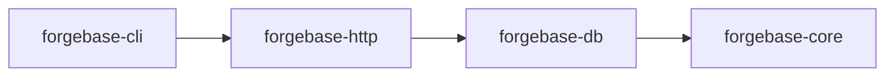

# Architecture

M1 is implemented: the metadata model and document validation (`forgebase-core`), the PostgreSQL pool, migrations, schema sync and document CRUD (`forgebase-db`) and the `forgebase` command-line tool (`forgebase-cli`). M2 is implemented in four PRs: M2.1 (Link fields and optimistic concurrency), M2.2 (child tables), M2.3 (lifecycle pipeline and hooks, [ADR 0009](../adr/0009-lifecycle-pipeline-and-hooks.md)) and M2.4 (docstatus with submit, cancel and amend, and naming series). M3 is implemented in three PRs: M3.1 (users, sessions, API tokens, [ADR 0010](../adr/0010-authentication-and-sessions.md)), M3.2 (role permissions, enforced document operations and the list query, [ADR 0011](../adr/0011-permission-model-phase-1.md)) and M3.3 (the HTTP API, section 7); everything from M4 on is design only. Sections and statements marked Accepted are owner-accepted ADRs or owner decisions recorded in these docs; the rest is a design proposal. Workflow and approval rules: [AGENTS.md](../../AGENTS.md).

**Status vocabulary**

| Status | Meaning |
|---|---|
| Accepted | Confirmed by the owner, or a process decision recorded as Accepted (an ADR marked "Accepted by owner" is an Accepted decision the owner made or provided). |
| Proposed | Recommendation, awaiting owner decision. |
| Undecided | Options listed; decision deferred. The deciding milestone is named where the approved plan ties it (for example UI library: M4, multi-site: before the multi-site milestone); otherwise: decide when the related milestone is planned. |

Accepted so far: ADR 0001 (record decisions as ADRs), ADRs 0002-0006 (accepted by the owner on 2026-10-28: modular monolith and workspace layout, PostgreSQL only, database access layer direction, HTTP stack, extension model), MIT license (ADR 0007), English docs, the four-stage workflow and the Model Selection Policy (ADR 0008), the Toolchain/MSRV policy (owner decision 2026-10-28, see [maintenance-policy](maintenance-policy.md#toolchain-and-msrv)), and the M1 owner decisions of 2026-10-28 (TOML metadata files, UUID v7 generated in the application, `time`, `rust_decimal`, `clap` (derive) for the CLI, PostgreSQL 16 as the version floor, DocType `name` with a separate `label`; see section 3 and [dependency-evaluation](dependency-evaluation.md)), and the seven M2 owner decisions of 2026-10-28 (section 3, "M2 owner decisions"). **Everything else below is Proposed or Undecided.** The M1 spike confirmed the ADR 0004 direction (no superseding ADR; see [dependency-evaluation](dependency-evaluation.md#m1-spike-result-adr-0004-checkpoint)). Decisions are recorded in [docs/adr](../adr/README.md). Frappe behavior referenced here is labelled in the [feature matrix](feature-matrix.md).

## 1. Shape: modular monolith (Accepted, [ADR 0002](../adr/0002-modular-monolith-and-workspace-layout.md))

The Accepted scope is exactly the ADR 0002 decision: four crates (`forgebase-core`, `forgebase-db`, `forgebase-http`, `forgebase-cli`), the dependency direction cli → http → db → core, jobs and scheduler as a module in `forgebase-db` plus a `worker` command, and a React + TypeScript `desk/` arriving at M4. Other details in this section (Vite, the specific CLI command list, the "Rejected for now" list) remain Proposed.

One Cargo workspace, four crates. Do not split further until a real boundary problem appears.

| Crate | Responsibility |
|---|---|
| `forgebase-core` | Metadata model (DocType, DocField, field types), document value model (validated map), validation, naming, lifecycle pipeline definitions, permission evaluator. **No I/O, no async, no SQL.** Pure and unit-testable; most business rules live here. |
| `forgebase-db` | PostgreSQL access: pool, transactions, metadata-driven schema sync (DDL), framework migrations, document persistence, permission-filtered queries, job queue tables. |
| `forgebase-http` | axum routes, Host validation, authentication and CSRF extractors, REST resource API, the error envelope and the JSON mapping (`forgebase_http::json`). Thin; delegates to core and db. axum types stay inside this crate. |
| `forgebase-cli` | The `forgebase` binary (clap): site init, migrate, serve, create user, run worker. |

The frontend `desk/` (React + TypeScript + Vite) arrives only at the Desk milestone (M4).

Dependency direction (core depends on nothing internal):

Background jobs and the scheduler are a module in `forgebase-db` plus a `worker` command, not a separate service.

Rejected for now: microservices, dynamic libraries, WASM plugins, a separate jobs service, Redis.

## 2. Extension model (Accepted, [ADR 0006](../adr/0006-extension-model.md))

A Forgebase "app" is a Rust crate compiled into the user's binary. The user's `main` depends on `forgebase-*` and registers app DocTypes and hooks at startup through an explicit registration list (no global magic or inventory macros).

- Pros: type safety, no runtime plugin machinery, one build artifact.
- Cons: changing hooks requires rebuild and redeploy; no install-at-runtime like `bench get-app`.
- This is an intentional difference from Frappe. Server Scripts (runtime user code) are out of scope.

## 3. Metadata (DocType) model (Proposed)

**Owner decisions, 2026-10-28 (Accepted)**, for M1; the remaining items in this section keep their stated status. The last four bullets were confirmed ("setuju semua") after the M1.1 review:

- Metadata file format: **TOML**.
- `id` is a **UUID v7 generated in the application**.
- A DocType `name` is a snake_case identifier with a separate `label`; the label is not derived automatically.
- `required` is enforced by application validation, not by a database `NOT NULL`, in M1.
- M1 field types: Data, Text, Int, Decimal, Check, Date, Datetime, Select. Link arrived in M2.1 and Table in M2.2.

- Int maps to PostgreSQL `bigint` (spike lesson: an `int` column decodes as `i32`, while `Value::Int` is `i64`).
- Data fields default to `max_length` 140.
- A required Data, Text, Select or Link field treats an empty or whitespace-only string as missing.
- Decimal values with more decimal places than the field's scale are rejected rather than rounded.

- **Schema-as-code.** DocTypes are defined in files inside the app crate (versioned in git) and loaded at startup; the DB holds a synced copy for introspection and admin. Single direction of truth: files to DB. File format: TOML (Accepted, see above).
- **Field types.** Small closed set first: Data (text with max length), Text, Int, Decimal (Postgres `numeric`; Float only if justified), Check (bool), Date, Datetime (`timestamptz`), Select, Link, Table (child). Layout-only types (section/column breaks) stay out of the data field list; UI layout is a separate optional section. Other types (Attach, JSON, Dynamic Link, Currency, ...) are added one at a time with a reason.
- **Standard columns.** `id` (UUID surrogate PK; v7, generated in the application, Accepted), `name` (unique human-facing identifier), `owner`, `created_at`, `modified_at`, `modified_by`, `version` (int, optimistic concurrency), `docstatus` and `amended_from` (submittable types only, M2.4: `smallint NOT NULL DEFAULT 0` and nullable `text`). A surrogate PK separate from `name` is an intentional difference (Frappe uses `name` as PK) so renames do not cascade. The surrogate key itself is confirmed in M1. A child DocType's table (M2.2) has only `id`, `parent_id` and `idx` as standard columns, see section 4.
- **Table naming.** Deterministic, validated snake_case identifiers derived from DocType names (for example `doc_sales_order`), always quoted; never interpolated from unvalidated input. PostgreSQL truncates identifiers at 63 bytes, so the limit applies to the full table name including the `doc_` prefix (and to index and constraint names).
- **Naming strategies, initially.** Random/hash; field-based; naming series (Accepted owner decision 2026-10-28, implemented in M2.4: gapless per rendered prefix, a counter row in `fb_series` incremented in the document's transaction; see "M2 owner decisions" below). Others deferred.
- **Single DocTypes (settings): Undecided** (decide when the related milestone is planned). Simplest option is a regular one-row table rather than a key-value `singles` table.

### M2 owner decisions (2026-10-28, Accepted)

Approved with the M2 plan ("setuju semua"). Implementation is split into four PRs: M2.1 Link fields and optimistic concurrency (implemented), M2.2 child tables (implemented), M2.3 lifecycle and hooks (implemented), M2.4 docstatus and naming series (implemented). Details of each decision are in the section named in brackets.

1. **Link storage** [section 4]: a `uuid` column with a foreign key to the target's `id` (`ON DELETE RESTRICT`) and an automatic index. The API accepts and returns the target `name`. A missing target is a validation error naming the field; deleting a referenced document is refused with a message naming the referencing DocType. The target must be in the registry; self-links are allowed.
2. **Optimistic concurrency** [section 6]: update, delete, submit and cancel require `expected_version`; a mismatch is `DbError::Conflict` with the current version. The CLI needs `--version N` for `doc update` and `doc delete`. This is a breaking API change, accepted in 0.x.
3. **Child tables** [section 4, implemented in M2.2]: `is_child = true`; no own CRUD; no nesting (a child cannot contain a Table field). Columns `id`, `parent_id` (foreign key `ON DELETE CASCADE`, indexed), `idx` and the fields; Link fields inside a child are allowed. Saved with the parent in the same transaction: insert writes all rows; update replaces the rows of a table (delete the old rows, insert the new ones in `idx` order) only when they differ from the stored rows, so a table with identical rows keeps its row ids (identical means equal to the stored rows with every field present; a row that leaves out a null field counts as different and the table is replaced, which is always correct).
4. **Hooks** [section 6, implemented in M2.3 for insert, update and delete and in M2.4 for submit, cancel and amend]: synchronous and pure, defined in `forgebase-core`; they may modify the document or reject it with an error. No database access in M2; hooks that read the database and after-commit effects wait for the outbox (M5). Hooks: `before_insert`, `validate` (insert, update, submit), `before_submit`, `before_cancel`, `before_delete`. Insert order within one transaction: `before_insert`, the `validate` hook, framework validation (types, required, Links), naming, then write the document and its children. Any hook failure rolls back the whole transaction.
5. **docstatus** [section 6, implemented in M2.4]: `submittable = true` adds `docstatus` and `amended_from` columns. A draft is editable and deletable. A submitted document is locked except fields marked `allow_on_submit`. A cancelled document is deletable or can be amended into a new draft. The amended name is `<original-name>-<n>`; submittable DocTypes may not use field naming. Implementation details (M2.4, decided by the implementer, reviewed per PR): section 6, "docstatus".
6. **Naming series** [implemented in M2.4; details in section 6]: for example `naming = { series = "INV-.YYYY.-.#####" }`; the counter lives in table `fb_series` and is incremented in the same transaction as the document, so numbers have no gaps per rendered prefix (a rollback returns the number) and inserts with the same prefix serialize. Date parts come from the transaction date in UTC. M2.4 implementation details: the key of `fb_series` is the rendered text before the number part, see section 6, "Naming series".
7. **ADR 0009** records the lifecycle and hooks decisions: [0009 Lifecycle pipeline and hooks](../adr/0009-lifecycle-pipeline-and-hooks.md) (written with M2.3).

### DocType file format

One TOML file per DocType; unknown keys are rejected. Loaded with `DocType::from_toml_str`; an example is `crates/forgebase-core/tests/fixtures/customer.toml`.

Top-level keys:

- `name` (required): snake_case identifier, `^[a-z][a-z0-9_]*$`, at most 59 bytes.
- `label` (required): human-readable name, not derived from `name`.
- `naming` (optional): `"random"` (default), `{ field = "<fieldname>" }` (the named field must be a required, unique Data field) or `{ series = "<pattern>" }` (M2.4, see section 6, "Naming series"; the pattern is validated when the file is loaded). Not allowed in a child DocType.
- `submittable` (optional, default `false`, M2.4): the DocType has a docstatus and can be submitted, cancelled and amended (section 6). It is a definition error on a child DocType and together with `naming = { field = ... }`.
- `is_child` (optional, default `false`): a child DocType (M2.2), the row type of a Table field of exactly one other DocType. A child has no `naming` key (its rows have no names), no Table fields (no nesting) and no `unique` fields (uniqueness across all parents is not meaningful), cannot be the target of a Link, and has no CRUD of its own.
- `[[fields]]`: the field list, in order.
- `[[permissions]]` (optional, repeatable, M3.2, [ADR 0011](../adr/0011-permission-model-phase-1.md)): who may do what with the DocType's documents. Keys: `role` (required; the same rule as a user's role: 1 to 140 characters, not blank, no control characters), `read`, `write`, `create`, `delete`, `submit`, `cancel`, `amend` (all default `false`) and `if_owner` (default `false`: the rights apply to documents whose `owner` is the caller only). Access is the union over the caller's roles; there are no deny rules. The built-in role `Administrator` bypasses every rule, and a DocType **without rules is closed** to everyone else (deny by default). Definition errors: an invalid role, a rule that grants nothing, `submit`, `cancel` or `amend` on a DocType that is not `submittable`, two rules with the same `role` and `if_owner`, and any rule on a child DocType (its rows follow the parent). Example: [examples/doctypes/sales_order.toml](../../examples/doctypes/sales_order.toml).

Field keys (`[[fields]]`):

- `name` (required): snake_case identifier, at most 63 bytes, not a reserved standard column (`id`, `name`, `owner`, `created_at`, `modified_at`, `modified_by`, `version`, `docstatus`, `amended_from`, `idx`, `parent_id`) or a PostgreSQL system column (`tableoid`, `xmin`, `xmax`, `cmin`, `cmax`, `ctid`).
- `label` (optional): defaults to the field `name`.
- `type` (required): `data`, `text`, `int`, `decimal`, `check`, `date`, `datetime`, `select`, `link` or `table`.
- `required`, `unique` (optional, default `false`). `required` is enforced by application validation; for Text, Data, Select and Link an empty or whitespace-only string counts as missing; for a `table` field it means at least one row. A `table` field cannot be `unique`.
- `allow_on_submit` (optional, default `false`, M2.4): the field may still change on a submitted document. Setting it on a DocType that is not `submittable`, or on a `table` field (the rows of a submitted document are always locked), is a definition error (`AllowOnSubmitNotSubmittable`, `AllowOnSubmitTable`) rather than being ignored, so a forgotten `submittable = true` is noticed when the file is loaded.
- `max_length` (`data` only): `1..=65535`, default 140.
- `precision` (`1..=28`) and `scale` (`<= precision`), both required for `decimal`. Strict rule: a value with more decimal places than `scale` is rejected, not rounded (trailing zeros are ignored).
- `options` (`select` only, required): non-empty list of unique, non-empty strings.
- `target` (`link` and `table`, required): the name of the DocType the field points to, a valid DocType name; for `table` it must be a child DocType. A parameter that does not belong to the type is an error.

Text, Data, Select and Link values and Select options must not contain NUL (`\0`), which PostgreSQL text cannot store.

## 4. Relationships (Link implemented in M2.1, child tables in M2.2; both Accepted)

- **Link field (Accepted owner decision 2026-10-28; implemented in M2.1)** is a real PostgreSQL foreign key to the target's `id` (`ON DELETE RESTRICT`), so the DB enforces integrity (Frappe checks in the application; behavior itself Unverified, see [feature matrix](feature-matrix.md)). The API accepts and returns the target `name`; resolution is internal. Intentional difference.
  - **Definition.** `type = "link"` with `target = "<doctype name>"` (see the file format in section 3). `FieldType::Link { target }`; the value is `Value::Text(name)`, validated like Data without a length limit (text, no NUL, a required Link is non-blank). Existence of the target document is not checked by `forgebase-core` (no I/O): `forgebase-db` reports `ValidationError::LinkNotFound`.
  - **References between DocTypes.** `Registry::add` checks one DocType, so files may name DocTypes that are loaded later. `Registry::check_references` checks that every Link target is in the registry (a self-link is fine) and is not a child DocType, and returns every `DefinitionError::UnknownLinkTarget` and `LinkToChild`; since M2.2 it checks the child-table rules too (below). Callers must run it after loading all DocTypes: `forgebase-db::sync` does (`DbError::InvalidMetadata`, a clear error and not a schema conflict) and so does the CLI loader (the message names the file).
  - **Writing.** For every non-null Link value, `insert` and `update` resolve the name with `SELECT "id" FROM "doc_<target>" WHERE "name" = $1::text FOR KEY SHARE` on the same client. The row lock stops a concurrent delete of the target until the transaction ends. Since M2.2 every call runs in its own transaction (a savepoint inside a caller's transaction, see "Document CRUD" in section 5), so the lock lasts until the write is done, on a pooled client too. An unknown name is a `LinkNotFound` item in `DbError::Validation`, collected with the other problems; nothing is written. The resolved id is bound as `uuid` with an explicit cast.
  - **Reading.** `get` and the `RETURNING` of `insert` and `update` select the target's `name` with a scalar subquery on the id (aliased to the field name), so `StoredDocument` holds `Value::Text(name)`.
  - **Deleting.** A document that other documents link to cannot be deleted: SQLSTATE 23503 becomes `DbError::LinkedDocumentExists { doctype, name, referenced_by }`. `referenced_by` is the DocType derived from the table the server names in the error (`doc_<doctype>`), or `None` if that is not available; no extra query is needed. For a link from a child row it is the DocType that owns the row (the parent). The delete runs in a savepoint, so the failure does not abort a caller's transaction.
- **Child tables (Accepted owner decision 2026-10-28, see section 3; implemented in M2.2).** Each child DocType belongs to exactly one parent DocType and is marked `is_child = true`; it has no CRUD of its own and cannot contain a Table field (no nesting). The child table has columns `id`, `parent_id` (FK `ON DELETE CASCADE`, indexed), `idx` for ordering and the fields; Link fields inside a child are allowed. There are no polymorphic `parenttype`/`parentfield` columns. Intentional difference (Frappe allows reusing one child DocType across parents). Child rows are saved only as part of the parent document, in the same transaction. Insert writes all rows; update replaces the rows of a table (delete the old rows, insert the new ones in `idx` order) only when they differ from the stored rows, so child row ids change only when a table's rows change.
  - **Definition.** In the parent: `type = "table"`, `target = "<child doctype>"` (`FieldType::Table { target }`). The Table field has no column in the parent's table and no `Value`; its rows are in `Document::tables` (`BTreeMap<field, Vec<Row>>`, `Row = BTreeMap<String, Value>`), and a row's position in the list is its `idx` (from 1). `required` on a Table field means at least one row; `unique` is not allowed. In a child DocType: no `naming`, no Table field, no `unique` field (`DefinitionError::ChildWithNaming`, `ChildWithTable`, `ChildWithUnique`, `UniqueTable`).
  - **References.** `Registry::check_references` also checks that a Table target exists and is a child DocType, that a Link target is not a child, that every child DocType is the target of exactly one Table field (`UnknownTableTarget`, `TableTargetNotChild`, `LinkToChild`, `UnusedChild`, `ChildSharedByTables`; an unused child is an error, not a warning), and `Registry::parent_of` finds the owner of a child. `sync` and the CLI loader run it.
  - **Validation.** `validate` takes the `Registry` (breaking change) to find the child DocTypes. Each row is validated like a document (unknown fields, required fields, value kinds, constraints; Link names are text here). Row problems are `ValidationError::InRow { field, row, error }` with the 1-based row position, displayed as ``field `items` row 2: field `qty` is required``; all problems are collected. A value for a Table field in `values`, or rows for a field that is not a Table field, is a `TypeMismatch`; an unknown table key is `UnknownField`. `update` takes `Changes { values, tables }`: a Table field present in `tables` replaces its rows (when they differ) and an absent one keeps them; since M2.3 the merged whole document is validated (so a required table cannot be given an empty list), and `validate_update` was removed.
  - **Reading.** `StoredDocument::tables` has one entry per Table field with the rows in `idx` order (row values only; row ids and `idx` are not exposed). A document with Table fields is read with several statements; `get` re-reads when the `version` changed meanwhile (the version and the rows change together in one transaction), so a document and rows of different versions are never mixed, also at READ COMMITTED; after five unlucky attempts it fails with `DbError::ChangedWhileReading`.
  - **Writing.** `insert` writes the document, then one `INSERT` per row (new UUID v7 id, `parent_id`, `idx`, bound values with casts) in the same transaction. `update` locks the document row with its first read (`FOR NO KEY UPDATE`, which keeps other writers out), updates the document row and then, for every Table field whose rows differ from the stored ones (given in `Changes::tables` or changed by a hook), runs `DELETE FROM <child> WHERE parent_id = $1` and inserts the new rows; the version is bumped as usual, and an update that changes tables only is valid (`NoChanges` means no values and no tables). `delete` removes the rows through the `ON DELETE CASCADE` key. Calling any of the four with a child DocType is `DbError::ChildDocType`; an unknown DocType name is `DbError::UnknownDocType`. Links inside rows are resolved like the document's own (`FOR KEY SHARE`, one lookup per link per row); a missing target is a `LinkNotFound` wrapped in `InRow`.
  - **Limits.** No row-level ids, upserts or per-row diffs (a table is compared as a whole: replaced entirely when any row differs, left alone when identical); no limit on the number of rows per save beyond memory; no nested child tables; a child cannot be shared by several parents or be linked to. If a document's own child rows link to that same document, deleting it may be refused with `LinkedDocumentExists` naming its own DocType, depending on the order in which PostgreSQL fires the cascade and restrict triggers (nothing is corrupted).
  - **Invariant.** Every change to a document's child rows bumps the parent's `version` in the same transaction (today `update` does this by updating the parent row first). `get` relies on it for its consistency check; any future operation that writes child rows (M2.3, M2.4) must keep it.
- **Dynamic Link:** deferred (no FK possible); not a priority.

## 5. Schema sync and migrations (Proposed; M1.2, M2.1 and M2.2 implemented in `forgebase-db`)

**Implemented in M1.2, M2.1 and M2.2** (the rest of this section is still the design direction):

- **Framework migrations**: embedded SQL in `crates/forgebase-db/migrations/`, run by `migrate_framework` in one transaction under a transaction-level advisory lock (`pg_advisory_xact_lock`, released automatically, never a session lock on a pooled connection). Applied migrations are verified first: unknown version (database newer than code) or checksum mismatch is an error. The checksum is SHA-256 computed by PostgreSQL (no hash crate). Tables: `fb_migration`, `fb_doctype` (which DocType tables Forgebase manages) and, since migration 0002 (M2.4), `fb_series` (naming series counters: `prefix text PRIMARY KEY`, `current bigint NOT NULL`) and, since migration 0003 (M3.1, [ADR 0010](../adr/0010-authentication-and-sessions.md)), the auth tables: `fb_user` (`id`, unique `username`, `password_hash`, `enabled`, `created_at`), `fb_user_role` (`user_id`, `role`), `fb_session` (`token_hash`, `csrf_hash`, `user_id`, `created_at`, `last_seen_at`, `expires_at`), `fb_api_token` (`key`, `secret_hash`, `user_id`, `created_at`, `revoked_at`) and `fb_login_failure` (`username`, `failures`, `locked_until`). Users, sessions and tokens are framework tables, not DocTypes; token and CSRF digests are SHA-256 computed by PostgreSQL. The Rust API is `forgebase_db::auth`.
- **Schema sync** (`sync`): one transaction; transaction-local `lock_timeout` (default 5 s, clamped to 1 ms ..= `i32::MAX` ms; an error `LockTimeout` that is safe to retry; in `migrate` the framework migrations stay applied, only the sync step is not), advisory lock, then introspection of the connection's current schema inside the transaction so concurrent syncs see each other's result. Steps are additive only: create table, add the keys of new tables, add foreign keys, add nullable column, create unique index, create a Link index, register in `fb_doctype`. `dry_run` rolls back and returns the SQL; for framework migrations a dry run still executes the migration DDL before rolling back. Connection errors keep the server message and SQLSTATE (for example 28P01, 3D000). Database state that does not match expectations (such as an `fb_migration` with other column types) gives an error, never a panic.
- **Type mapping**: Data `varchar(n)`, Text and Select `text` (Select options are validated by the application, so option changes need no migration), Int `bigint`, Decimal `numeric(p,s)`, Check `boolean`, Date `date`, Datetime `timestamptz`, Link `uuid` (the target's `id`), Table no column (the rows are in the child's table). Field columns are always nullable; `required` is application-enforced.
- **Conflicts** (whole sync refused, nothing applied): a column whose type, length, precision or scale differs from the metadata (including a Data `max_length` change in either direction), a standard column that is missing, differently typed or nullable (also `id` not being the primary key and `name` not unique), a `timestamptz` column with a precision other than the default 6, a non-table relation or standalone type named `doc_<name>`, and an existing `doc_<name>` table that Forgebase did not create (never adopted); and, for Link fields, the foreign key conflicts described below. **Warnings** (reported, nothing changed): a field column that is `NOT NULL` in the database (fields are nullable; the application enforces `required`), a column no field describes, a unique index whose field is no longer `unique`, and a registered DocType missing from the registry.
- **Names**: Forgebase does not name constraints or indexes. `CREATE TABLE` creates columns only, keys are added afterwards with `ALTER TABLE ... ADD PRIMARY KEY ("id"), ADD UNIQUE ("col")` (unnamed), and unique indexes added later use `CREATE UNIQUE INDEX ON ... ("col")`; PostgreSQL picks free names of at most 63 bytes. A sync works in phases: it first creates every new table with columns only, then adds the primary key and unique constraints of the new tables, then the foreign keys of the new tables, then added columns, then the foreign keys of added Link columns, then late unique and Link indexes, then registers the DocTypes. Every primary key exists before any foreign key is added, so Link fields between new tables (also two DocTypes that link to each other, and self-links) sync in one run. Because all tables of the sync exist before any key or index is named, a generated name cannot clash with a DocType table in the same sync, even when PostgreSQL truncates long names. Unique and index detection reads `pg_index` (valid, single-column, non-partial), not names. If a relation of any kind or a standalone type (view, index, sequence, domain, ...) already has the name `doc_<name>`, the sync reports a conflict; an ordinary table of that name that Forgebase did not create is reported as unmanaged. A later sync can still conflict when a DocType table name equals a name PostgreSQL already gave to an index of an earlier table.
- **Child tables (M2.2)**: the table of a child DocType (`doc_<child>`) has the standard columns `id uuid NOT NULL`, `parent_id uuid NOT NULL` and `idx integer NOT NULL`, then the field columns (nullable); no `name`, `owner`, `version` or timestamps. Keys: `ADD PRIMARY KEY ("id")` only. Foreign keys, in the same phase as Link keys and in one statement per table: `ADD FOREIGN KEY ("parent_id") REFERENCES "doc_<parent>" ("id") ON DELETE CASCADE`, plus the child's Link keys (`RESTRICT`). Indexes: a plain index on `parent_id` and on each non-unique Link column. The parent is found with `Registry::parent_of`; a parent and its child can be created in one sync (all primary keys exist before the foreign keys), and a Table field and its child can be added later without touching the parent's table. **Conflicts**: a missing or differently typed or nullable child standard column, `id` not the primary key, and a `parent_id` foreign key that is missing, not validated, points elsewhere, or has a delete rule other than `CASCADE`. A missing `parent_id` index is an additive step. A DocType that switches between child and not child is a conflict through its standard columns (for example `column doc_x.parent_id is missing in the database but the metadata requires uuid NOT NULL`); nothing is applied and nothing is dropped. A leftover `name` column on a child table is a warning like any column no field describes.
- **Submittable DocTypes (M2.4)**: the table has `docstatus smallint NOT NULL DEFAULT 0` and `amended_from text` (nullable) after the standard columns. Making an existing DocType submittable adds both with `ADD COLUMN` (the default makes every existing document a draft; adding a column with a constant default does not rewrite the table in PostgreSQL 11 and later). A missing column is added; a column with another type, or a different nullability, is a conflict (`column doc_x.docstatus is bigint NOT NULL in the database but the metadata requires smallint NOT NULL`). Turning `submittable` off is not destructive: the columns are kept and reported as `ColumnNotInMetadata` warnings, and inserts keep working because `docstatus` has a default. Making a DocType submittable again later adopts the kept columns if they still match.
- **Link fields (M2.1)**: a Link column is `uuid`. New tables get `ALTER TABLE t ADD FOREIGN KEY ("col") REFERENCES "doc_<target>" ("id") ON DELETE RESTRICT` (unnamed, one statement per table) in the foreign-key phase. A Link column added to an existing table gets `ADD COLUMN`, then the foreign key, then the index. Every Link column gets a plain `CREATE INDEX ON t ("col")` because PostgreSQL does not index referencing columns itself; a `unique` Link field is covered by its unique constraint and gets no extra index. An index that is missing on an existing Link column is an additive step (it may have been dropped by hand). Foreign keys of managed tables are read from `pg_constraint` (single-column, `contype = 'f'`, with the delete rule, the referenced table and column, and whether it is validated). **Conflicts** (whole sync refused): a Link column that exists without the expected foreign key, with a foreign key to another table or column, with a delete rule other than `RESTRICT` (including the default `NO ACTION`), or with a `NOT VALID` foreign key (existing rows were never checked); and a foreign key on a column whose field is not a Link. Forgebase never repairs a foreign key by itself, because adding one validates all existing rows. A Link whose target DocType is not in the registry is refused before any SQL runs (`DbError::InvalidMetadata`), not reported as a conflict.
- **Limits**: plain `CREATE INDEX` (blocks writes on that table while building; no `CONCURRENTLY` yet); adding a unique index to an existing column fails, and the sync rolls back, if the column already holds duplicates; only the connection's current schema is handled; no TLS to PostgreSQL yet (planned: rustls; run over a local or private network until then).

Two distinct problems:

1. **Framework migrations** (Forgebase's own system tables): small embedded, ordered SQL migrations with checksums and an advisory lock. Tool choice depends on the DB-layer decision ([ADR 0004](../adr/0004-database-access-layer.md)).
2. **DocType schema sync.** Framework code diffs metadata against the live schema (`information_schema`) and produces a plan.
   - **Additive changes** (new table, new nullable column, new index, and the foreign key constraint plus index that a new Link column implies) apply automatically.
   - **Destructive or risky changes** (drop/rename column, type change, NOT NULL on existing data) are never automatic; they require an explicit migration file.
   - `migrate --dry-run` prints the plan. Sync runs in a transaction where PostgreSQL allows it (most DDL is transactional).
   - **Design notes for M1/M2 (not decisions):**
     - A plain `CREATE INDEX` takes a lock that blocks writes on the table while it builds, which matters on large tables.
     - `CREATE INDEX CONCURRENTLY` and `CREATE DATABASE` (needed for database-per-site) cannot run inside a transaction block, so they sit outside the sync transaction and need special handling (for example an explicit, separate step).
     - Adding a Link column also adds a foreign key constraint, which takes locks on the referenced table.
     - PostgreSQL does not automatically index the referencing column of a foreign key; sync should create an index on every foreign key column (Link columns and child `parent_id`), otherwise `ON DELETE RESTRICT` checks and child-row lookups scan the whole table.
     - Most `ALTER TABLE` forms (including ADD COLUMN) take an ACCESS EXCLUSIVE lock (ADD FOREIGN KEY takes SHARE ROW EXCLUSIVE); while such a statement waits behind a long-running transaction it queues and blocks every later read and write on that table. Set `lock_timeout` for sync DDL so it fails fast instead of stalling the application. Hitting `lock_timeout` aborts the sync transaction, so sync must report the failure and allow a retry.
3. **Data patches.** Ordered, run-once, recorded in a table, inside transactions, with "before schema sync" and "after schema sync" phases (concept from Frappe's pre/post model sync).

### Document CRUD (M1.3, implemented in `forgebase-db`)

`insert`, `get`, `update` and `delete` handle one document of one DocType. They take a `&mut impl tokio_postgres::GenericClient` and the `&Registry`, and the DocType **name** (`insert(client, registry, "customer", doc, &caller)`; `get(client, registry, doctype, name, &caller)`, `update(client, registry, doctype, name, expected_version, &Changes, &caller)`, `delete(client, registry, doctype, name, expected_version, &caller)`; M2.2 changed these signatures, breaking, M2.3 added the actor to `delete` and M3.2 replaced the actor string by the `&Caller` of the permission model, see below). The registry gives them the child DocTypes of Table fields. Each call runs all its statements inside `client.transaction()`: a transaction of its own on a pooled connection, a savepoint when the client is a caller-owned `Transaction`. So a document and its rows are written atomically on a pooled connection too, the `FOR KEY SHARE` lock of Links lasts until the write is done, and a failed call (a conflict, a linked delete, a failing row) is undone without aborting the caller's transaction; the caller still commits or rolls back its own.

- **Hooks, then validation.** `insert` and `update` run their hooks (`before_insert` then `validate` for `insert`, `validate` for `update`) and then `forgebase_core::document::validate` on the whole document (for `update` the stored document with the changes merged in, since M2.3); all problems are returned together (`DbError::Validation`). Nothing is written when validation fails. The full order of every operation, with the hooks, is in section 6.
- **Names.** Random naming: `name` is the new `id` as a hyphenated UUID, and a given name is rejected. Field naming: `name` is the value of the naming field; a given name must be absent or equal to it. Series naming (M2.4): `name` is the next name of the series and a given name is rejected (section 6). Changing the naming field in an update is rejected: renames are not supported yet.
- **Standard columns.** `id` is a UUID v7 generated in the application. `created_at` and `modified_at` are the database's `now()` (the transaction start time, so several writes in one transaction share it). `owner` and `modified_by` are the `actor`, which must be a non-empty string without NUL; it is recorded, not authenticated. `version` starts at 1 and every update adds 1. An update keeps `id`, `name`, `owner` and `created_at`.
- **Values.** Always bound parameters, with an explicit cast per field type in the SQL (`$n::varchar`, `::bigint`, `::numeric`, ...) so parameter types come from the metadata, not from inference. Absent fields are stored as NULL; an update changes only the fields it names, and `null` clears one. Identifiers come from validated metadata and are quoted.
- **Errors.** A duplicate in a `unique` field or in `name` is `DbError::UniqueViolation` (SQLSTATE 23505, server message kept); an unknown name in `update` or `delete` is `NotFound` (`get` returns `None`); an update without changes is `NoChanges`.
- **Links (M2.1).** See section 4: names are resolved to ids on write (`FOR KEY SHARE`) and back to names on read; a missing target is a `LinkNotFound` validation item; a delete that would orphan links is `LinkedDocumentExists`.
- **Optimistic concurrency (M2.1, Accepted owner decision 2026-10-28).** `update` and `delete` take `expected_version: i64` (a breaking change to the M1 signatures). Since M2.3 the first read of the call (which takes the row lock) detects `NotFound` and `Conflict`; the write keeps `... WHERE "name" = $n AND "version" = $m` as a safeguard. When no row matches, one more `SELECT "version" ... WHERE "name" = $1` tells the cases apart: no row is `NotFound`; a row with another version is `DbError::Conflict { doctype, name, expected, current }` and nothing was written. Under READ COMMITTED (the PostgreSQL default, which the conflict detection assumes) a second writer waits for the row lock of the first and then re-checks the version, so of two concurrent updates with the same `expected_version` exactly one succeeds. In a caller transaction at REPEATABLE READ or SERIALIZABLE the losing writer instead gets a serialization failure (SQLSTATE 40001, returned as `DbError::Postgres`, not `Conflict`) and should retry the whole transaction. A conflict is an ordinary result, so it does not abort a caller-owned transaction (and since M2.2 neither does any other failure of a call).
- **Child tables (M2.2).** See section 4: `Document::tables` and `Changes::tables` in, `StoredDocument::tables` out; a table's rows are replaced on update only when they differ from the stored rows; rows removed by the cascade on delete; child DocTypes have no CRUD of their own.
- **Lifecycle hooks (M2.3).** The registered `DocTypeHooks` run inside each call's transaction; see section 6 for the order and `DbError::Hook`. **Behaviour change of `update`:** it now loads the stored document with a row lock (`FOR NO KEY UPDATE`) and merges the changes into it, so hooks and validation see the whole document, **every column field is written**, and only the Table fields whose rows differ from the stored ones are replaced (an unchanged table keeps its row ids). `NotFound` and `Conflict` are now detected by that first read, before validation and before any hook (a stale update with invalid changes reports the conflict, no longer the validation errors). `delete` loads the document with `FOR UPDATE` first (for `before_delete`) and reports the same two cases there.
- **Submit, cancel and amend (M2.4).** `submit`, `cancel` and `amend` take the same arguments as `delete` (`client, registry, doctype, name, expected_version, actor`) and return the document as stored (`amend` the new draft); the rules are in section 6. `StoredDocument` has `docstatus: Option<DocStatus>` and `amended_from: Option<String>` (`None` for a DocType that is not submittable). `docstatus` and `amended_from` are not fields: a value for them in a document or in changes is an unknown field, so users cannot set them.
- **Permissions (M3.2, [ADR 0011](../adr/0011-permission-model-phase-1.md)).** Every operation takes a `forgebase_core::permission::Caller`: `User { username, roles }` (build it with `AuthUser::caller()` from M3.1) or the trusted `System { actor }` (the CLI, tests; bypasses all rules; never from request data). The caller's name is recorded as `owner` / `modified_by` and given to hooks as `HookContext.actor`. The one evaluator `evaluate(&DocType, &Caller, Right) -> Access` decides; the operation turns `Access` into SQL (`AND "owner" = $n` for an `if_owner` read, also in the locking reads) or `DbError::PermissionDenied { doctype, right }`. A document the caller cannot read is `None` (`get`) or `NotFound` (everything else), checked before the version and before any hook, so a stale version on a hidden document is `NotFound`, not `Conflict`; a Link to such a document is `LinkNotFound` (checked for new or changed Link values on `update` and `submit`: Links already stored on the document are kept, per field and per table, and `amend` never keeps them; ADR 0011, item 6), and `LinkedDocumentExists` names the linking DocType only to a caller who can read it. Details and known limits: ADR 0011 and the [security model](security-model.md).
- **List query (M3.2).** `list(client, registry, doctype, &caller, &ListQuery)` returns a page of documents (typed filters, multi-field sort, `limit` default 20 and at most 500, `offset`; no child rows), with the caller's read access in the same statement; see ADR 0011 for the operators, the fields and the errors (`DbError::InvalidQuery`).
- **Not yet:** renames, field-level permissions, user permissions and sharing.

### The `forgebase` command-line tool (M1.3, implemented in `forgebase-cli`)

`forgebase migrate --doctypes DIR [--dry-run] [--lock-timeout-ms N]`, `forgebase doc insert|get|list|update|delete|submit|cancel|amend`, and (M3.1) `forgebase user create|set-password|add-role|remove-role|disable|enable` and `forgebase token create|revoke`, and (M3.3) `forgebase serve --doctypes DIR` (the HTTP API; no migrations, run `migrate` first). (M3.2) The `doc` commands run as the **trusted system context** (`Caller::System`): `--actor` names it, no permission rule applies, and nothing else changed for them; `doc list DOCTYPE [--filter JSON] [--sort FIELD[:desc]]... [--limit N] [--offset N]` prints a JSON array of documents (filters are `[{"field":"tier","op":"=","value":"gold"}, ...]` with the operators `=`, `!=`, `<`, `<=`, `>`, `>=`, `in`, `like`, `is null` and `is not null`, values mapped like `--data`). The `user` commands read the password from the first line of standard input (never an argument or environment variable); `user create USERNAME [--role R]...`; `token create USERNAME` prints `key:secret` once and nothing else; `token revoke KEY`. Errors never contain a password or secret. `doc insert`, `doc update`, `doc delete`, `doc submit`, `doc cancel` and `doc amend` take `--actor NAME` (default `cli`), and all but insert and get require `--version N`, the `version` of the document as last read; a stale version fails with exit code 1 and a message that includes the current version, and deleting a document that others link to fails with a message naming the linking DocType. The DocType directory is also checked for Link targets that no file defines and for the child-table rules (reported with the file name). A child DocType has no commands of its own: `doc` on it fails with a message that says so. The database URL comes from the `FORGEBASE_DATABASE_URL` environment variable; there is no config file. DocTypes are read from the `*.toml` files directly in `--doctypes DIR` (sorted by file name; not recursive; the extension match is case-sensitive, so `*.TOML` is ignored; names starting with `.` are skipped; a `*.toml` entry that cannot be read, such as a dangling symlink, is reported as an error; every file error is reported with its file name). `doc submit`, `doc cancel` and `doc amend` take no data (M2.4; `doc amend NAME --version N` names the cancelled document and prints the new draft). The output of a submittable DocType includes `docstatus` (0, 1 or 2) and `amended_from` (a name or `null`). Output is the stored document as pretty JSON on standard output; errors are `error: ...` on standard error with exit code 1, usage errors exit with 2.

JSON mapping (`forgebase_http::json`, shared by the CLI and the HTTP API since M3.3): Data, Text and Select are strings; a Link is a string, the `name` of the target document (the database stores its `id`); a Table field is an array of objects, one per row in order, each with the fields of the child DocType (same mapping; `null` or `[]` is no rows; in `doc update` the array replaces the rows and an omitted key keeps them; output rows have every field, `null` when empty, and no ids); Int is a JSON integer (floats and values outside `i64` are rejected); Decimal is a JSON **string** (a JSON number is rejected so no precision is lost); Check is a boolean; Date is `YYYY-MM-DD`; Datetime is RFC 3339 and is printed in UTC with `Z`; `null` is no value. Datetime has **microsecond precision** (PostgreSQL `timestamptz`): finer digits are truncated, not rounded or rejected. Duplicate keys in the input are accepted and the last one wins (serde_json behavior). Decimal strings accept every form `rust_decimal` parses (for example `"1e3"`, `"+12.5"`, `".5"`) with exact values. Output keys are sorted alphabetically (the standard columns appear among the fields). Keys that are not fields are passed on so that validation reports them. Limit: values another tool wrote that are outside the supported ranges (`date` and `timestamptz` years beyond ±9999 as `time` supports them, `infinity`, `NaN`) cannot be read; `get` fails with an error that names the DocType and the field.

## 6. Document lifecycle and transactions (insert pipeline and hooks Accepted and implemented in M2.3; update and delete pipelines are reviewed M2.3 implementation details; docstatus and naming series are Accepted owner decisions implemented in M2.4, their details below are M2.4 implementation details; the rest Proposed)

- **One fixed, documented, tested pipeline per operation (implemented in M2.3 for insert, update and delete, tested in `forgebase-db/tests/lifecycle.rs`; submit, cancel and amend in M2.4, tested in `tests/docstatus.rs`).** The insert order and the rollback rule are Accepted owner decisions ([ADR 0009](../adr/0009-lifecycle-pipeline-and-hooks.md)); the update and delete orders, including the merge semantics and the lock modes, are reviewed M2.3 implementation details ([ADR 0009, Implementation details](../adr/0009-lifecycle-pipeline-and-hooks.md#implementation-details-m23)). Every step runs in the operation's one transaction (a savepoint inside a caller's); any hook error rolls it back (`DbError::Hook`).

  | Operation | Order |
  |---|---|
  | Insert | 1. reject a child DocType; 2. `before_insert` hooks; 3. `validate` hooks; 4. framework validation (types, required, rows); 5. Link resolution (`FOR KEY SHARE`); 6. naming; 7. write the document and its rows |
  | Update | 1. load the stored document and its rows with `FOR NO KEY UPDATE`: `NotFound`, or `Conflict` when `version` is not `expected_version`; 2. merge the changes (stored values overlaid with `changes.values`; rows from `changes.tables` where given, else the stored rows); 3. reject a change to the naming field; 4. `validate` hooks on the merged document (the naming field must stay); 5. framework validation of the whole merged document; 6. Link resolution; 7. write every column field, replace the rows of each table that differs from the stored rows, `version = version + 1` |
  | Delete | 1. load with `FOR UPDATE`: `NotFound` or `Conflict`; 2. a submitted document is refused (`InvalidDocStatus`); 3. `before_delete` hooks with the stored document and rows; 4. delete (rows by cascade; `LinkedDocumentExists` when linked) |
  | Submit (M2.4) | 1. the DocType must be submittable; 2. load with `FOR NO KEY UPDATE`: `NotFound` or `Conflict`; 3. the document must be a draft (`InvalidDocStatus`); 4. `validate` hooks on the whole stored document, then `before_submit` hooks; 5. framework validation of the whole document; 6. Link resolution; 7. write every column field, replace the rows of each table that differs, `docstatus = 1`, `version = version + 1` |
  | Cancel (M2.4) | 1. the DocType must be submittable; 2. load with `FOR NO KEY UPDATE`: `NotFound` or `Conflict`; 3. the document must be submitted; 4. `before_cancel` hooks with the stored document and rows; 5. write `docstatus = 2`, `version = version + 1` |
  | Amend (M2.4) | 1. the DocType must be submittable; 2. load the cancelled document with `FOR NO KEY UPDATE`: `NotFound` or `Conflict`; 3. it must be cancelled and not amended yet (`AlreadyAmended`); 4. the **insert** pipeline on a copy (steps 2 to 7 of the insert row, with `Operation::Amend`), where naming is the amend name rule |
  | Update, docstatus (M2.4) | after step 1: a cancelled document is refused; on a submitted document a change to a field that is not `allow_on_submit`, or to a table, is refused (`FieldLocked`), checked before the hooks and again after them, and only the `allow_on_submit` columns are written |

  Permissions (M3.2, ADR 0011) are checked before step 1 of each: the doctype-level right first (`PermissionDenied`), then, in the locking read of step 1, the read scope in SQL (an unreadable document is `NotFound`), then the right on that document (`if_owner`: `PermissionDenied`), then the version (`Conflict`); Link resolution in the steps above uses the caller's read access on the target. A refused operation runs no hook. The proposed `after_*` hooks and after-commit effects are not part of this. An update is an explicit save: it bumps `version` even when the merged document equals the stored one (only an empty `Changes` is `NoChanges`).
- **Hooks** (Accepted, [ADR 0006](../adr/0006-extension-model.md)) are a small Rust trait per DocType (`DocTypeHooks`, default no-op methods) registered by the app; with several apps, hooks run in registration order. No class override mechanism. The M2 owner decisions of 2026-10-28 (section 3, decisions 4 and 7) narrow the first version: hooks are synchronous and pure, defined in `forgebase-core` (`forgebase_core::hooks`), may modify the document or reject it with a `HookError`, and have no database access in M2. **Implemented in M2.3:** `before_insert`, `validate` (insert and update) and `before_delete`, registered with `Registry::add_hooks(doctype, Arc<dyn DocTypeHooks>)` (an unknown or a child DocType is refused; child tables have no lifecycle of their own, the hooks of the parent see the rows in `doc.tables`), receiving a `HookContext { doctype, actor, operation }` (`actor` is a `&str` for every operation, delete included: a reviewed M2.3 implementation detail, see [ADR 0009, Implementation details](../adr/0009-lifecycle-pipeline-and-hooks.md#implementation-details-m23)). **Implemented in M2.4:** `before_submit` and `before_cancel` as new default methods, and `Operation::{Submit, Cancel, Amend}`; `validate` also runs on submit and on amend (and `before_insert` on amend), see "docstatus" below. Hooks run before the framework validation and must be defensive; a hook panic is not caught (it aborts the operation like any panic; an implementation detail). The `after_*` hooks, hooks with database reads and after-commit effects remain Proposed and need a new ADR superseding or extending ADR 0009.
- **Transactions.** Exactly one DB transaction per API request or command; the framework owns commit and rollback. Hooks **cannot commit**: in M2 (ADR 0009) they have no database access at all, only the document. Design requirement for any later hook that reads the database: it receives a restricted, framework-provided handle (a fixed set of operations) rather than a raw database connection or transaction, so app code cannot issue `COMMIT` or unvalidated SQL; the mechanism, and whether such reads run as the user or the system, need a new ADR. Side effects that must happen only after commit (jobs, realtime, emails) go to an outbox/job table written in the same transaction (transactional outbox).
- **docstatus (Accepted owner decision 2026-10-28; implemented in M2.4).** Draft (0) / Submitted (1) / Cancelled (2) (`forgebase_core::document::DocStatus`), and amendment (a new draft with `amended_from`, named `<original-name>-<n>`) for DocTypes with `submittable = true`; a submitted document is locked except fields marked `allow_on_submit`; submittable DocTypes may not use field naming (`DefinitionError::SubmittableWithFieldNaming`); a child DocType cannot be submittable. The state machine is `Draft --submit--> Submitted --cancel--> Cancelled --amend--> new Draft`; every other transition is `DbError::InvalidDocStatus { doctype, name, docstatus, operation }`, and submit, cancel and amend on a DocType that is not submittable are `DbError::NotSubmittable`. Details decided in M2.4 (implementation details, reviewed per PR):
  - **Rules by state.** Draft: update and delete as for any document. Submitted: update only for `allow_on_submit` column fields (a locked field, or any table, gives `DbError::FieldLocked`; repeating a stored value is not a change); no delete. Cancelled: no update; delete allowed, and amend. Cancel does not touch documents that link to the cancelled one (no automatic cancellation; Links stay valid because the document still exists).
  - **A hook cannot get around the lock.** The locked-field check runs on the merged document before the `validate` hooks and again after them; a hook that changes a locked field of a submitted document fails the update with `FieldLocked`.
  - **Submit** locks with `FOR NO KEY UPDATE` (the lock an update takes: it serializes with other updates, submits, cancels, amends and deletes of the same document but does not block Link lookups of other documents, which use `FOR KEY SHARE`). The `validate` hooks run on the stored document with `Operation::Submit`, then `before_submit` (both may modify it; `&mut` like `validate`, because a submit hook typically finalizes values), then the whole document is validated. It is written like an update: every column field, and the tables whose rows a hook changed (so changes made by the hooks are persisted), with `docstatus = 1` in the same statement as `version = version + 1`, which keeps the child-rows invariant.
  - **Cancel**: `before_cancel` takes `&Document` (a veto, like `before_delete`); there is no validation (nothing else changes). It writes `docstatus = 2` and bumps the version.
  - **Amend** takes the cancelled document's `expected_version` (as `delete` does; the CLI passes `--version`) and does not change that document. The hooks run as for an insert with `Operation::Amend` in the context: `before_insert` and `validate`, so every hook that sees new documents also sees amendments and tells them apart by `ctx.operation`. The document they see already has the new name in `doc.name`; changing it is `DbError::Naming`. The new name is `<root>-<n>`, not the DocType's naming rule (a series takes no number): if the cancelled document has `amended_from` and its name is `<root>-<k>` (k digits only), the new name is `<root>-<k+1>`, otherwise `<name>-1`; so `X`, `X-1`, `X-2`. Its `amended_from` is the cancelled document's name, `owner` and `modified_by` are the actor, `version` is 1. A cancelled document can be amended once at a time: if the document with the new name exists and has `amended_from` equal to the cancelled one, the call fails with `DbError::AlreadyAmended` (concurrent amends serialize on the row lock of the cancelled document, so the second sees the first); deleting the amendment allows amending again. The check is by the (indexed) name, not by scanning `amended_from`, so no extra index is needed. Two edge cases (documented, no code change): (1) `amended_from` has no foreign key, so after a cancelled document in a chain is deleted and re-created by re-amending, a later amend can report `AlreadyAmended` naming an amendment of the deleted document (`X`, `X-1`, `X-2`; delete `X-1`; amend `X` again, giving a new `X-1`; submit and cancel it; amending it gives `AlreadyAmended { amended_by: "X-2" }`); the workaround is to delete `X-2`. (2) The copy repeats the values of `unique` fields while the cancelled original still holds them, so amending a document of a DocType with a `unique` field fails with `DbError::UniqueViolation` unless a `before_insert` or `validate` hook checks `ctx.operation == Operation::Amend` and changes the value (the original cannot be deleted or updated first: amend needs it, and a cancelled document cannot be updated); tested in `tests/docstatus.rs`. Links in the copy are resolved again (a target deleted since is a validation error).
  - **`docstatus` and `amended_from` are not fields.** They are columns outside the field list, written only by these operations (the draft default is the column default; `amended_from` only by amend), so a value for them in `insert` or `update` input is an unknown field (validation error) and `docstatus` and `amended_from` are reserved field names.
- **Naming series (Accepted owner decision 2026-10-28; implemented in M2.4).** `naming = { series = "INV-.YYYY.-.#####" }`. Pattern (`forgebase_core::series::SeriesPattern`, validated when the DocType is loaded, `DefinitionError::InvalidSeriesPattern`): parts separated by `.`; a part is literal text, `YYYY`, `YY`, `MM`, `DD` or a run of `#` (the number, zero-padded; at most 20 wide; a wider number is printed in full); exactly one number part; no empty part; a literal may not contain `#` or NUL; a child DocType cannot use a series. The counter row is taken with `INSERT INTO fb_series (prefix, current) VALUES ($1, 1) ON CONFLICT (prefix) DO UPDATE SET current = fb_series.current + 1 RETURNING current` in the insert's transaction at the naming step (after hooks, validation and Link resolution, so a document refused earlier takes no number). The row lock lasts until the transaction ends, so inserts with the same prefix serialize, and a rollback (a failed insert, a caller's transaction, a savepoint) gives the number back: no gaps. The prefix and the number are bound parameters. The date is `(now() AT TIME ZONE 'UTC')::date` of the database, that is the start of the transaction (of the caller's transaction when there is one), whatever the session time zone. A given `doc.name` is rejected (`DbError::Naming`), as under random naming. M2.4 implementation details: (a) the **key** is the rendered text *before* the number part (`INV-2026-`), not the whole pattern. Reason: numbering is then unique per name stem even when the width or the part after the number changes later, while a key that includes the width or the suffix would restart at 1 and could reuse a number (`INV-.##` at 100 and `INV-.###` at 100 both print `INV-100`). Costs: a date part after the number does not restart the count; numbering is gapless **per rendered prefix** (the `fb_series` key), not per DocType: two DocTypes whose patterns render the same prefix share one counter and each of them sees gaps, so give every DocType a distinct prefix. **Owner decision of 2026-10-29 (Accepted): option (a), DocTypes that share a series prefix share one counter.** This is documented behaviour; the registry does not reject two DocTypes with the same prefix, and no per-DocType counter is added; (b) the one case this does not prevent is a pattern changed to a different prefix that renders an already used name (prefix `A-` number 11 and prefix `A-1` number 1 both give `A-11`); the unique `name` constraint then refuses the insert (`DbError::UniqueViolation`), a last resort. The collision also **blocks the series**: the failed insert rolls the counter back, so every later insert retries the same number and fails until the counter is set by hand with an upsert (the row may not exist yet, since the rollback also removes a row the failed insert created): `INSERT INTO fb_series (prefix, current) VALUES ('<prefix>', <n>) ON CONFLICT (prefix) DO UPDATE SET current = EXCLUDED.current`, choosing `<n>` so that the names rendered for `<n> + 1` and the numbers after it are not already used (the colliding names come from another prefix, for example `A-` numbers 11 to 19 block `A-1` numbers 1 to 9); (c) the series applies to `insert` only: an amended document is named by the amend rule and takes no number; a delete does not give a number back; (d) `fb_series` is created by framework migration 0002 and must exist (a database that was not migrated fails on the first series insert with the PostgreSQL error).
- **Child rows and `version`.** Every change to a document's child rows must bump the parent's `version` in the same transaction (see "Child tables" in section 4); `get` relies on it. M2.3 keeps it (`update` writes the parent row before the rows, under the row lock taken by its first read); M2.4 keeps it too: submit writes the parent row (and `version`) in the same statement as `docstatus` and before replacing any rows, and cancel and amend change no existing rows (amend creates a new document with its own rows).
- **Optimistic concurrency (Accepted owner decision 2026-10-28; implemented in M2.1 for update and delete, in M2.4 for submit and cancel).** Update, delete, submit and cancel require `expected_version`; a mismatch is `DbError::Conflict` with the current version, which the HTTP API (M3) maps to 409 Conflict. Amend takes the cancelled document's version too (an M2.4 implementation detail). Details: section 5, "Document CRUD".

## 7. API (REST resource API implemented in M3.3; the rest Proposed)

- REST: `/api/v1/resource/{doctype}` (list with filters/sort/paging, get, create, update with version, delete) is implemented (M3.3, below). `/api/v1/method/{name}` for explicitly registered app endpoints is deferred by the owner and answers 404.
- JSON only; consistent error envelope; stable versioned prefix from day one; default page limit with a hard maximum.
- No GraphQL, no RPC-by-dotted-path.
- HTTP stack: axum on tokio ([ADR 0005](../adr/0005-http-stack.md)): `axum` 0.8 with `http1`, `json`, `query` and `tokio` features, no `tower-http` (the body limit is axum's `DefaultBodyLimit`; no CORS, no compression, no tracing layer), cookies built and parsed by hand. TLS is terminated at a reverse proxy.

Security rules for the API are in [security-model](security-model.md).

### The HTTP layer (M3.3, implemented in `forgebase-http`)

`forgebase serve --doctypes DIR` runs it (`FORGEBASE_LISTEN`, default `127.0.0.1:8000`; `FORGEBASE_ALLOWED_HOSTS`, default `localhost,127.0.0.1`; `FORGEBASE_DEV_INSECURE_COOKIES=1` for local development over plain HTTP, with a warning). It loads and checks the DocType registry like `migrate` but **does not run migrations**; Ctrl-C or SIGTERM shuts it down gracefully (running requests get up to 10 seconds; a second signal or the end of the period exits at once). `FORGEBASE_ALLOWED_HOSTS` entries must not contain a port (startup error). Library entry points: `forgebase_http::{AppConfig, AppState, router, serve}`.

**Routes** (all JSON, prefix `/api/v1`; success bodies are `{"data": ...}`):

| Route | Success | Notes |
|---|---|---|
| `POST /login` | 200 `{"data": {"username", "roles", "csrf_token"}}` + `Set-Cookie` | body `{"username", "password"}`; failure is the uniform 401; concurrent logins are bounded (`max_concurrent_logins`, default 8, capped at half of the pool's maximum size and at least 1; excess is 503 `too_many_logins` with `Retry-After: 1`) |
| `POST /logout` | 204, cookie cleared (`Max-Age=0`) | cookie session only, CSRF required; with an API token it is 400 (a token has no session; revoke it with `forgebase token revoke`) |
| `GET /resource/{doctype}` | 200 `{"data": [...]}` | query: `filters` (the JSON array of the CLI's `--filter`), `sort` (`field[:desc],field2`), `limit`, `offset`; any other parameter is `invalid_query` |
| `POST /resource/{doctype}` | 201 `{"data": doc}` | body is the document |
| `GET /resource/{doctype}/{name}` | 200 `{"data": doc}` | |
| `PATCH /resource/{doctype}/{name}` | 200 `{"data": doc}` | body `{"version": N, "data": {changes}}`; a Table field in `data` replaces its rows |
| `DELETE /resource/{doctype}/{name}?version=N` | 204, no body | |
| `POST /resource/{doctype}/{name}/submit` and `/cancel` | 200 `{"data": doc}` | body `{"version": N}` |
| `POST /resource/{doctype}/{name}/amend` | 201 `{"data": new doc}` | body `{"version": N}` |

Query parameters: every `/resource` route refuses a repeated parameter and any parameter it does not take (`invalid_query`, 400); routes other than list and delete take none. `login` and `logout` ignore query strings.

Anything else is 404 `not_found` (an unknown or child DocType too), a wrong method 405. Documents use the JSON mapping of the CLI (section 5); `version` of every read document is what `PATCH`, `DELETE`, submit, cancel and amend need.

**Request pipeline, in this order.** (1) *Host*: the `Host` header (port ignored, case-insensitive) must be in `allowed_hosts`; missing, repeated or unknown is `400 invalid_host`; it applies to every route, every error and login. (2) *Authentication* (resource routes and logout): `Authorization: token <key>:<secret>` is checked with `validate_api_token`; **when an `Authorization` header is present it decides alone** (a bad one is 401, the cookie is not tried); otherwise the `fb_session` cookie is checked with `validate_session`; a missing, malformed, expired, revoked or tampered credential is always the same `401 unauthenticated`. (3) *CSRF*: a cookie-authenticated request that is not `GET`/`HEAD` must carry the session's `X-Forgebase-CSRF` header (`check_csrf`), else `403 csrf_failed`; API-token requests are exempt. (4) The user becomes `Caller::User` (`AuthUser::caller()`, roles read from the database for each request); the HTTP layer never builds `Caller::System`. (5) The path, query and body are then mapped; before a body or filter is mapped the DocType-level right is checked with the same evaluator (`forgebase_core::permission::evaluate`), so a mapping error never describes a DocType the caller may not use. `forgebase-db` still enforces every right.

**Cookie.** `fb_session=<token>; HttpOnly; Secure; SameSite=Lax; Path=/; Max-Age=604800`; `Secure` is omitted only in the explicit development mode. Every response carries `Cache-Control: no-store` and `X-Content-Type-Options: nosniff`. No CORS headers are ever sent.

**Error envelope.** Every error, including axum's extractor rejections, is `{"error": {"code", "message", "details"?}}` (`details` is a list of strings, for validation). Codes and statuses: `unauthenticated` 401, `permission_denied` 403, `csrf_failed` 403, `not_found` 404, `method_not_allowed` 405, `conflict` 409 (stale `version`, the message shows the current one; also a document changed while being read), `invalid_docstatus` / `already_amended` / `field_locked` / `unique_violation` / `linked_document_exists` 409, `not_submittable` / `validation_failed` / `hook_rejected` 422, `bad_request` / `invalid_query` / `invalid_host` 400, `payload_too_large` 413 (body limit, default 1 MiB), `unsupported_media_type` 415, `too_many_logins` 503, `internal` 500. An internal error (database or pool failure, an unreadable stored value) is written to standard error and answered with a generic message; a unique violation's message is generic too (the server's text names the constraint and the key). Decision 9 holds through the mapping: the messages come from `DbError`, which names no DocType or document the caller cannot read.

## 8. Background jobs, scheduler, realtime

- **Jobs (Proposed).** Postgres table queue using `SELECT ... FOR UPDATE SKIP LOCKED`, run by `forgebase worker` (same binary; Accepted, [ADR 0002](../adr/0002-modular-monolith-and-workspace-layout.md): jobs are a module in `forgebase-db` plus a `worker` command; the queue design in this bullet remains Proposed). At-least-once delivery, so jobs must be idempotent; retries with backoff; a lease/visibility timeout so jobs claimed by a crashed worker become runnable again; a dead state.
- **Scheduler (Proposed).** Cron-like, table driven, leader elected with a Postgres advisory lock. Milestone M5. Design note: a session-level advisory lock belongs to one connection, so it must be held on a dedicated (non-pooled) connection, or a transaction-level lock taken per tick must be used. With the per-tick lock, `next_run_at` must be advanced in the same transaction so a second instance cannot re-run the same tick right after the first commits. The mechanism is decided in M5.
- **Realtime (Undecided, deferred).** Later option: Postgres `LISTEN/NOTIFY` to SSE/WebSocket in the same binary. No Node/socket.io, no Redis.

## 9. Multi-site (Undecided)

Lean: **database-per-site** (strong isolation, simple per-tenant backup and restore, matches the Frappe concept). Alternatives: schema-per-site; row-level tenant column (rejected for weakest isolation: permission bugs leak data). Decide before the multi-site milestone. Note: database-per-site needs `CREATE DATABASE`, which cannot run in a transaction (see section 5).

Design constraint from day one (Proposed): every request or command carries an explicit `Site`/DB-pool context; there is no global DB handle, so multi-site is additive later.

## 10. Customization (Proposed, not a priority)

Custom fields and property setters: when added, a small explicit per-site overlay table applied over app metadata, schema-sync aware. No "Customize Form" equivalent before a real need.

## 11. Desk, reports, workflow

- **Desk (Proposed, M4).** Metadata-driven generic list and form views in React; minimal. UI component library: **Undecided**, decided in M4 together with a dependency evaluation.
- **Reports (Proposed, Later).** Start with saved list views and filters; SQL-based query reports later with a read-only DB role. Script reports: no.
- **Workflow (Proposed, not a priority).** States, transitions and roles mapped onto docstatus; after M5.

## Key challenges and how we approach them

| Challenge | Approach |
|---|---|
| Tables and columns come from runtime metadata, so static ORMs do not fit | Small in-house SQL layer for DocType DDL/CRUD with strict identifier validation, quoting and bound parameters ([dependency-evaluation](dependency-evaluation.md)). Accepted direction ([ADR 0004](../adr/0004-database-access-layer.md)), confirmed by the M1 spike. |
| Schema drift and risky migrations | Additive-only auto-sync, explicit files for destructive changes, `--dry-run`, transactional DDL. |
| Hook order and partial commits. Frappe's docs may list hook order inconsistently (Unverified; search summaries suggest the hook table and the Document API page differ, see [feature matrix](feature-matrix.md)); partial commits from user-code `commit()` are our own analysis (opinion, not documented fact) | One fixed pipeline, one transaction per request, hooks cannot commit, outbox for side effects. |
| Permission complexity | One evaluator in `forgebase-core`; all reads go through a permission-filtered query path; exhaustive negative tests ([security-model](security-model.md)). |
| Integrity of references | Real foreign keys instead of application-level checks. |
| Multi-site retrofit cost | Explicit site/pool context from day one; decision deferred. |
| Scope creep | Closed field-type set, milestone gates, explicit non-goals, [maintenance-policy](maintenance-policy.md). |

## Cost of in-house components

The approach in this document means owning these pieces ourselves: SQL builder, schema sync, migration runner, runtime validator, job queue, scheduler, session store and permission evaluator. This is a deliberate trade against dependency weight and lock-in, not free. Each must stay small, be thoroughly tested (integration tests against real PostgreSQL where it touches the database), and be reviewed against the maintenance cost it adds. If one grows beyond that, revisit the dependency alternatives in [dependency-evaluation](dependency-evaluation.md).

## What we deliberately do not build

- Microservices, dynamic libraries, WASM plugins, runtime plugin install.
- Server Scripts, Script Reports, or any admin-authored code stored in the DB.
- Redis, a Node realtime server, a separate jobs service.
- GraphQL, RPC-by-dotted-path.
- Class-override mechanisms for hooks.
- Row-level tenant column for multi-site.
- A "Customize Form" equivalent (until a real need exists).
- Databases other than PostgreSQL.
